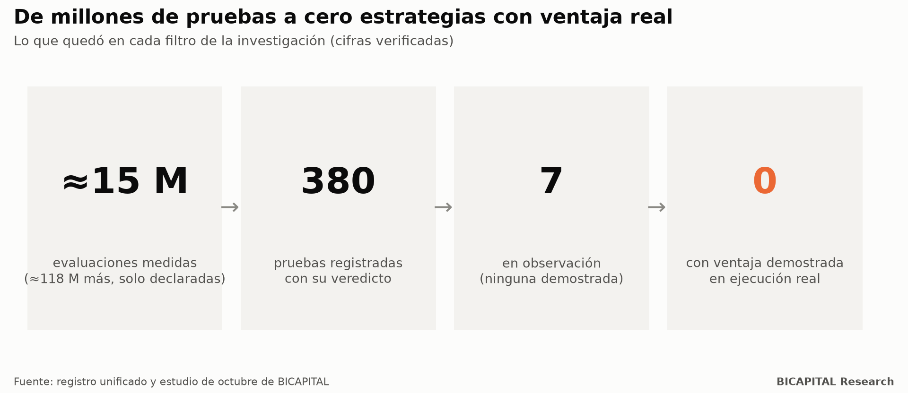
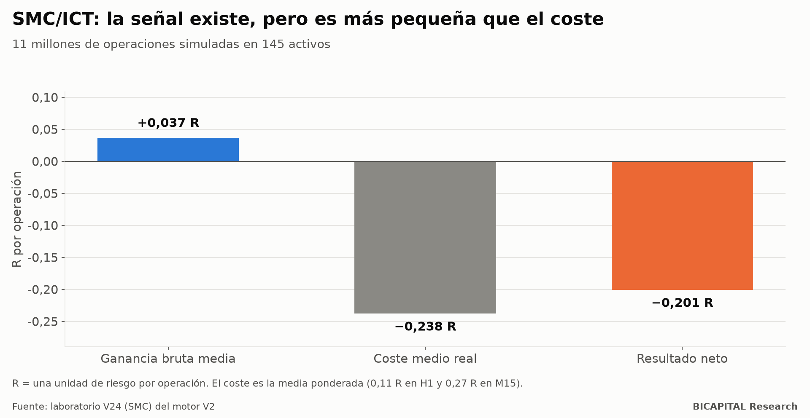
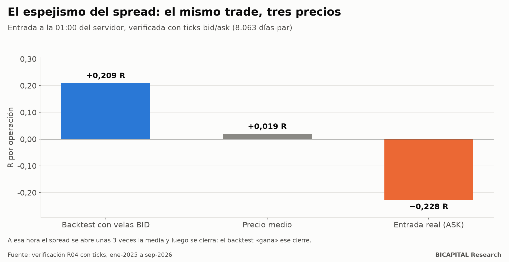

# Más de 130 millones de combinaciones de trading declaradas: esto encontré

Durante meses busqué una cosa muy concreta: **una regla de trading automática que ganara dinero después de pagar todos los
costes reales.** No una estrategia que se viera bonita en un gráfico, sino una que sobreviviera a la prueba más dura: datos
que nunca había visto, el precio real al que se ejecuta una orden y un control estricto del azar.

Este artículo resume lo que encontré. La respuesta corta es incómoda, pero útil: **ninguna regla basada solo en el precio
tuvo ventaja demostrada en ejecución real.** Y el porqué te puede ahorrar mucho dinero.

## Qué probé y cómo

Probé casi todo lo que se enseña en cursos y redes:

- indicadores (RSI, MACD, Ichimoku, medias móviles, Bollinger…);
- velas japonesas y figuras de chartismo;
- Wyckoff y Smart Money Concepts (SMC/ICT);
- reglas publicadas en artículos académicos;
- aprendizaje automático y redes neuronales;
- reglas de horario, calendario y eventos.

Lo hice en divisas, índices, oro, acciones y criptomonedas, con horizontes de minutos a pocos días.

**Antes de seguir, una precisión honesta sobre el número del título.** Sumando todos los laboratorios, se declararon unos
**133 millones de combinaciones evaluadas**. Pero unos 118 millones eran pares de filtros de un barrido masivo cuyos
resultados no se guardaron uno a uno. Lo **medido y guardado** son unos **15 millones de evaluaciones**. Prefiero que lo
sepas por mí.

Tres reglas de método que no negocié nunca:

1. **Escribir las reglas antes de mirar los resultados.** Las congelaba en un registro con fecha. Así no puedo «retocar»
   la estrategia hasta que salga bonita.
2. **Guardar datos que nunca había visto.** Una reserva sellada que solo se abre una vez, al final.
3. **Contar todas las pruebas y corregir por azar.** Con tantas pruebas, alguna sale buena por pura suerte. Con la carga
   total de la investigación, una regla necesita un estadístico t de al menos **6,26** para no ser sospechosa de suerte.
   La mayoría de los «sistemas ganadores» que circulan no pasarían ni de 2.

## El embudo

De todo eso quedaron **380 pruebas registradas con su veredicto** (310 muertas) y **7 ideas en observación**, ninguna
demostrada. **Con ventaja demostrada en ejecución real: 0.**

## Por qué no funciona: la señal existe, pero es más pequeña que el coste

Esto es lo más importante del artículo. **No es que el mercado sea puro azar.** Hay estructura estadística real: en un
estudio de 5.032 pruebas, 2.292 mostraron una dirección significativa *en bruto*. El problema es su tamaño.

El caso de Smart Money Concepts lo ilustra perfectamente. Simulé **11 millones de operaciones** en 145 activos:

- **Ganancia bruta media:** +0,037 R por operación (R es una unidad de riesgo). Mejor que el azar.
- **Coste medio real** (spread, comisión y deslizamiento): 0,24 R.
- **Resultado neto:** −0,20 R por operación.

SMC elige un poco mejor que una moneda al aire. Pero esa pequeña ventaja cuesta seis veces más de lo que rinde. Lo mismo
pasó con indicadores, velas, figuras y Wyckoff: **las señales valen poco y operarlas cuesta más.**

## El coste que casi nadie ve

Un ejemplo de por qué la mayoría de los backtests mienten sin que nadie haga trampa a propósito. Muchas plataformas guardan
las velas con el precio de compra del bróker (BID). A la 01:00 del servidor, justo después del cambio de día, el spread se
abre unas tres veces más de lo normal y luego se cierra.

Una regla que entra en ese minuto «gana» en el backtest el cierre del spread. Lo verifiqué con datos tick a tick:

| Precio usado | Resultado por operación |
|---|---:|
| Backtest con velas BID | **+0,209 R** |
| Precio medio | +0,019 R |
| Entrada real (ASK) | **−0,228 R** |

**La misma estrategia, el mismo minuto:** ganadora en el papel y perdedora en la realidad.

## Tres hallazgos más que me bajaron el ego

- **Mi propia regla rendía igual que entrar al azar.** Una regla mía de comprar retrocesos en tendencia dio −0,175 R por
  operación. Entradas al azar con el mismo stop y objetivo: −0,180 R.
- **La inteligencia artificial sobreajusta.** Modelos que en entrenamiento parecían espectaculares (t cercano a 10) dieron
  resultados negativos en datos nuevos.
- **Un backtest «perfecto» me engañó.** Una regla pasó todas las validaciones con +0,672 R por operación en 2.768
  operaciones. Una sola línea de código miraba el futuro. Corregida, perdía −4.380 R en 22 años. Lo cuento entero en el
  próximo artículo.

## ¿Entonces el trading es mentira?

No exactamente. Lo que medí es más estrecho y más útil: **con reglas automáticas basadas solo en el precio, a corto plazo
y con los costes de un minorista, la ventaja esperada es igual o menor que el coste.** Es justo lo que predice la idea de
que los mercados son eficientes *hasta el coste de operar*.

El dinero sostenido en los mercados sale de cuatro fuentes:

| Fuente | Quién la cobra | ¿Al alcance del minorista? |
|---|---|---|
| Liquidez y velocidad | Creadores de mercado y alta frecuencia | No: tú pagas el spread |
| Primas de riesgo (bolsa, ciclo de largo plazo) | Quien aguanta riesgo años con costes bajos | **Sí** |
| Información | Quien sabe algo antes que el precio | Rara vez |
| Anomalías de comportamiento | Quien las encuentra primero | Se apagan al publicarse |

**La ventaja real del pequeño inversor es el tiempo, la paciencia y los costes bajos**, no un patrón en un gráfico de 5
minutos.

## Qué significa para ti

1. **Si alguien te vende una estrategia, pídele el resultado neto de costes, en datos que no usó para diseñarla.** Si no
   lo tiene, no tiene nada.
2. **Desconfía del backtest perfecto.** Cuanto mejor se ve, más probable es que mire el futuro o ignore el spread.
3. **Mide tus costes reales.** En plazos cortos se comen casi todo.
4. **Si vas a invertir, piensa en años, no en minutos.**

En los próximos artículos voy a abrir cada laboratorio: SMC con datos, el backtest que miraba el futuro, los retos de las
firmas de fondeo y mi cartera real con sus reglas y su riesgo. Con fuentes y código.

*Héctor Sandoval · BICAPITAL Research*

---

*Contenido educativo y de investigación. No es asesoría de inversión ni una recomendación personalizada. Los resultados de
backtest y simulación son hipotéticos y pasados; no garantizan resultados futuros. Las criptomonedas y el apalancamiento
pueden hacer perder todo el capital.*
