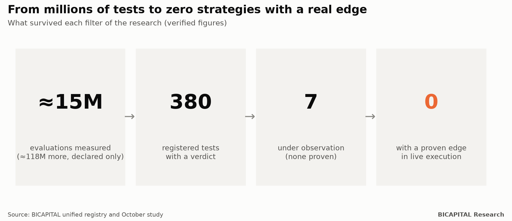
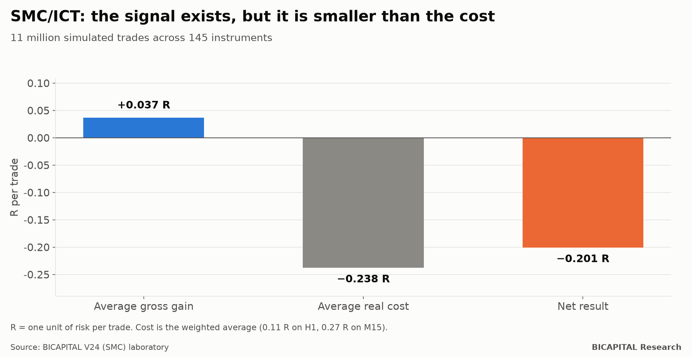
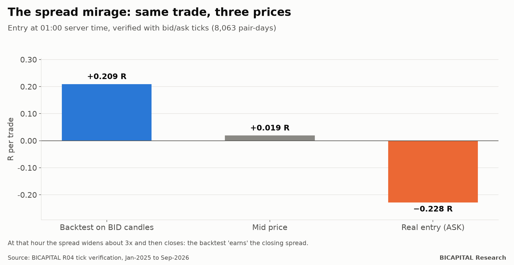

# More than 130 million trading combinations declared: here is what I found

For months I looked for one very specific thing: **an automated trading rule that made money after paying every real cost.**
Not a strategy that looks good on a chart, but one that survives the hardest test: data it had never seen, the real price
at which an order is filled, and strict control for luck.

This article summarises what I found. The short answer is uncomfortable but useful: **no rule based only on price showed a
proven edge in live execution.** The reasons why can save you a lot of money.

## What I tested, and how

I tested almost everything that is taught in courses and on social media:

- indicators (RSI, MACD, Ichimoku, moving averages, Bollinger…);
- Japanese candlesticks and chart patterns;
- Wyckoff and Smart Money Concepts (SMC/ICT);
- rules published in academic papers;
- machine learning and neural networks;
- time-of-day, calendar and event rules.

I did it on currencies, indices, gold, stocks and crypto, with holding periods from minutes to a few days.

**First, an honest note about the number in the title.** Adding up every laboratory, about **133 million combinations were
declared as evaluated**. But about 118 million of them were filter pairs from one massive sweep whose results were not
stored one by one. What was **measured and stored** is about **15 million evaluations**. I would rather you hear it from me.

Three rules of method I never negotiated:

1. **Write the rules before looking at the results.** I froze them in a dated registry, so I could not "tweak" a strategy
   until it looked pretty.
2. **Keep data I had never seen.** A sealed hold-out, opened only once, at the end.
3. **Count every test and correct for luck.** With so many tests, some look good by pure chance. Given the total research
   load, a rule needs a t-statistic of at least **6.26** before it stops looking like luck. Most "winning systems" out
   there would not pass 2.

## The funnel

What remained: **380 registered tests with a verdict** (310 dead) and **7 ideas under observation**, none of them proven.
**With a proven edge in live execution: 0.**

## Why it does not work: the signal exists, but it is smaller than the cost

This is the most important part. **The market is not pure noise.** There is real statistical structure: in one study of
5,032 tests, 2,292 showed a significant direction *before costs*. The problem is its size.

Smart Money Concepts illustrates it perfectly. I simulated **11 million trades** across 145 instruments:

- **Average gross gain:** +0.037 R per trade (R is one unit of risk). Better than chance.
- **Average real cost** (spread, commission and slippage): 0.24 R.
- **Net result:** −0.20 R per trade.

SMC picks entries slightly better than a coin flip, but that small edge costs about six times what it earns. The same
happened with indicators, candlesticks, chart patterns and Wyckoff: **the signals are worth little and trading them costs
more.**

## The cost almost nobody sees

Here is an example of why most backtests lie without anyone cheating on purpose. Many platforms store candles at the
broker's bid price. At 01:00 server time, right after the daily rollover, the spread widens about three times and then
closes again.

A rule that enters in that minute "earns" the closing spread in the backtest. I checked it with tick-by-tick data:

| Price used | Result per trade |
|---|---:|
| Backtest on BID candles | **+0.209 R** |
| Mid price | +0.019 R |
| Real entry (ASK) | **−0.228 R** |

**Same strategy, same minute:** a winner on paper and a loser in reality.

## Three more findings that humbled me

- **My own rule performed like random entries.** One of my rules for buying pullbacks in a trend lost −0.175 R per trade.
  Random entries with the same stop and target: −0.180 R.
- **Machine learning overfits.** Models that looked spectacular in training (t close to 10) went negative on new data.
- **A "perfect" backtest fooled me.** A rule passed every validation with +0.672 R per trade over 2,768 trades. One line of
  code was looking into the future. Once fixed, it lost −4,380 R over 22 years. I tell the full story in the next article.

## So is trading a lie?

Not exactly. What I measured is narrower and more useful: **with automated rules based only on price, at short horizons and
with retail costs, the expected edge is equal to or smaller than the cost.** That is exactly what the idea of markets
being efficient *up to the cost of trading* predicts.

Lasting money in markets comes from four sources:

| Source | Who collects it | Within a retail investor's reach? |
|---|---|---|
| Liquidity and speed | Market makers and high-frequency firms | No: you pay the spread |
| Risk premia (equities, long-term cycles) | Whoever holds risk for years at low cost | **Yes** |
| Information | Whoever knows something before the price does | Rarely |
| Behavioural anomalies | Whoever finds them first | They fade once published |

**The real edge of a small investor is time, patience and low costs**, not a pattern on a 5-minute chart.

## What this means for you

1. **If someone sells you a strategy, ask for the result net of costs, on data that was not used to design it.** If they do
   not have it, they have nothing.
2. **Distrust the perfect backtest.** The better it looks, the more likely it peeks into the future or ignores the spread.
3. **Measure your real costs.** At short horizons they eat almost everything.
4. **If you invest, think in years, not minutes.**

In the next articles I will open each laboratory: SMC with data, the backtest that looked into the future, prop-firm
challenges, and my real portfolio with its rules and its risk. With sources and code.

*Héctor Sandoval · BICAPITAL Research*

---

*Educational and research content. This is not investment advice or a personal recommendation. Backtest and simulation
results are hypothetical and past; they do not guarantee future results. Crypto assets and leverage can lose all of your
capital.*
