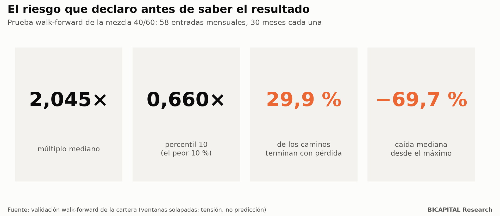
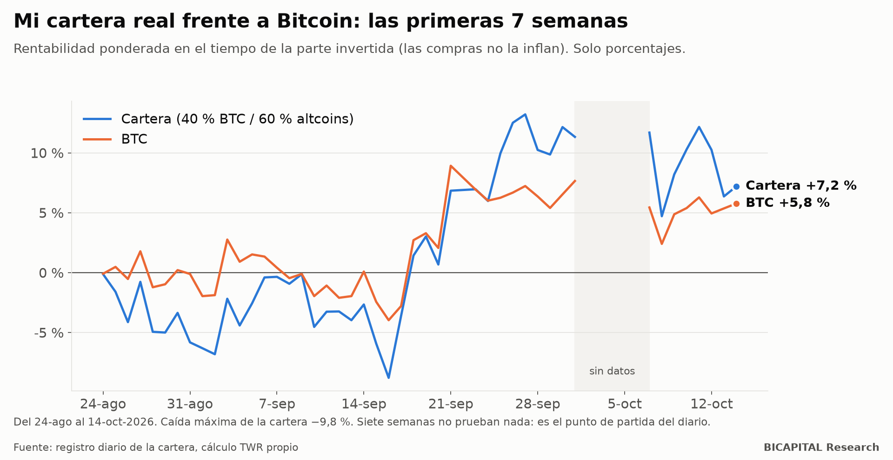

# Mi cartera real: la tesis, las reglas y cuánto puede caer

Casi todo el contenido sobre inversión que vemos tiene un problema: **se publica después de saber el resultado.** El que
ganó lo cuenta y el que perdió desaparece.

Voy a hacer lo contrario. Te enseño mi cartera real de criptomonedas **antes** de saber cómo termina: qué creo, qué reglas
sigo, cuánto puede caer y qué dice mi propia investigación en contra. Cada mes publicaré cómo va, salga bien o salga mal.

No publico montos, solo porcentajes. La cantidad no te sirve para nada y a mí me expone sin necesidad.

## La tesis: lo que creo

1. **Bitcoin marca el ritmo del ciclo cripto.** El halving es un marcador intermedio.
2. **Las altcoins siguen a Bitcoin con desfase**, y algunas pueden multiplicarse mucho más que él.
3. **Mi objetivo es la riqueza al final del ciclo**, no tener la menor volatilidad.
4. **Solo Bitcoin es mi referencia de comparación, no mi operación.**
5. **Los extremos de los indicadores on-chain** (MVRV, Mayer, Puell y otros) sirven para decidir cuándo entrar y cuándo
   vigilar la salida.
6. **Cada altcoin necesita su propia salida**, porque sus techos no coinciden con el de Bitcoin.

## Las reglas

| Tema | Regla |
|---|---|
| Dónde | Mercado spot, **sin apalancamiento, margen ni derivados** |
| Mezcla de cada compra nueva | **40 % Bitcoin y 60 % altcoins** (21 monedas a peso igual; las de oferta pesada por desbloqueos reciben la mitad) |
| Compra ordinaria | Solo cuando el compuesto de cinco indicadores on-chain esté en su 5 % más bajo histórico |
| Compras escalonadas | Órdenes límite en tres niveles de retroceso por moneda, calculados con su volatilidad y su estructura |
| Rebalanceo | No vendo ganadoras para recomprar perdedoras: la mezcla solo rige el dinero nuevo |
| Salidas | Cada altcoin por separado (vigilancia cuando el mercado está muy caro y revisión tras caer un 40 % desde su máximo). Bitcoin: revisión manual por tercios a finales de 2029 |
| Ejecución | Cada lote se prueba antes contra el exchange, caduca a los 60 minutos y exige mi confirmación explícita |

Una aclaración honesta: **el 40/60 no es un óptimo.** Con dos o tres ciclos de historia no hay datos suficientes para
saber cuál es el peso ideal. Lo elegí como un compromiso entre dos escenarios contradictorios, y lo digo así.

## Cuánto puede caer: el riesgo que declaro antes

En una prueba con 58 fechas de entrada distintas y 30 meses de duración cada una, la mezcla 40/60 dio:

- **Múltiplo mediano: 2,045×.**
- **En el peor 10 %: 0,660×.** Es decir, perder un tercio.
- **El 29,9 % de los caminos terminó con pérdida.**
- **Caída mediana desde el máximo: −69,7 %.**

Léelo dos veces: **en el camino típico, esta cartera llega a valer menos de un tercio de su máximo.** Si eso te parece
insoportable, esta estrategia no es para ti. Probablemente tampoco las criptomonedas.

## Lo que mi propia investigación dice en contra

Esto es lo que casi nadie publica. Mi investigación encontró evidencia **contra** mi propia tesis:

- **En el último ciclo (2022-2025), Bitcoin dominó.** Solo un 6,6 % de cestas de altcoins elegidas al azar le ganaron.
- **Las altcoins amplificaron las caídas más que las subidas.** En la fase de recuperación tras el suelo, su sensibilidad a
  Bitcoin fue de 1,29 a la baja y de 0,56 al alza. Es lo contrario de lo que promete la «temporada de altcoins».
- **En mi propio walk-forward, la mezcla 40/60 rindió en la mediana 0,603 veces lo que rindió Bitcoin solo.**
- **Mi sistema más complejo (17 parámetros) no batió a simplemente comprar y mantener Bitcoin.**

Entonces, ¿por qué mantengo un 60 % en altcoins? Porque en los ciclos 2015-2017 y 2018-2021 la cesta de altcoins sí superó
a Bitcoin, y mi tesis es que su convexidad puede volver. **Es una apuesta de gestor, no un resultado demostrado.** Por eso
la publico con su riesgo y con el criterio que me haría cambiarla.

## Cuándo reconoceré que me equivoqué

Revisaré la tesis de las altcoins si la cesta sigue mostrando:
- más sensibilidad a la baja que al alza;
- baja supervivencia de las monedas;
- dilución destructiva;
- falta de liquidez.

Al cierre del ciclo, la compararé con Bitcoin comprado y mantenido. Si pierdo, lo publicaré igual.

## Cómo va: las primeras 7 semanas

Del 24 de agosto al 14 de octubre de 2026, la parte invertida rindió **+7,2 %**, frente a **+5,8 %** de Bitcoin en el
mismo periodo. La caída máxima fue de **−9,8 %**.

Uso la rentabilidad ponderada en el tiempo, así que las compras nuevas no inflan el resultado. Hubo unos días sin datos a
principios de octubre y los dejo en blanco, sin inventarlos.

**Siete semanas no prueban nada.** Un ciclo dura años. Es solo el punto de partida del diario.

## Qué significa para ti

1. **Exige a cualquier gestor su tesis y su riesgo antes del resultado,** no después.
2. **Mira la caída, no solo la ganancia.** Un −69,7 % mediano es la verdad incómoda de las criptomonedas.
3. **Distingue lo demostrado de lo apostado.** Mi 40/60 es una apuesta razonada, no una ley.

Cada mes publicaré el diario de decisiones: qué hice, por qué y cómo sabré si me equivoqué.

*Héctor Sandoval · BICAPITAL Research*

---

*Contenido educativo y de investigación. No es asesoría de inversión ni una recomendación personalizada; no te digo qué
comprar. Los resultados de backtest y simulación son hipotéticos y pasados; no garantizan resultados futuros. Las
criptomonedas pueden hacer perder todo el capital.*
