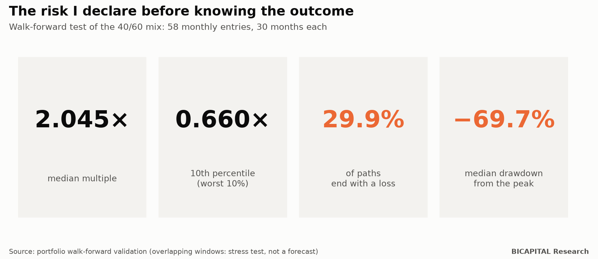
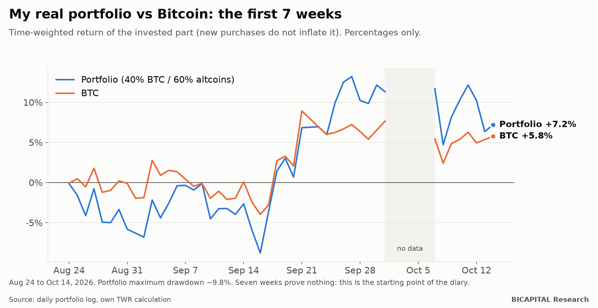

# My real portfolio: the thesis, the rules and how far it can fall

Almost all investing content has one problem: **it is published after the result is known.** Whoever won tells the story;
whoever lost disappears.

I will do the opposite. Here is my real crypto portfolio **before** I know how it ends: what I believe, the rules I follow,
how far it can fall, and what my own research says against it. Every month I will publish how it is going, good or bad.

I do not publish amounts, only percentages. The size is of no use to you and exposes me for no reason.

## The thesis: what I believe

1. **Bitcoin sets the rhythm of the crypto cycle.** The halving is an intermediate marker.
2. **Altcoins follow Bitcoin with a lag**, and some can multiply far more than it does.
3. **My goal is wealth at the end of the cycle**, not the lowest volatility.
4. **Bitcoin alone is my benchmark, not my strategy.**
5. **Extremes in on-chain indicators** (MVRV, Mayer, Puell and others) help decide when to buy and when to watch for the exit.
6. **Each altcoin needs its own exit**, because their tops do not coincide with Bitcoin's.

## The rules

| Topic | Rule |
|---|---|
| Where | Spot market, **no leverage, margin or derivatives** |
| Mix of every new purchase | **40% Bitcoin and 60% altcoins** (21 coins, equal weight; those with heavy token unlocks get half) |
| Ordinary purchase | Only when the composite of five on-chain indicators sits in its lowest 5% historically |
| Staggered purchases | Limit orders at three pullback levels per coin, based on its volatility and structure |
| Rebalancing | I do not sell winners to buy losers: the mix applies only to new money |
| Exits | Each altcoin separately (watch when the market is very expensive, review after a 40% fall from its own peak). Bitcoin: manual review in thirds in late 2029 |
| Execution | Every batch is tested against the exchange first, expires after 60 minutes and needs my explicit confirmation |

An honest clarification: **40/60 is not an optimum.** With two or three cycles of history there is not enough data to know
the ideal weight. I chose it as a compromise between two contradictory scenarios, and I say so.

## How far it can fall: the risk I declare in advance

In a test with 58 different entry dates, 30 months each, the 40/60 mix produced:

- **Median multiple: 2.045×.**
- **In the worst 10%: 0.660×**, that is, losing a third.
- **29.9% of the paths ended with a loss.**
- **Median drawdown from the peak: −69.7%.**

Read it twice: **on the typical path, this portfolio falls to less than a third of its peak value at some point.** If that
sounds unbearable, this strategy is not for you. Probably crypto is not either.

## What my own research says against it

This is what almost nobody publishes. My research found evidence **against** my own thesis:

- **In the last cycle (2022-2025), Bitcoin dominated.** Only 6.6% of randomly chosen altcoin baskets beat it.
- **Altcoins amplified the falls more than the rises.** In the recovery phase after the bottom, their sensitivity to Bitcoin
  was 1.29 on the way down and 0.56 on the way up. That is the opposite of what "altseason" promises.
- **In my own walk-forward test, the 40/60 mix returned, at the median, 0.603 times what Bitcoin alone returned.**
- **My most complex system (17 parameters) did not beat simply buying and holding Bitcoin.**

So why do I keep 60% in altcoins? Because in the 2015-2017 and 2018-2021 cycles the altcoin basket did beat Bitcoin, and my
thesis is that this convexity can come back. **It is a manager's bet, not a proven result.** That is why I publish it with
its risk and with the criteria that would make me change it.

## When I will admit I was wrong

I will review the altcoin thesis if the basket keeps showing:
- more sensitivity on the way down than on the way up;
- low survival of the coins;
- destructive dilution;
- lack of liquidity.

At the end of the cycle I will compare it with buying and holding Bitcoin. If I lose, I will publish that too.

## How it is going: the first 7 weeks

From August 24 to October 14, 2026, the invested part returned **+7.2%**, against **+5.8%** for Bitcoin over the same
period. The maximum drawdown was **−9.8%**.

I use the time-weighted return, so new purchases do not inflate the result. A few days in early October have no data and I
leave them blank instead of inventing them.

**Seven weeks prove nothing.** A cycle lasts years. This is just the starting point of the diary.

## What this means for you

1. **Ask any manager for their thesis and their risk before the result,** not after.
2. **Look at the drawdown, not just the gain.** A median −69.7% is the uncomfortable truth of crypto.
3. **Tell apart what is proven from what is a bet.** My 40/60 is a reasoned bet, not a law.

Every month I will publish the decision diary: what I did, why, and how I will know if I was wrong.

*Héctor Sandoval · BICAPITAL Research*

---

*Educational and research content. This is not investment advice or a personal recommendation; I am not telling you what to
buy. Backtest and simulation results are hypothetical and past; they do not guarantee future results. Crypto assets can lose
all of your capital.*
