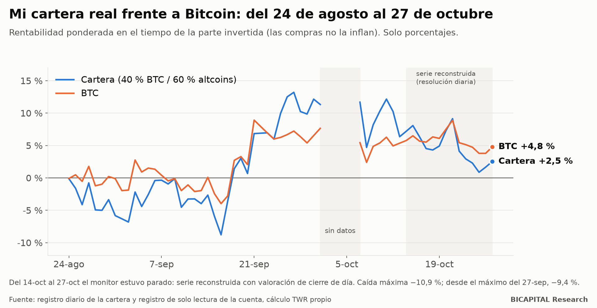
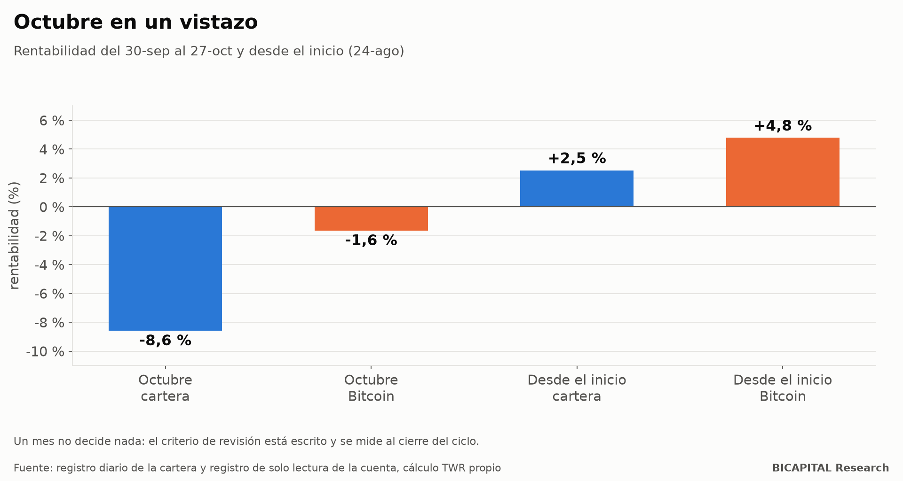

# Diario de decisiones n.º 1 (octubre de 2026): perdí contra Bitcoin, y esto es lo que decidí

Prometí publicar cada mes cómo va mi cartera real de criptomonedas, con sus decisiones, **antes** de saber cómo termina.
Esta es la primera entrega. No es un buen mes, y por eso es un buen momento para empezar: un diario que solo se escribe
cuando se gana no sirve para nada.

Como siempre, solo porcentajes. El tamaño no te sirve y a mí me expone.

## El resultado

| Periodo | Cartera | Bitcoin |
|---|---:|---:|
| Octubre (del 30-sep al 27-oct) | **−8,6 %** | −1,6 % |
| Desde el inicio (24-ago) | **+2,5 %** | **+4,8 %** |

En el artículo anterior, con datos hasta el 14 de octubre, la cartera iba +7,2 % y Bitcoin +5,8 %. Dos semanas después
la situación se ha dado la vuelta: **la cartera va por detrás de Bitcoin.** La caída desde el máximo del 27 de
septiembre es del **−9,4 %**, y la máxima del periodo, **−10,9 %**. El peor día fue el 22 de octubre: −4,6 %, contra
−3,2 % de Bitcoin.

Es exactamente lo que mi propia investigación advertía y publiqué en el artículo anterior: **en las caídas, las altcoins
amplifican.** Un mes no decide nada, pero no voy a esconderlo.

## Un aviso sobre los datos

El monitor automático de la cartera estuvo parado desde el 14 de octubre a la 01:00 UTC hasta el 27. Para esos días
reconstruí la serie a partir del registro de solo lectura de la cuenta, con resolución diaria en lugar de tres lecturas
al día. Es la misma rentabilidad ponderada en el tiempo (las compras nuevas no la inflan), pero con una valoración de
cierre de día; puede desviarse unas décimas respecto al monitor. Lo digo para que sepas de dónde sale cada número.

## Estado de la cartera a 27 de octubre

- **Capital desplegado:** 75,8 % de lo previsto. El resto espera en 28 órdenes de compra escalonadas.
- **Parte invertida:** +2,2 % sobre su coste. Los mismos aportes, en las mismas fechas, solo en Bitcoin: +0,6 %.
- **Peso de Bitcoin:** 38,6 %, frente al 40 % objetivo. Sigue siendo el activo más infraponderado y el que más
  presupuesto tiene en la escalera.
- **Compra ordinaria:** bloqueada. El compuesto on-chain está en el percentil 42, lejos del 5 que exige la regla, y además
  sus datos tienen 7 días de antigüedad cuando el candado exige 3 o menos. Sin datos frescos no se compra.

## Las decisiones del mes

Cada decisión lleva su tesis, su hipótesis falsable, la evidencia a favor y en contra, y el criterio con el que la
revisaré. Es el formato que mantendré todos los meses.

### D09 · 7 de octubre · Reducir las altcoins con oferta pesada y pasar lo liberado a Bitcoin

- **Decisión:** en plena caída, sacar de la escalera una moneda y reducir a la mitad el presupuesto de otras cuatro, por
  desbloqueos continuos de insiders; lo liberado va a Bitcoin. No se persigue el precio.
- **Tesis:** los desbloqueos y la dilución pesan contra las altcoins con oferta pesada.
- **Hipótesis falsable:** esas cuatro altcoins rendirán peor que el resto de la cesta.
- **Evidencia a favor:** el estudio de desbloqueos del 1 de octubre.
- **Evidencia en contra:** la decisión se tomó durante una caída. Puede haber sesgo de reacción.
- **Criterio de revisión:** comparar el rendimiento de las cuatro reducidas con el de la cesta.

### D10 · 9 de octubre · La caja ociosa, a rendimiento flexible

- **Decisión:** el efectivo y las posiciones sin uso pasan a un producto de rendimiento flexible del exchange, sin plazo.
- **Tesis:** la caja ociosa debe rendir algo sin quedar bloqueada.
- **Evidencia en contra:** riesgo de contraparte del exchange. Lo asumo y lo declaro.

### Y dos decisiones del laboratorio de trading, para que conste

- **7 de octubre:** detuve el sistema que operaba en una cuenta de evaluación, tras una auditoría que invalidó su reserva
  de datos. Sin ventaja demostrada no se arriesga la cuenta.
- **23 de octubre:** apagué la última estrategia que seguía en observación. Ninguna sombra activa. Lo cuento en detalle en
  el artículo del backtest que miraba el futuro.

## Lo que no cambié, y por qué

- **La mezcla 40/60** sigue. Un mes malo no es evidencia; mi criterio de revisión es que la cesta siga mostrando más
  sensibilidad a la baja que al alza, baja supervivencia, dilución destructiva o falta de liquidez. Octubre apunta en esa
  dirección, pero con un mes no se decide. Lo mido, no lo adivino.
- **Sin ventas para rebalancear.** La mezcla solo rige el dinero nuevo.
- **Sin apalancamiento.** Nunca.

## Cómo sabré si me equivoqué

Al cierre del ciclo compararé la cartera con Bitcoin comprado y mantenido. Hoy voy perdiendo esa comparación por 2,3
puntos. Si al final pierdo, lo publicaré con el mismo formato que esto.

El próximo diario sale a finales de noviembre.

*Héctor Sandoval · BICAPITAL Research*

---

*Contenido educativo y de investigación. No es asesoría de inversión ni una recomendación personalizada; no te digo qué
comprar. Las rentabilidades pasadas no garantizan resultados futuros. Las criptomonedas pueden hacer perder todo el
capital.*
