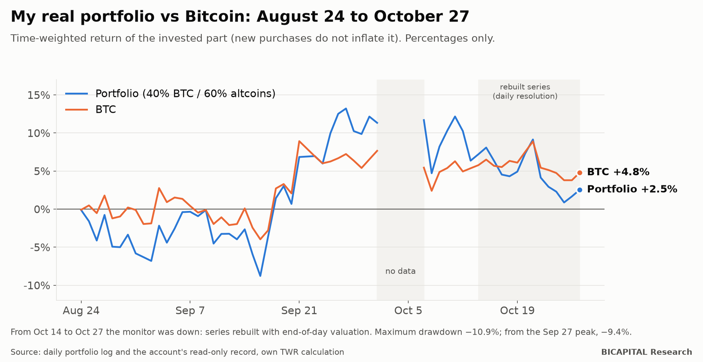
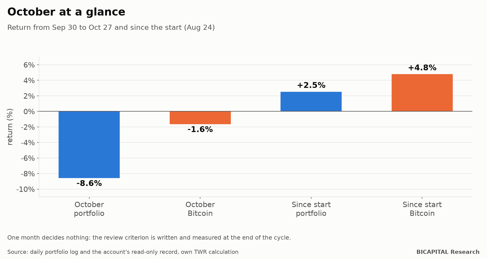

# Decision diary no. 1 (October 2026): I lost to Bitcoin, and here is what I decided

I promised to publish every month how my real crypto portfolio is doing, with its decisions, **before** knowing how it
ends. This is the first entry. It is not a good month, which makes it a good time to start: a diary written only when
you win is worthless.

As always, percentages only. The size is of no use to you and exposes me.

## The result

| Period | Portfolio | Bitcoin |
|---|---:|---:|
| October (Sep 30 to Oct 27) | **−8.6%** | −1.6% |
| Since the start (Aug 24) | **+2.5%** | **+4.8%** |

In the previous article, with data up to October 14, the portfolio was at +7.2% and Bitcoin at +5.8%. Two weeks later
the picture has flipped: **the portfolio is behind Bitcoin.** The drawdown from the September 27 peak is **−9.4%**, and
the maximum of the period is **−10.9%**. The worst day was October 22: −4.6%, against −3.2% for Bitcoin.

It is exactly what my own research warned, and what I published in the previous article: **in a fall, altcoins
amplify.** One month decides nothing, but I will not hide it.

## A note on the data

The portfolio's automatic monitor was down from October 14 at 01:00 UTC until the 27th. For those days I rebuilt the
series from the account's read-only record, at daily resolution instead of three readings a day. It is the same
time-weighted return (new purchases do not inflate it), but valued at the day's close; it may differ from the monitor by
a few tenths. I say it so you know where every number comes from.

## Portfolio status on October 27

- **Capital deployed:** 75.8% of the planned amount. The rest waits in 28 staggered buy orders.
- **Invested part:** +2.2% over its cost. The same contributions, on the same dates, in Bitcoin only: +0.6%.
- **Bitcoin weight:** 38.6%, against a 40% target. It is still the most underweight asset and the one with the largest
  budget in the ladder.
- **Ordinary buying:** blocked. The on-chain composite sits at the 42nd percentile, far from the 5th the rule requires,
  and its data is 7 days old when the lock demands 3 or less. No fresh data, no buying.

## The month's decisions

Every decision carries its thesis, its falsifiable hypothesis, the evidence for and against, and the criterion I will use
to review it. This is the format I will keep every month.

### D09 · October 7 · Reduce the heavy-supply altcoins and move what is freed to Bitcoin

- **Decision:** in the middle of a fall, remove one coin from the ladder and halve the budget of four others, because of
  continuous insider unlocks; what is freed goes to Bitcoin. No chasing the price.
- **Thesis:** unlocks and dilution weigh against altcoins with heavy supply.
- **Falsifiable hypothesis:** those four altcoins will underperform the rest of the basket.
- **Evidence for:** the unlock study of October 1.
- **Evidence against:** the decision was taken during a fall. There may be reaction bias.
- **Review criterion:** compare the performance of the four reduced coins with the basket.

### D10 · October 9 · Idle cash into flexible yield

- **Decision:** cash and unused positions go into the exchange's flexible yield product, with no lock-up.
- **Thesis:** idle cash should earn something without being locked.
- **Evidence against:** exchange counterparty risk. I accept it and declare it.

### And two decisions from the trading laboratory, for the record

- **October 7:** I stopped the system trading on an evaluation account, after an audit invalidated its data reserve. No
  proven edge, no risk to the account.
- **October 23:** I switched off the last strategy still under observation. No active shadow. I tell it in detail in the
  article on the backtest that looked into the future.

## What I did not change, and why

- **The 40/60 mix** stays. One bad month is not evidence; my review criterion is that the basket keeps showing more
  sensitivity on the way down than on the way up, low survival, destructive dilution or lack of liquidity. October points
  that way, but one month does not decide. I measure it; I do not guess it.
- **No selling to rebalance.** The mix only applies to new money.
- **No leverage.** Ever.

## How I will know I was wrong

At the end of the cycle I will compare the portfolio with Bitcoin bought and held. Today I am losing that comparison by
2.3 points. If I lose in the end, I will publish it in the same format as this.

The next diary comes out at the end of November.

*Héctor Sandoval · BICAPITAL Research*

---

*Educational and research content. This is not investment advice or a personal recommendation; I am not telling you what
to buy. Past returns do not guarantee future results. Crypto assets can lose all of your capital.*
