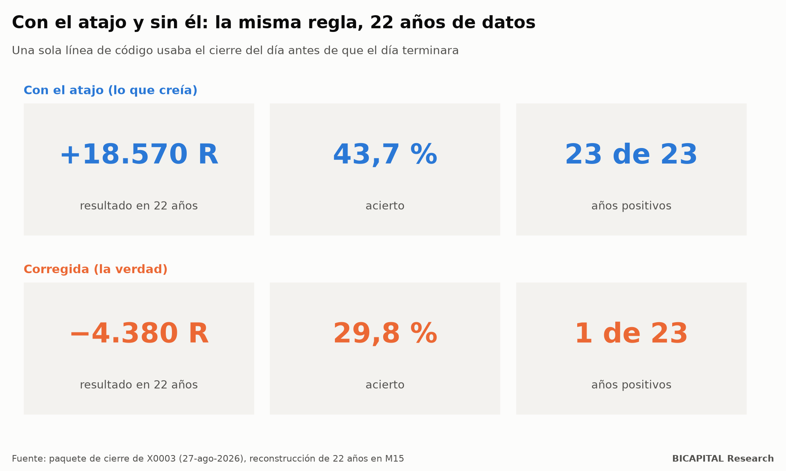
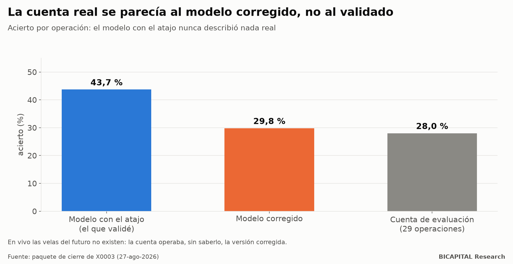

# Mi backtest era perfecto y mi cuenta de evaluación perdía: una línea de código miraba el futuro

Tengo una regla de trading que pasó **todas** las validaciones que conozco. Reglas congeladas antes de mirar datos,
control del azar, prueba paso a paso hacia adelante, escenarios de costes, un equipo que intentó romperla y una reserva de
datos sellada que se abrió **una sola vez**. Ese día dio esto:

**2.768 operaciones · +0,672 R por operación · factor de beneficio 2,23 · p ≈ 0,002**

(R es una unidad de riesgo: lo que arriesgo en cada operación.)

Con ese resultado la puse a operar en una cuenta de evaluación de una firma de fondeo. Y perdía. Poco, pero perdía, con un
acierto muy por debajo del esperado.

La regla no era mala por mala suerte. Era mala desde siempre. **Toda su rentabilidad salía de una sola línea de código que
usaba el cierre del día antes de que el día terminara.** Este artículo cuenta cómo pasó, por qué ninguna prueba lo vio y
qué herramienta construí para que no se repita.

## El resultado antes y después de corregir la línea



| | Con el atajo (lo que creía) | Corregida (la verdad) |
|---|---:|---:|
| Resultado en 22 años | **+18.570 R** | **−4.380 R** |
| Acierto | 43,7 % | 29,8 % |
| Años positivos | 23 de 23 | 1 de 23 |

No es que la regla funcionara «un poco menos». Es que nunca funcionó. Lo que yo había validado era otra estrategia: una que
sabía cada mañana cómo cerraría el día.

## La línea

Mi regla operaba en velas de 15 minutos, pero solo a favor de la tendencia diaria. Para calcular esa tendencia, el código
resumía el día así (lo pongo tal cual, porque es el tipo de línea que cualquiera escribe sin pensar):

```python
diario = cierre.resample("1D").last()          # el cierre de cada día…
tendencia = diario.reindex(intradia.index, method="ffill")   # …llevado a cada vela de 15 minutos
```

El problema está en cómo se etiqueta el resultado. `resample("1D").last()` toma el cierre de las 23:45 y lo **etiqueta a
las 00:00 de ese mismo día**. Al llevarlo a las velas de 15 minutos, la vela de las 03:00 ya «conocía» un cierre que
ocurriría veinte horas más tarde. Hasta 24 horas de información del futuro, en cada día de los 22 años.

La corrección es una línea más: sellar el valor diario en su **cierre**, no en su apertura, para que solo esté disponible
a partir del día siguiente.

```python
diario.index = diario.index + pd.Timedelta(days=1)
```

Y no, el `shift(1)` habitual no lo arregla: desplaza una vela de 15 minutos, no un día.

## Por qué ninguna validación lo vio

Esto es lo que más me interesa que entiendas, porque afecta a cualquier backtest, no solo al mío.

**1. Todas las pruebas comían del mismo plato.** La prueba hacia adelante, la reserva sellada, los escenarios de coste, las
mutaciones y el equipo rojo usaban la misma función de indicadores. Veinte pruebas sobre un dato contaminado dan veinte
resultados coherentes entre sí y todos falsos. Es un fallo de modo común: el mismo defecto en todas las copias.

**2. Mirar el futuro sobrevive a los datos fuera de muestra.** Una reserva sellada aparta, por ejemplo, 2019-2026. Pero
cuando simulas esos años, el backtest **sigue teniendo** sus datos completos. La fuga funciona igual de bien en el tramo
apartado. Por eso la reserva dio +0,672 R: estaba midiendo la misma trampa en datos nuevos.

| Problema | ¿Lo cazan la reserva y la prueba hacia adelante? |
|---|---|
| Sobreajuste (ajustar la regla al ruido del pasado) | Sí |
| Mirar el futuro (usar un dato antes de que exista) | **No** |

La mayoría de los cursos te enseñan a protegerte del primero. Del segundo no te protege ninguna validación por resultados.
Solo se detecta mirando **cómo se construye cada dato**.

## La cuenta real tenía razón

Lo curioso es que la cuenta de evaluación nunca tuvo el atajo. En vivo, las velas del futuro no existen. Así que operaba,
sin saberlo, la estrategia corregida.



| | Acierto |
|---|---:|
| Modelo con el atajo (el que validé) | 43,7 % |
| Modelo corregido | 29,8 % |
| Cuenta de evaluación, 29 operaciones | 28,0 % |

El modelo corregido describe la cuenta casi exacto. El modelo validado no describía nada real. La cuenta cerró con
**−0,27 %** sobre el capital de evaluación: barato para lo que enseñó.

## Lo que confirmó un laboratorio independiente

Un mes después repetí la regla en dos motores de backtest gratuitos y de código abierto, con paridad del 100 % entre
ellos, sobre los 13 pares de divisas originales:

| Versión de la señal | Operaciones | R por operación | Tramo de la reserva |
|---|---:|---:|---:|
| Congelada (con el atajo) | 74.317 | +0,559 | +0,677 |
| Causal (corregida) | 81.750 | −0,077 | −0,028 |

Los motores reproducen el backtest original casi al número (+0,677 frente al +0,672 publicado). Y con la señal corregida,
los 13 pares quedan en negativo. **La ventaja era el atajo.**

Después busqué si algo se salvaba: 48 combinaciones de stop, duración, umbral y filtro, y 3 marcos temporales con 2 stops.
**Cero rentables.** Hay una pequeña ventaja bruta (+0,027 R por operación, consistente en 22 años), pero los costes son
−0,082 R. Y cada escape está acoplado: subir de marco baja el coste pero la ventaja desaparece más rápido; quitar el
spread no basta porque comisión y swap ya la superan; evitar la noche quita el swap, pero las operaciones que ganan son
justo las que cruzan la noche.

## La herramienta: comprobar que cada dato era conocible

La solución no es «revisar mejor el código». Un detector de eventos que audité después tenía un fallo parecido, por el
reloj del servidor, en **116 de 145 activos** y en **772.890 de 25,7 millones** de eventos, y nadie lo había visto leyendo.

La solución es una prueba mecánica. Un dato es causal en el instante *t* solo si depende de lo que existía hasta *t*. Así
que se comprueba, columna por columna:

```
construir(historia_completa)[t]  ==  construir(historia_hasta_t)[-1]
```

Si los dos valores difieren en algún punto, ese dato mira el futuro, por definición, sin necesidad de entender el código.
La sonda lo prueba en puntos al azar y en cada cambio de día, semana y mes, que es donde viven los errores de remuestreo.

Y como una sonda que no encuentra nada no demuestra nada, antes de dar un veredicto limpio inyecta **8 fugas conocidas
que debe detectar y 3 variantes selladas que debe dejar pasar**. Si falla alguna, el veredicto es inválido. Es un control
positivo, como en un laboratorio.

La publiqué como código abierto, con pruebas y licencia MIT:
[`causality-probe`](https://github.com/test201807/causality-probe) (DOI
[10.5281/zenodo.23649802](https://doi.org/10.5281/zenodo.23649802)). Se instala con una línea y se usa con tres.

## Qué significa para ti

1. **Un backtest que pasa todo no está demostrado; está sin refutar.** Si todas las pruebas usan el mismo dato, valen por
   una.
2. **Pregunta cómo se construye cada indicador, no solo cuánto gana.** Cualquier agregado diario, semanal o de un marco
   superior es sospechoso hasta que se demuestre que está sellado en su cierre.
3. **La prueba es mecánica, no de ojo.** Comprueba que cada valor se puede reconstruir solo con el pasado. Si no puedes
   hacer esa prueba, no sabes lo que estás validando.
4. **Cuanto mejor se ve, más sospecha merece.** 23 de 23 años positivos no es una buena señal. Es una alarma.

Me costó una cuota de evaluación y un mes de servidor. Compró encontrar un defecto de una línea que llevaba años pasando
todas las validaciones, antes de escalarlo. No compró una estrategia.

*Héctor Sandoval · BICAPITAL Research*

---

*Contenido educativo y de investigación. No es asesoría de inversión ni una recomendación personalizada. Los resultados de
backtest y simulación son hipotéticos y pasados; no garantizan resultados futuros. Las criptomonedas y el apalancamiento
pueden hacer perder todo el capital.*
