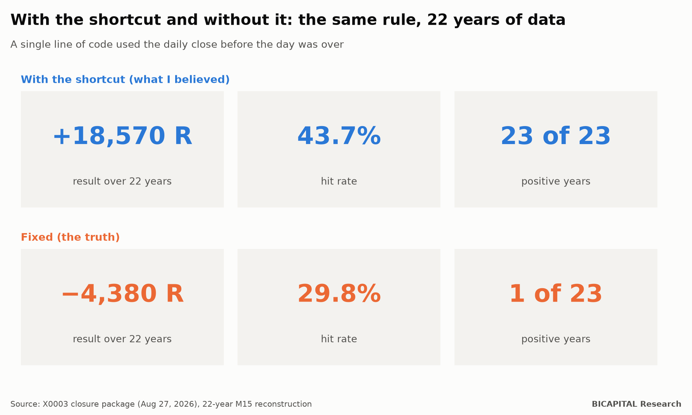
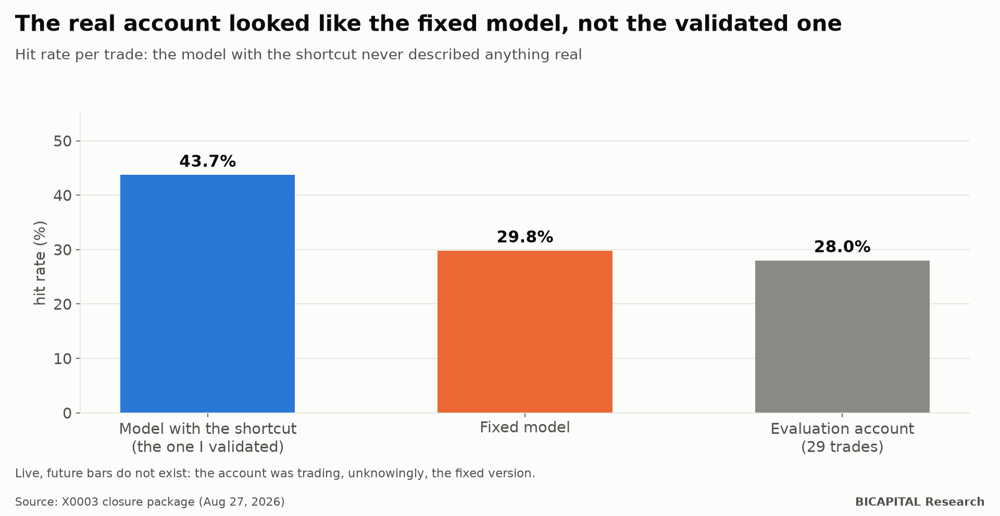

# My backtest was perfect and my evaluation account was losing: one line of code was looking into the future

I have a trading rule that passed **every** validation I know. Rules frozen before looking at the data, control for luck,
walk-forward testing, cost scenarios, a team that tried to break it, and a sealed reserve of data opened **exactly
once**. That day it returned this:

**2,768 trades · +0.672 R per trade · profit factor 2.23 · p ≈ 0.002**

(R is one unit of risk: what I put at risk on each trade.)

With that result I set it to trade on a prop-firm evaluation account. And it was losing. Not much, but losing, with a hit
rate far below what the backtest promised.

The rule was not unlucky. It had always been bad. **All of its profit came from a single line of code that used the daily
close before the day was over.** This article tells how it happened, why no test caught it, and what tool I built so it
does not happen again.

## The result before and after fixing the line



| | With the shortcut (what I believed) | Fixed (the truth) |
|---|---:|---:|
| Result over 22 years | **+18,570 R** | **−4,380 R** |
| Hit rate | 43.7% | 29.8% |
| Positive years | 23 of 23 | 1 of 23 |

The rule did not work "a bit less". It never worked. What I had validated was a different strategy: one that knew every
morning how the day would close.

## The line

My rule traded 15-minute bars, but only in the direction of the daily trend. To compute that trend, the code summarised
the day like this (I show it as it was, because it is the kind of line anyone writes without thinking):

```python
daily = close.resample("1D").last()          # each day's close…
trend = daily.reindex(intraday.index, method="ffill")   # …carried down to every 15-minute bar
```

The problem is how the result is labelled. `resample("1D").last()` takes the 23:45 close and **labels it at 00:00 of the
same day**. Carried down to the 15-minute bars, the 03:00 bar already "knew" a close that would happen twenty hours later.
Up to 24 hours of future information, every day, for 22 years.

The fix is one more line: stamp the daily value at its **close**, not its open, so it only becomes available from the
next day on.

```python
daily.index = daily.index + pd.Timedelta(days=1)
```

And no, the usual `shift(1)` does not fix it: it shifts one 15-minute bar, not one day.

## Why no validation caught it

This is the part I most want you to take away, because it applies to any backtest, not just mine.

**1. Every test ate from the same plate.** The walk-forward, the sealed reserve, the cost scenarios, the mutations and the
red team all consumed the same indicator function. Twenty tests on one contaminated input give twenty mutually consistent
results, all wrong. It is a common-mode failure: the same defect in every copy.

**2. Looking into the future survives out-of-sample data.** A sealed reserve sets aside, say, 2019-2026. But when you
simulate those years, the backtest **still has** their complete data. The leak works just as well in the reserved
stretch. That is why the reserve returned +0.672 R: it was measuring the same trick on new data.

| Problem | Do the reserve and the walk-forward catch it? |
|---|---|
| Overfitting (fitting the rule to past noise) | Yes |
| Look-ahead (using a value before it exists) | **No** |

Most courses teach you to protect yourself from the first. No outcome-based validation protects you from the second. It
is only detected by looking at **how each value is built**.

## The real account was right

The curious part is that the evaluation account never had the shortcut. Live, future bars do not exist. So it was
trading, unknowingly, the fixed strategy.



| | Hit rate |
|---|---:|
| Model with the shortcut (the one I validated) | 43.7% |
| Fixed model | 29.8% |
| Evaluation account, 29 trades | 28.0% |

The fixed model describes the account almost exactly. The validated model described nothing real. The account closed at
**−0.27%** of the evaluation capital: cheap for what it taught.

## What an independent laboratory confirmed

A month later I re-ran the rule on two free, open-source backtest engines, with 100% parity between them, over the 13
original currency pairs:

| Signal version | Trades | R per trade | Reserve stretch |
|---|---:|---:|---:|
| Frozen (with the shortcut) | 74,317 | +0.559 | +0.677 |
| Causal (fixed) | 81,750 | −0.077 | −0.028 |

The engines reproduce the original backtest almost to the number (+0.677 against the published +0.672). With the fixed
signal, all 13 pairs end negative. **The edge was the shortcut.**

Then I searched for anything worth saving: 48 combinations of stop, duration, threshold and filter, and 3 timeframes with
2 stops. **Zero profitable.** There is a small gross edge (+0.027 R per trade, consistent over 22 years), but costs are
−0.082 R. And every escape is coupled: moving up a timeframe lowers the cost but the edge disappears faster; removing the
spread is not enough because commission and swap already exceed it; avoiding the overnight removes the swap, but the
winning trades are precisely the ones that cross the night.

## The tool: check that every value was knowable

The answer is not "review the code more carefully". An event detector I audited later had a similar flaw, caused by the
server clock, in **116 of 145 instruments** and **772,890 of 25.7 million** events, and nobody had seen it by reading.

The answer is a mechanical test. A value is causal at time *t* only if it depends on what existed up to *t*. So you
check, column by column:

```
build(full_history)[t]  ==  build(history_up_to_t)[-1]
```

If the two values differ at any point, that feature looks into the future, by definition, without having to understand
the code. The probe tests it at random points and at every day, week and month boundary, which is where resampling bugs
live.

And since a probe that finds nothing proves nothing, before giving a clean verdict it injects **8 known leaks that it
must detect and 3 sealed variants that it must let through**. If any of them misbehaves, the verdict is invalid. It is a
positive control, as in a laboratory.

I published it as open source, with tests and an MIT licence:
[`causality-probe`](https://github.com/test201807/causality-probe) (DOI
[10.5281/zenodo.23649802](https://doi.org/10.5281/zenodo.23649802)). One line to install, three to use.

## What this means for you

1. **A backtest that passes everything is not proven; it is unrefuted.** If every test uses the same input, they count as
   one.
2. **Ask how each indicator is built, not only how much it earns.** Any daily, weekly or higher-timeframe aggregate is
   suspect until it is shown to be stamped at its close.
3. **The test is mechanical, not visual.** Check that every value can be rebuilt from the past alone. If you cannot run
   that test, you do not know what you are validating.
4. **The better it looks, the more suspicion it deserves.** 23 positive years out of 23 is not a good sign. It is an
   alarm.

It cost me one evaluation fee and a month of server time. It bought finding a one-line defect that had been passing every
validation for years, before scaling it up. It did not buy a strategy.

*Héctor Sandoval · BICAPITAL Research*

---

*Educational and research content. This is not investment advice or a personal recommendation. Backtest and simulation
results are hypothetical and past; they do not guarantee future results. Crypto assets and leverage can lose all of your
capital.*
