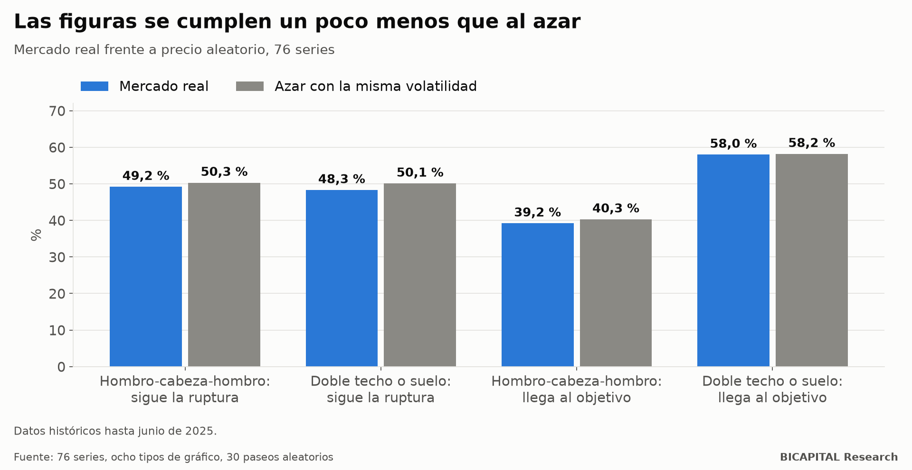

# Chartismo: 28 figuras contra el azar, en ocho tipos de gráfico

Hombro-cabeza-hombro, doble techo, triángulos, banderas, cuñas. Las figuras chartistas son lo primero que aprende casi
cualquier trader, y cada una viene con su regla: si rompe la línea, el precio va hacia allá y llega hasta tal objetivo.

Busqué **28 figuras** (14 familias, en sus dos sentidos) en **76 series de mercado** y en **ocho tipos de gráfico**
(velas, Heikin Ashi, Renko, Kagi, punto y figura, ruptura de línea, barras de rango y de ticks). En total, 18.157
combinaciones. Y busqué las mismas figuras en **precios inventados al azar** con la misma volatilidad.

## La comparación que importa

Las figuras aparecen en cualquier precio, también en uno aleatorio. Así que la pregunta no es si «funcionan» alguna vez,
sino si funcionan **mejor que en un precio que no tiene ninguna dirección**.

| Figura | Siguiente movimiento a favor de la ruptura | | Llega al objetivo clásico antes que al stop | |
|---|---:|---:|---:|---:|
| | **Real** | **Azar** | **Real** | **Azar** |
| Hombro-cabeza-hombro | 49,2 % | 50,3 % | 39,2 % | 40,3 % |
| Doble techo o suelo | 48,3 % | 50,1 % | 58,0 % | 58,2 % |
| Triple techo o suelo | 47,2 % | 49,9 % | 55,9 % | 56,4 % |

**En el mercado real, las figuras se cumplen un poco menos que en un precio aleatorio.** Ni siquiera aparecen más a
menudo: el hombro-cabeza-hombro sale unas 5 veces al año por serie y gráfico, igual que en el azar.

El conjunto completo lo confirma: de 18.157 combinaciones, solo 15 sobreviven a todos los filtros, y la mayor señal
encontrada en el mercado real es más débil que la que aparece por azar en los paseos aleatorios.

## Operarlas como dice el manual

Con la entrada, el stop y el objetivo de los libros, y los costes reales de un bróker de CFD:

| Figura | Resultado mediano por operación | Combinaciones con resultado positivo |
|---|---:|---:|
| Hombro-cabeza-hombro | −0,149 R | 21 % |
| Doble techo o suelo | −0,103 R | 17 % |
| Triple techo o suelo | −0,098 R | 20 % |

Cuatro de cada cinco combinaciones pierden. Y las que ganan son las que se esperan por azar entre tantas pruebas.

## ¿Y el tipo de gráfico?

Se suele decir que las figuras se ven «más limpias» en punto y figura, en Renko o en Heikin Ashi. Medí cada figura por
separado en cada tipo de gráfico, y ninguno las mejora de forma apreciable. Cambiar la forma de dibujar no cambia lo que
hace el precio.

Lo único que asoma, en unas pocas series, es lo contrario de lo que dice el manual: **falsas rupturas**, en las que el
precio vuelve hacia dentro de la figura. Son casos aislados y medidos antes de costes.

## Qué te llevas

1. **Que una figura «se cumpla» no prueba nada.** Pregunta cuántas veces se cumpliría en un precio aleatorio.
2. **Las figuras son reales como dibujo, no como predicción.** Aparecen igual en el azar.
3. **Si las operas, mide.** Con el stop, el objetivo y los costes reales, el resultado típico es negativo.

*Héctor Sandoval · BICAPITAL Research*

---

*Contenido educativo y de investigación. No es asesoría de inversión ni una recomendación personalizada. 76 series, 28
figuras, ocho tipos de gráfico y 30 paseos aleatorios por gráfico; datos históricos hasta junio de 2025. Operaciones con
costes reales de CFD, solo informativas.*
