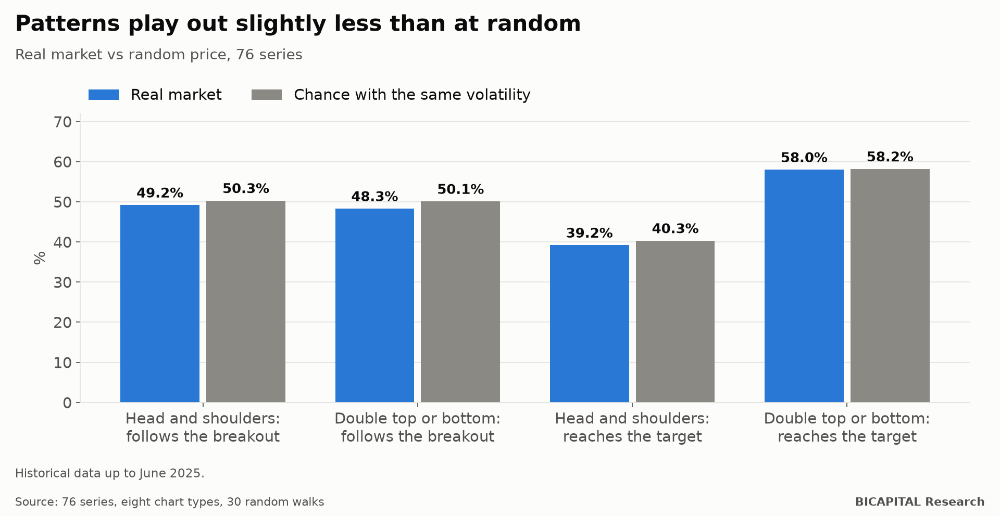

# Chart patterns: 28 figures against chance, on eight chart types

Head and shoulders, double top, triangles, flags, wedges. Chart patterns are the first thing almost every trader learns,
and each comes with its rule: if it breaks the line, price goes that way and reaches such-and-such target.

I looked for **28 patterns** (14 families, in both directions) across **76 market series** and **eight chart types**
(candles, Heikin Ashi, Renko, Kagi, point and figure, line break, range bars and tick bars). In total, 18,157
combinations. And I looked for the same patterns in **prices invented at random** with the same volatility.

## The comparison that matters

Patterns appear in any price, random ones included. So the question is not whether they ever "work", but whether they
work **better than on a price with no direction at all**.

| Pattern | Next move in the breakout direction | | Reaches the textbook target before the stop | |
|---|---:|---:|---:|---:|
| | **Real** | **Random** | **Real** | **Random** |
| Head and shoulders | 49.2% | 50.3% | 39.2% | 40.3% |
| Double top or bottom | 48.3% | 50.1% | 58.0% | 58.2% |
| Triple top or bottom | 47.2% | 49.9% | 55.9% | 56.4% |

**In the real market, the patterns play out slightly less often than on a random price.** They do not even appear more
often: head and shoulders shows up about 5 times a year per series and chart, the same as at random.

The full set confirms it: of 18,157 combinations, only 15 survive every filter, and the strongest signal found in the real
market is weaker than what turns up by chance in the random walks.

## Trading them by the book

With the textbook entry, stop and target, and a CFD broker's real costs:

| Pattern | Median result per trade | Combinations with a positive result |
|---|---:|---:|
| Head and shoulders | −0.149 R | 21% |
| Double top or bottom | −0.103 R | 17% |
| Triple top or bottom | −0.098 R | 20% |

Four out of five combinations lose. And the ones that win are what chance predicts among so many tests.

## What about the chart type?

People often say patterns look "cleaner" on point and figure, Renko or Heikin Ashi. I measured each pattern separately on
each chart type, and none improves them noticeably. Changing how you draw does not change what price does.

The only thing that shows up, on a handful of series, is the opposite of what the book says: **false breakouts**, where
price comes back inside the pattern. They are isolated cases, measured before costs.

## Takeaways

1. **A pattern "playing out" proves nothing.** Ask how often it would play out on a random price.
2. **Patterns are real as drawings, not as predictions.** They appear just the same at random.
3. **If you trade them, measure.** With the real stop, target and costs, the typical result is negative.

*Héctor Sandoval · BICAPITAL Research*

---

*Educational and research content. Not investment advice or a personalised recommendation. 76 series, 28 patterns, eight
chart types and 30 random walks per chart; historical data up to June 2025. Trades with real CFD costs, for information
only.*
