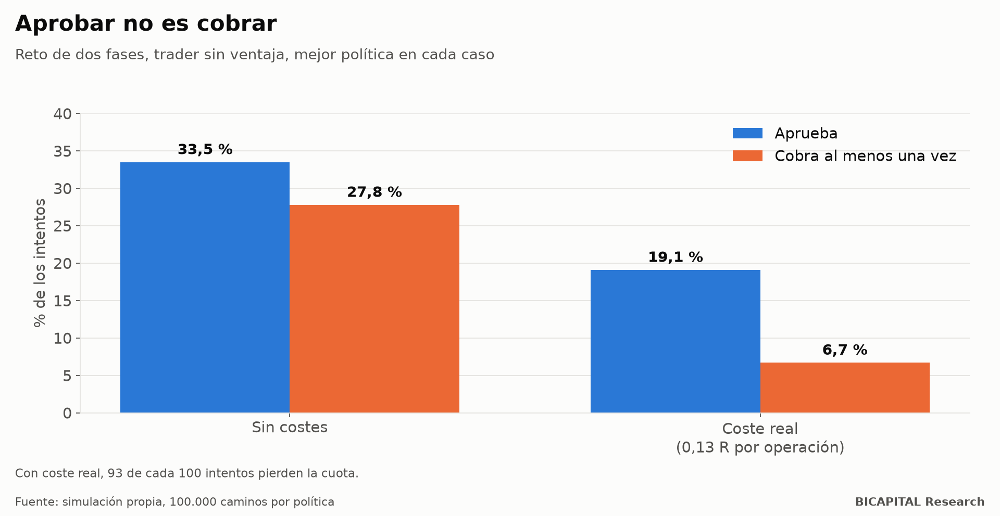
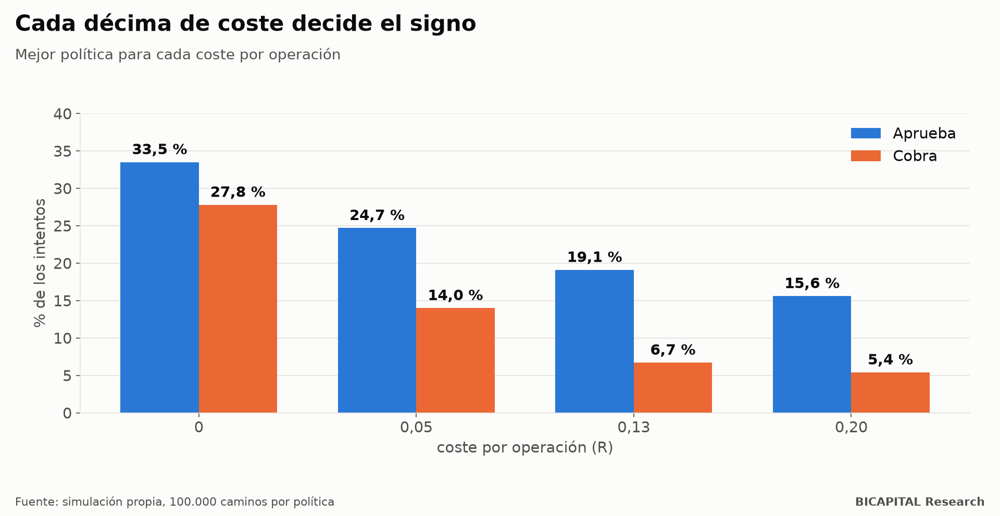

# Retos de fondeo: de cada 100 que lo intentan sin ventaja, 93 pierden la cuota

Las firmas de fondeo venden una promesa atractiva: pagas una cuota, pasas un examen operando una cuenta simulada y, si
apruebas, operas con su dinero y te quedas con la mayor parte del beneficio. Circulan vídeos que dicen que incluso un
trader sin ventaja aprueba la mayoría de las veces.

Lo simulé con las reglas públicas del reto de dos fases de una de las firmas más conocidas: **324 políticas de tamaño y
gestión, 100.000 caminos cada una.** Sin ventaja y con los costes reales que medí en mis propias operaciones, la mejor
política **aprueba el 19,1 % de las veces y cobra el 6,7 %. Es decir, 93 de cada 100 intentos pierden la cuota.**

## Las reglas, en corto

- **Fase 1:** ganar un 10 % antes de perder un 10 %.
- **Fase 2:** ganar un 5 % antes de perder un 10 %.
- **Límite diario:** no perder más de un 5 % en un día.
- Si apruebas, operas la cuenta con los mismos límites y cobras el 80 % del beneficio cada dos semanas.

## Sin ventaja y sin costes: el techo es un tercio

Si no tienes ventaja, cada operación es una moneda al aire con el saldo esperado sin cambiar. Matemáticamente, la fase 1
se pasa como mucho la mitad de las veces y la fase 2 como mucho dos de cada tres: **el techo de aprobar las dos es de un
33 %.** La mejor política medida aprueba el 33,5 % y cobra al menos una vez el 27,8 %.

Lo curioso es que, sin costes, el valor esperado de intentarlo **es positivo**. La cuenta funciona como una opción: si va
bien, cobras; si va mal, pierdes la cuenta, no tu dinero. El problema es el siguiente apartado.

## Con costes reales, casi todo se vuelve negativo

En mis operaciones reales con instrumentos de esta firma, el coste medio fue de **0,13 R por operación** (R es lo que
arriesgas en cada una). Con ese coste:

- **Solo 23 de las 136 políticas** tienen un valor esperado positivo con seguridad estadística, y solo en las cuentas
  grandes.
- La mejor es **pocas apuestas grandes**: arriesgar el 2 % por operación, buscar 5 veces lo arriesgado y hacer una sola
  operación al día.
- Aprueba el **19,1 %** y cobra el **6,7 %**.
- En las cuentas pequeñas, su valor esperado es **prácticamente cero**: lo que cobran los pocos que llegan apenas cubre las
  cuotas de los demás.
- Hacer más operaciones al día siempre es peor: el coste se multiplica y el límite diario se rompe antes.

| Coste por operación | Aprueba | Cobra |
|---|---:|---:|
| 0 | 33,5 % | 27,8 % |
| 0,05 R | 24,7 % | 14,0 % |
| **0,13 R (real)** | **19,1 %** | **6,7 %** |
| 0,20 R | 15,6 % | 5,4 % |

## Aprobar no es cobrar

Esta es la parte que los vídeos no cuentan. Sin costes, de los que aprueban cobra el 78-86 %. Con costes reales, en las
mejores políticas solo cobra el **35-43 %** de los que aprueban. Y con estrategias agresivas de varias operaciones al día
aprueba un 12-13 % y **casi nadie cobra**: queman la cuenta antes del primer pago.

Tampoco pude reproducir el «82 % de aprobados sin ventaja» que circula. Con un solo intento, sin ventaja, es imposible
pasar del techo de las reglas. Lo más probable es que cuente reintentos.

## Entonces, ¿vale la pena?

Con lo que medí:

- **Sin ventaja, es una lotería** con premio esperado ligeramente positivo solo si el coste es muy bajo, la cuenta es
  grande y apuestas fuerte y poco. La mediana de los intentos es perder la cuota.
- **Con una ventaja real, cambia todo.** La única estrategia de mi investigación que pasó una reserva de datos sellada
  aprueba la mayoría de las veces en la simulación. Pero esa cifra es optimista por razones que explicaré en su propio
  artículo.
- **Mide tu coste antes de pagar.** Es la variable que decide el signo.

*Héctor Sandoval · BICAPITAL Research*

---

*Contenido educativo y de investigación. No es asesoría de inversión ni una recomendación personalizada. Las simulaciones
son hipotéticas y dependen de supuestos (reglas vigentes, costes, cadencia de pagos) que pueden cambiar el resultado.*
