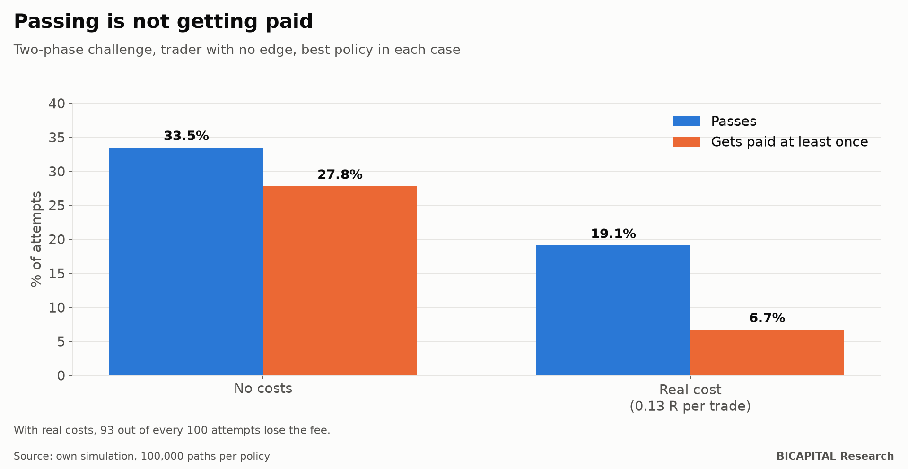
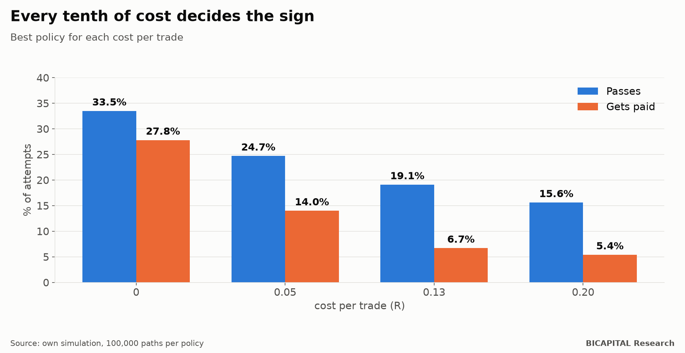

# Prop-firm challenges: out of every 100 who try without an edge, 93 lose the fee

Prop firms sell an attractive promise: you pay a fee, pass an exam trading a simulated account and, if you pass, you trade
their money and keep most of the profit. Videos circulate saying that even a trader with no edge passes most of the time.

I simulated it with the public rules of the two-phase challenge of one of the best-known firms: **324 sizing and
management policies, 100,000 paths each.** With no edge and the real costs I measured on my own trades, the best policy
**passes 19.1% of the time and gets paid 6.7%. That is, 93 out of every 100 attempts lose the fee.**

## The rules, in short

- **Phase 1:** make 10% before losing 10%.
- **Phase 2:** make 5% before losing 10%.
- **Daily limit:** do not lose more than 5% in a day.
- If you pass, you trade the account with the same limits and keep 80% of the profit every two weeks.

## No edge and no costs: the ceiling is one third

If you have no edge, every trade is a coin flip with the expected balance unchanged. Mathematically, phase 1 passes at
most half the time and phase 2 at most two out of three: **the ceiling for passing both is about 33%.** The best policy
measured passes 33.5% and gets paid at least once 27.8%.

The curious part is that, without costs, the expected value of trying **is positive**. The account works like an option:
if it goes well, you get paid; if it goes badly, you lose the account, not your money. The problem is the next section.

## With real costs, almost everything turns negative

On my real trades with this firm's instruments, the average cost was **0.13 R per trade** (R is what you risk on each
one). At that cost:

- **Only 23 of the 136 policies** have a positive expected value with statistical confidence, and only on large accounts.
- The best is **few large bets**: risk 2% per trade, aim for 5 times the risk and take a single trade per day.
- It passes **19.1%** and gets paid **6.7%**.
- On small accounts its expected value is **practically zero**: what the few who get there collect barely covers
  everyone else's fees.
- Taking more trades per day is always worse: the cost multiplies and the daily limit breaks sooner.

| Cost per trade | Passes | Gets paid |
|---|---:|---:|
| 0 | 33.5% | 27.8% |
| 0.05 R | 24.7% | 14.0% |
| **0.13 R (real)** | **19.1%** | **6.7%** |
| 0.20 R | 15.6% | 5.4% |

## Passing is not getting paid

This is the part the videos leave out. Without costs, 78-86% of those who pass get paid. With real costs, in the best
policies only **35-43%** of those who pass get paid. And with aggressive strategies of several trades a day, 12-13% pass
and **almost nobody gets paid**: they burn the account before the first payout.

Nor could I reproduce the "82% pass with no edge" that circulates. In a single attempt with no edge, it is impossible to
exceed the ceiling set by the rules. Most likely it counts retries.

## So is it worth it?

With what I measured:

- **Without an edge, it is a lottery** with a slightly positive expected prize only if the cost is very low, the account
  is large and you bet big and rarely. The median attempt loses the fee.
- **With a real edge, everything changes.** The only strategy in my research that passed a sealed data reserve passes
  most of the time in the simulation. But that figure is optimistic for reasons I will explain in its own article.
- **Measure your cost before paying.** It is the variable that decides the sign.

*Héctor Sandoval · BICAPITAL Research*

---

*Educational and research content. This is not investment advice or a personal recommendation. Simulations are
hypothetical and depend on assumptions (current rules, costs, payout cadence) that can change the result.*
