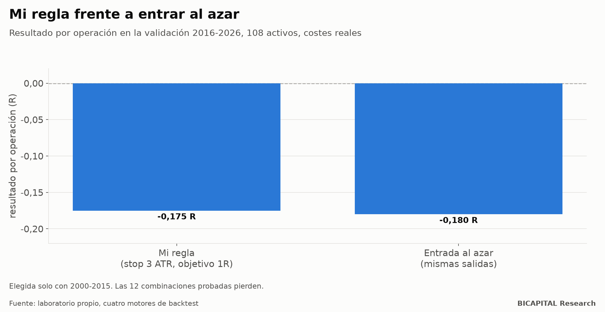

# Mi propia estrategia rendía igual que entrar al azar

Tenía una regla de trading que me gustaba. Es sencilla y suena sensata:

1. Opero solo en la sesión de Nueva York, en gráfico de 15 minutos.
2. Solo compro si hay tendencia: el cierre anterior está por encima de la media de 200 velas.
3. Espero a que el precio cotice por encima de la media de la sesión y pongo una orden de compra en esa media, para entrar
   en el retroceso.
4. Una operación por activo y día. Salgo en el stop, en el objetivo o al cierre de la sesión.

La probé en serio: **108 activos, de 2000 a 2026, con los costes actuales de un bróker de fondeo y contra un control de
entradas al azar**. El resultado: mi regla y el azar perdían prácticamente lo mismo.

## Cómo la probé sin hacerme trampas

- **Elegí la configuración solo con 2000-2015.** Probé 12 combinaciones de stop (1, 1,5, 2 y 3 veces el rango medio, el
  ATR) y objetivo (1, 2 y 3 veces lo arriesgado, R).
- **Miré 2016-2026 una sola vez**, para validar la elegida.
- **El control** usa las mismas salidas, pero entra en un momento al azar de la misma sesión. Si la regla tiene ventaja,
  tiene que ganarle al azar.
- **La ejecuté en cuatro motores de backtest distintos** (el mío, backtesting.py, Backtrader y VectorBT, más NautilusTrader
  en parte de los activos). Coinciden en más del 99 % de las operaciones.

## El resultado

La mejor combinación con los datos de 2000-2015 fue la del stop amplio (3 ATR) y objetivo pequeño (1R). En la validación
de 2016-2026:

| | Resultado por operación |
|---|---:|
| **Mi regla** | **−0,175 R** |
| **Entrada al azar** | **−0,180 R** |

Con 146.167 operaciones por combinación, el resultado de la regla es claramente negativo (t −25,4). **Y no se distingue
del azar.**

**Las 12 combinaciones pierden, en los dos periodos.**

## Lo que no sabía: el stop y el objetivo no crean ventaja

Esta fue la lección más útil. Mira la pérdida por operación medida en puntos básicos (centésimas de un 1 % del precio):

| Stop | Objetivo | Resultado en R | Pérdida por operación |
|---|---|---:|---:|
| 1 ATR | 1R | −0,514 R | −7,3 pb |
| 1,5 ATR | 2R | −0,347 R | −7,1 pb |
| 2 ATR | 3R | −0,264 R | −7,1 pb |
| **3 ATR** | **1R** | **−0,175 R** | **−7,2 pb** |

En R parece que el stop amplio «mejora» mucho. **En dinero, todas pierden lo mismo: unos 7 puntos básicos por
operación.** Un stop más ancho solo reparte la misma pérdida en un R más grande.

Antes de costes, las 12 combinaciones quedan entre −0,004 y −0,038 R: **la entrada no tiene ventaja propia y todo el
resultado neto son costes.** Mover el stop o el objetivo cambia cuántas veces aciertas y cuánto ganas cuando aciertas, pero
no cambia lo que esperas ganar.

## ¿Y los activos que salieron positivos?

Seis de los 108 activos quedaron en positivo, por ejemplo el índice alemán (+0,034 R) o el euro-yen (+0,007 R). Con 108
activos y ninguna ventaja, es exactamente lo que se espera por azar. Si me hubiera quedado solo con esos seis, habría
fabricado una estrategia «ganadora» con datos del pasado.

## Qué te llevas

1. **Compara siempre tu regla con entradas al azar.** Si no le gana al azar, no tiene ventaja, aunque gane dinero en un
   periodo concreto.
2. **Mide en dinero, no solo en R.** El R depende de dónde pones el stop; el dinero, no.
3. **Elige con un periodo y valida con otro**, y mira el segundo una sola vez.
4. **Desconfía de los activos «que funcionan»** dentro de un universo grande: alguno saldrá bien por suerte.

*Héctor Sandoval · BICAPITAL Research*

---

*Contenido educativo y de investigación. No es asesoría de inversión ni una recomendación personalizada. Resultados en
datos históricos de 108 instrumentos (divisas, índices, metales, energía, agrícolas y cripto) con los costes actuales de
un bróker de fondeo; los resultados pasados no garantizan los futuros.*
