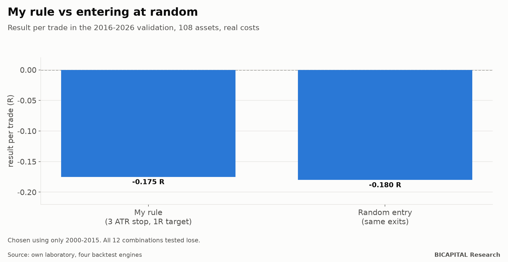

# My own strategy performed the same as entering at random

I had a trading rule I liked. It is simple and sounds sensible:

1. I trade only the New York session, on the 15-minute chart.
2. I only buy in a trend: the previous close is above the 200-bar average.
3. I wait for price to trade above the session average and place a buy order at that average, to enter on the pullback.
4. One trade per asset per day. I exit at the stop, at the target or at the session close.

I tested it properly: **108 assets, 2000 to 2026, with a prop-firm broker's current costs and against a control of random
entries**. The result: my rule and chance lost practically the same.

## How I tested it without cheating myself

- **I chose the configuration using only 2000-2015.** I tried 12 combinations of stop (1, 1.5, 2 and 3 times the average
  range, the ATR) and target (1, 2 and 3 times the amount risked, R).
- **I looked at 2016-2026 only once**, to validate the chosen one.
- **The control** uses the same exits but enters at a random moment of the same session. If the rule has an edge, it must
  beat chance.
- **I ran it on four different backtest engines** (my own, backtesting.py, Backtrader and VectorBT, plus NautilusTrader on
  part of the assets). They agree on more than 99% of trades.

## The result

The best combination on 2000-2015 data was the wide stop (3 ATR) with a small target (1R). In the 2016-2026 validation:

| | Result per trade |
|---|---:|
| **My rule** | **−0.175 R** |
| **Random entry** | **−0.180 R** |

With 146,167 trades per combination, the rule's result is clearly negative (t −25.4). **And it cannot be told apart from
chance.**

**All 12 combinations lose, in both periods.**

## What I did not know: stops and targets do not create an edge

This was the most useful lesson. Look at the loss per trade measured in basis points (hundredths of 1% of price):

| Stop | Target | Result in R | Loss per trade |
|---|---|---:|---:|
| 1 ATR | 1R | −0.514 R | −7.3 bp |
| 1.5 ATR | 2R | −0.347 R | −7.1 bp |
| 2 ATR | 3R | −0.264 R | −7.1 bp |
| **3 ATR** | **1R** | **−0.175 R** | **−7.2 bp** |

In R, the wide stop seems to "improve" a lot. **In money, they all lose the same: about 7 basis points per trade.** A wider
stop just spreads the same loss over a bigger R.

Before costs, the 12 combinations sit between −0.004 and −0.038 R: **the entry has no edge of its own and the whole net
result is costs.** Moving the stop or the target changes how often you win and how much you make when you win, but it does
not change what you expect to make.

## What about the assets that came out positive?

Six of the 108 assets ended positive, for example the German index (+0.034 R) or euro-yen (+0.007 R). With 108 assets and
no edge, that is exactly what chance predicts. Had I kept only those six, I would have manufactured a "winning" strategy
from past data.

## Takeaways

1. **Always compare your rule with random entries.** If it does not beat chance, it has no edge, even if it makes money in
   a given period.
2. **Measure in money, not only in R.** R depends on where you put the stop; money does not.
3. **Choose with one period and validate with another**, and look at the second one only once.
4. **Be wary of the assets "that work"** inside a large universe: some will do well by luck.

*Héctor Sandoval · BICAPITAL Research*

---

*Educational and research content. Not investment advice or a personalised recommendation. Results on historical data for
108 instruments (FX, indices, metals, energy, agricultural and crypto) with a prop-firm broker's current costs; past results
do not guarantee future ones.*
