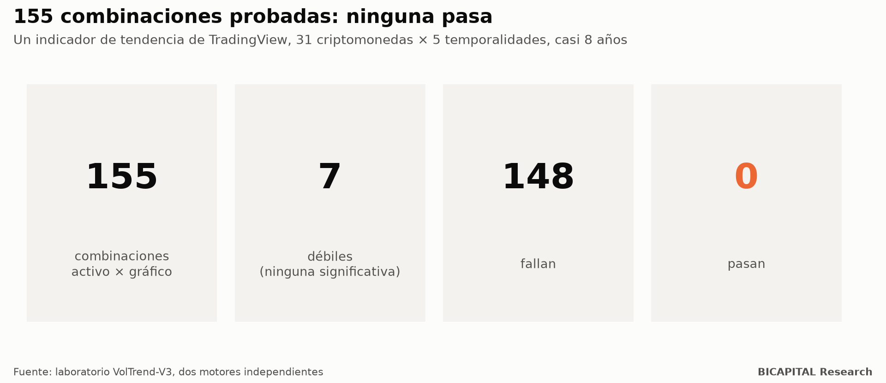
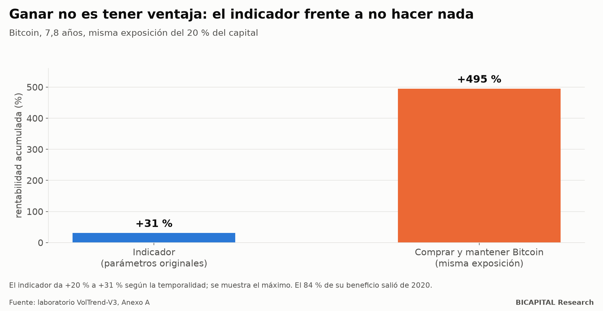

# Por qué tu backtest de TradingView miente: el indicador que «funcionaba» y daba +20 % en casi 8 años

Un indicador de tendencia muy compartido en TradingView mostraba en su probador de estrategias una curva preciosa en
Bitcoin. Lo reprogramé desde cero en Python, con dos motores independientes, y lo probé con casi 8 años de datos en 31
criptomonedas y 5 temporalidades: **155 combinaciones de activo y gráfico.**

Resultado: **ninguna pasa. 7 quedan «débiles» y 148 fallan.** Y en Bitcoin, el único activo donde gana, gana mucho menos
que no hacer nada.

No digo qué indicador es: no importa, y el código es de su autor. Lo que importa es **por qué el probador de TradingView
lo hacía ver bien**, porque son cinco trampas que afectan a casi cualquier estrategia que veas ahí.

## El resultado

- **La optimización no generaliza.** La correlación entre lo bien que iba una configuración en los datos de diseño y lo
  bien que fue después en datos nuevos: **0,001**. Es decir, ninguna.
- **Con los parámetros originales pierde en el universo.** Sin Bitcoin, todas las temporalidades pierden. En 15 de los 31
  activos no generó ni una operación en toda su historia.
- **Bitcoin es la excepción, y es débil.** Gana, pero con 32-45 operaciones en casi 8 años.

## Bitcoin: ganar no es lo mismo que tener ventaja

Con el tamaño de posición del propio script (el 20 % del capital por operación), el indicador da **+20 % a +31 % en 7,8
años**. Comprar Bitcoin y no tocarlo, con esa misma exposición del 20 %, da **+495 %**.

Y el **84 % del beneficio salió de un solo año** (2020, 5 operaciones). Varios años fueron negativos, y los últimos 12 meses
dejaron 3 operaciones y −4 %. Que gane en Bitcoin es compatible con «sigue la subida de Bitcoin con poca exposición». No
con «tiene ventaja».

## Las cinco trampas del probador

1. **Repinta.** El script usa una vela de marco superior (12 horas o 3 días) con `request.security`. En las velas históricas
   el gráfico muestra la vela superior **ya cerrada**; en tiempo real usa la vela **en formación**. La curva del probador no
   es la que operarías con alertas. Es la misma familia de error que el backtest que miraba el futuro.
2. **Pocas velas.** En gráficos de 5 y 15 minutos TradingView carga unos 20.000 bares: de 2 a 7 meses. Un «backtest» en 5
   minutos es un tramo corto, y según la racha el sistema luce brillante o desastroso.
3. **Sin costes.** El script no define comisión ni deslizamiento. Con 34 operaciones casi no cambia nada, pero en gráficos
   rápidos, con muchas operaciones, decide el signo.
4. **Se mira un solo activo.** El ejemplo que se comparte es el activo donde funciona. En el resto del universo, pierde.
5. **Se compara con nada.** El probador muestra beneficio, no beneficio **frente a comprar y mantener con la misma
   exposición**. Sin esa comparación, cualquier cosa que esté invertida en un mercado alcista parece una estrategia.

## Lo que no puedo concluir

Probé la versión histórica que **no** repinta, porque es la única verificable. No pude comparar vela a vela con
TradingView, porque no exporta las operaciones: la paridad la garantizan dos implementaciones independientes. Y no digo
nada de la versión en tiempo real, salvo que repinta.

## Cómo protegerte

1. **Pide la comparación a igual exposición.** «+31 %» no significa nada sin «frente a +495 % de no hacer nada».
2. **Mira todo el universo, no el activo del ejemplo.**
3. **Busca `request.security` con marcos superiores** y pregúntate si la vela que usa estaba cerrada en ese momento.
4. **Exige historia larga.** Si el backtest cabe en unos meses, no es un backtest.
5. **Mete costes antes de mirar el resultado.**

Escribí una nota técnica con el método completo, que publicaré como preprint.

*Héctor Sandoval · BICAPITAL Research*

---

*Contenido educativo y de investigación. No es asesoría de inversión ni una recomendación personalizada. Los resultados de
backtest y simulación son hipotéticos y pasados; no garantizan resultados futuros. Las criptomonedas pueden hacer perder
todo el capital.*
