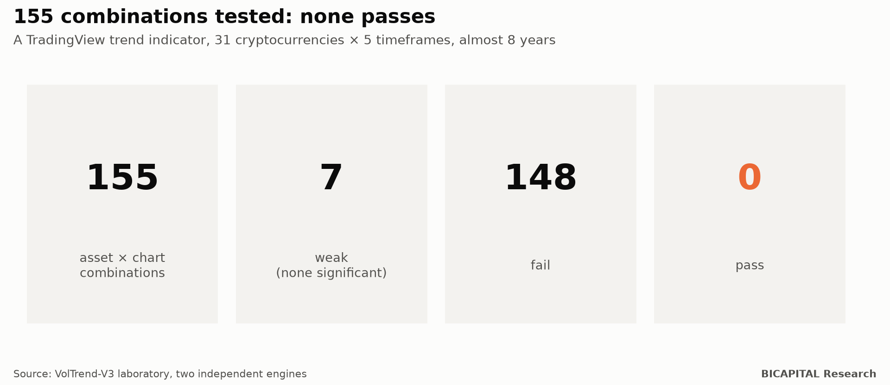
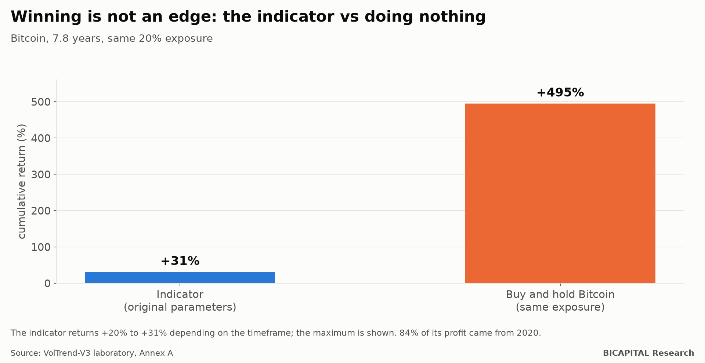

# Why your TradingView backtest lies: the indicator that "worked" and returned +20% in almost 8 years

A widely shared trend indicator on TradingView showed a beautiful curve on Bitcoin in its strategy tester. I rewrote it
from scratch in Python, with two independent engines, and tested it on almost 8 years of data across 31 cryptocurrencies
and 5 timeframes: **155 asset-and-chart combinations.**

Result: **none passes. 7 are "weak" and 148 fail.** And on Bitcoin, the only asset where it wins, it wins far less than
doing nothing.

I am not naming the indicator: it does not matter, and the code belongs to its author. What matters is **why
TradingView's tester made it look good**, because these are five traps that affect almost any strategy you see there.

## The result

- **The optimisation does not generalise.** The correlation between how well a configuration did on the design data and
  how well it did afterwards on new data: **0.001**. In other words, none.
- **With the original parameters it loses across the universe.** Without Bitcoin, every timeframe loses. On 15 of the 31
  assets it did not generate a single trade in their entire history.
- **Bitcoin is the exception, and a weak one.** It wins, but with 32-45 trades in almost 8 years.

## Bitcoin: winning is not the same as having an edge

With the script's own position size (20% of capital per trade), the indicator returns **+20% to +31% in 7.8 years**.
Buying Bitcoin and leaving it alone, at that same 20% exposure, returns **+495%**.

And **84% of the profit came from a single year** (2020, 5 trades). Several years were negative, and the last 12 months
left 3 trades and −4%. Winning on Bitcoin is consistent with "it follows Bitcoin's rise with little exposure". Not with
"it has an edge".

## The five traps of the tester

1. **It repaints.** The script uses a higher-timeframe bar (12 hours or 3 days) through `request.security`. On historical
   bars the chart shows the higher bar **already closed**; in real time it uses the bar **still forming**. The tester's
   curve is not the one you would trade with alerts. It is the same family of error as the backtest that looked into the
   future.
2. **Few bars.** On 5- and 15-minute charts TradingView loads about 20,000 bars: 2 to 7 months. A 5-minute "backtest" is
   a short stretch, and depending on the streak the system looks brilliant or disastrous.
3. **No costs.** The script defines no commission or slippage. With 34 trades it barely matters, but on fast charts, with
   many trades, it decides the sign.
4. **One asset is shown.** The example that gets shared is the asset where it works. Across the rest of the universe, it
   loses.
5. **It is compared with nothing.** The tester shows profit, not profit **against buying and holding at the same
   exposure**. Without that comparison, anything that is invested in a bull market looks like a strategy.

## What I cannot conclude

I tested the historical version that does **not** repaint, because it is the only verifiable one. I could not compare
bar by bar with TradingView, because it does not export the trades: parity is guaranteed by two independent
implementations. And I say nothing about the real-time version, except that it repaints.

## How to protect yourself

1. **Ask for the same-exposure comparison.** "+31%" means nothing without "against +495% for doing nothing".
2. **Look at the whole universe, not the example asset.**
3. **Look for `request.security` on higher timeframes** and ask whether the bar it uses was closed at that moment.
4. **Demand long history.** If the backtest fits in a few months, it is not a backtest.
5. **Add costs before looking at the result.**

I wrote a technical note with the full method, which I will publish as a preprint.

*Héctor Sandoval · BICAPITAL Research*

---

*Educational and research content. This is not investment advice or a personal recommendation. Backtest and simulation
results are hypothetical and past; they do not guarantee future results. Crypto assets can lose all of your capital.*
