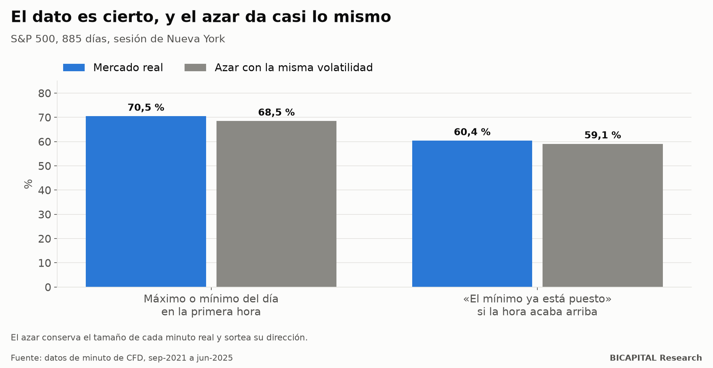

# «El máximo o el mínimo del día se marca en la primera hora 7 de cada 10 veces»: es geometría

En los vídeos de trading de índices circula un dato llamativo: **en 7 de cada 10 días, el máximo o el mínimo del día se
marca en la primera hora de la sesión de Nueva York** (de 9:30 a 10:30). Y uno más: si al terminar esa hora el precio
está en la parte alta de su rango, **en 6 de cada 10 días el mínimo del día ya está puesto**. De ahí sale una estrategia:
mirar dónde queda el precio a las 10:30 y operar en esa dirección el resto del día.

Lo comprobé con datos de minuto de 13 índices. **Las cifras se reproducen casi exactas. El problema es que el azar da
casi lo mismo.**

## Primero, replicar

Con el S&P 500 (885 días, de septiembre de 2021 a junio de 2025):

| Dato | El vídeo | Mis datos |
|---|---:|---:|
| Máximo o mínimo del día dentro de la primera hora | 70 % | **70,5 %** |
| «El mínimo ya está puesto» si la hora acaba arriba | 60 % | **60,4 %** |

Hasta aquí, el vídeo tiene razón.

## Después, compararlo con el azar

La pregunta que casi nadie se hace: **¿qué daría un precio que se mueve al azar?** Construí un azar exigente: cada
minuto real conserva su tamaño, pero su dirección (sube o baja) se sortea. Tiene la misma volatilidad que el mercado de
verdad, minuto a minuto, pero ninguna dirección.

| Dato | Real | Azar con la misma volatilidad | Azar de volatilidad constante |
|---|---:|---:|---:|
| Máximo o mínimo en la primera hora | 70,5 % | **68,5 %** | 50,6 % |
| «El mínimo ya está puesto» si la hora acaba arriba | 60,4 % | **59,1 %** | 44,0 % |

**El azar con la misma volatilidad da prácticamente lo mismo.** La diferencia (1-2 puntos) cae dentro del margen del
propio azar. En los 13 índices, el azar explica todo salvo 1-4 puntos.

## Por qué ocurre

Son dos efectos que no tienen nada que ver con predecir:

1. **Geometría.** Incluso en un paseo aleatorio, los extremos tienden a quedar cerca del principio o del final del
   tramo. Ya con volatilidad constante sale un 51 %.
2. **La forma en U de la volatilidad.** La primera hora es la más movida del día. Si el precio se mueve más en esa hora,
   es más probable que ahí toque su máximo o su mínimo. Eso sube el 51 % al 68 %.

Y lo del «mínimo ya puesto» es casi una tautología: si a las 10:30 el precio está arriba del rango, el mínimo de esa hora
quedó lejos, y el resto del día rara vez baja tanto.

## ¿Y sirve para operar?

Probé 16 versiones de la regla, escritas antes de ver los resultados: comprar si la hora acaba arriba, vender si acaba
abajo, con distintos stops y objetivos, con costes reales de CFD.

- **Dirección:** si la hora acaba arriba, el resto del día rinde **+0,2 puntos básicos** de media en el S&P 500, frente a
  +2,5 en un día cualquiera. No se distingue.
- **Regla: 0 de 16 pasan.** La mejor gana +0,040 R por operación con un intervalo de confianza que incluye el cero
  (−0,037 a +0,117) y deja de ser significativa al corregir por las 16 pruebas.

## Qué te llevas

1. **Antes de creer un porcentaje llamativo, pregunta qué daría el azar.** Muchos «patrones» intradía son la forma
   del gráfico, no información.
2. **La primera hora se mueve más; eso no dice hacia dónde.** Saber dónde estará el extremo no te dice la dirección del
   resto del día.
3. **Replica antes de operar.** Que una cifra sea cierta no significa que sea aprovechable.

*Héctor Sandoval · BICAPITAL Research*

---

*Contenido educativo y de investigación. No es asesoría de inversión ni una recomendación personalizada. Datos de minuto de
CFD de índices de un bróker de fondeo hasta junio de 2025; regla prerregistrada con costes reales. Los CFD tienen un alto
riesgo de perder dinero por el apalancamiento.*
