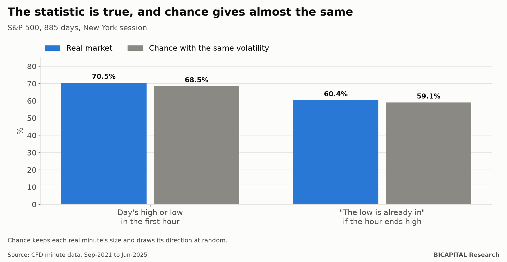

# "The day's high or low is set in the first hour 7 times out of 10": it is geometry

A striking statistic circulates in index-trading videos: **on 7 out of 10 days, the day's high or low is set in the first
hour of the New York session** (9:30 to 10:30). And another one: if price ends that hour in the upper part of its range,
**on 6 out of 10 days the day's low is already in**. A strategy follows: see where price sits at 10:30 and trade in that
direction for the rest of the day.

I checked it with minute data on 13 indices. **The figures replicate almost exactly. The problem is that chance gives
almost the same.**

## First, replicate

With the S&P 500 (885 days, September 2021 to June 2025):

| Statistic | The video | My data |
|---|---:|---:|
| Day's high or low inside the first hour | 70% | **70.5%** |
| "The low is already in" if the hour ends high | 60% | **60.4%** |

So far, the video is right.

## Then, compare it with chance

The question almost nobody asks: **what would a price moving at random give?** I built a demanding random benchmark:
every real minute keeps its size, but its direction (up or down) is drawn at random. It has the same minute-by-minute
volatility as the real market, but no direction at all.

| Statistic | Real | Chance with the same volatility | Constant-volatility chance |
|---|---:|---:|---:|
| High or low in the first hour | 70.5% | **68.5%** | 50.6% |
| "The low is already in" if the hour ends high | 60.4% | **59.1%** | 44.0% |

**Chance with the same volatility gives practically the same.** The difference (1-2 points) is within chance's own margin.
On all 13 indices, chance explains everything except 1-4 points.

## Why it happens

Two effects, neither of which has anything to do with prediction:

1. **Geometry.** Even in a random walk, extremes tend to land near the start or the end of the period. Constant volatility
   alone gives 51%.
2. **The U shape of volatility.** The first hour is the busiest of the day. If price moves more in that hour, it is more
   likely to touch its high or low there. That lifts 51% to 68%.

And "the low is already in" is close to a tautology: if price is above the range at 10:30, that hour's low was left far
behind, and the rest of the day rarely falls that much.

## Can you trade it?

I tested 16 versions of the rule, written down before seeing any result: buy if the hour ends high, sell if it ends low,
with different stops and targets, using real CFD costs.

- **Direction:** if the hour ends high, the rest of the day returns **+0.2 basis points** on average on the S&P 500,
  against +2.5 on any day. Indistinguishable.
- **Rule: 0 of 16 pass.** The best makes +0.040 R per trade with a confidence interval that includes zero (−0.037 to
  +0.117) and stops being significant once corrected for the 16 tests.

## Takeaways

1. **Before you believe a striking percentage, ask what chance would give.** Many intraday "patterns" are the shape of the
   chart, not information.
2. **The first hour moves more; that says nothing about where.** Knowing where the extreme will be does not tell you the
   direction of the rest of the day.
3. **Replicate before you trade.** A statistic being true does not make it exploitable.

*Héctor Sandoval · BICAPITAL Research*

---

*Educational and research content. Not investment advice or a personalised recommendation. Minute data from a prop-firm
broker's index CFDs up to June 2025; pre-registered rule with real costs. CFDs carry a high risk of losing money due to
leverage.*
