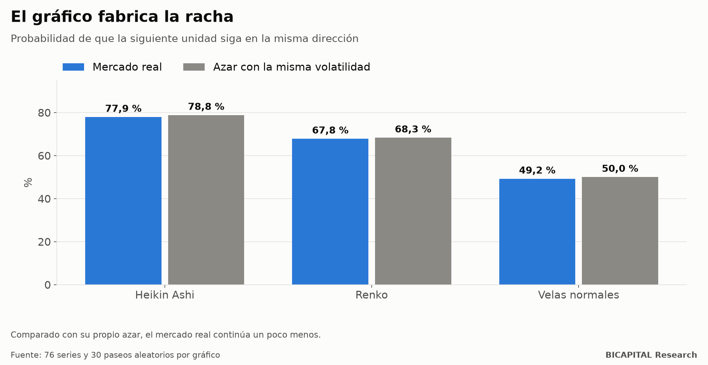

# Renko y Heikin Ashi: las tendencias que dibuja el propio gráfico

Los gráficos Renko y Heikin Ashi tienen fama de «limpiar el ruido» y mostrar las tendencias. Mira uno y lo verás: largas
rachas de ladrillos o velas del mismo color, una detrás de otra. Parece que, cuando arranca una racha, lo normal es que
continúe.

Lo medí en 76 series de mercado (divisas, índices, metales, materias primas, cripto y series relativas entre ellas) con 43
configuraciones de gráfico. Y después hice lo que casi nadie hace: **dibujé los mismos gráficos sobre precios inventados
al azar.**

## La trampa: el gráfico fabrica la racha

Probabilidad de que la siguiente unidad siga en la misma dirección después de una:

| Gráfico | Mercado real | Precio aleatorio con la misma volatilidad |
|---|---:|---:|
| Heikin Ashi (vela) | 77,9 % | **78,8 %** |
| Renko (ladrillo) | 67,8 % | **68,3 %** |
| Velas normales (control) | 49,2 % | 50,0 % |

**Un precio que se mueve al azar ya «continúa» 2 de cada 3 veces en Renko y 3 de cada 4 en Heikin Ashi.** No es
información del mercado: es cómo se construyen.

- **Heikin Ashi** promedia cada vela con la anterior. Al suavizar, los colores se agrupan solos.
- **Renko** solo dibuja un ladrillo nuevo cuando el precio recorre un tamaño fijo, y para cambiar de color necesita
  recorrer el doble. Es más fácil seguir que girar, también al azar.

Si comparas el 78 % de continuación con un 50 %, te parecerá una ventaja enorme. Comparado con lo que da el azar en ese
mismo gráfico, **el mercado real continúa un poco menos**, no más.

## Lo que sí aparece

Al comparar contra el azar de cada gráfico, lo que sobresale es lo contrario de la tendencia: en muchas series, tras una
racha larga el mercado real **gira algo más** de lo que giraría al azar. Es reversión de corto plazo, sobre todo en
algunas divisas y en la plata frente al oro.

Pero hay que leerlo con cuidado:

- Es una diferencia de pocos puntos, **medida antes de costes**.
- Cuando en otro laboratorio intenté operar la reversión de corto plazo con costes reales, perdía.
- Las cifras son del periodo de descubrimiento; la reserva de datos más reciente sigue sin abrir.

## Qué te llevas

1. **Compara con el azar en el mismo tipo de gráfico, no con un 50 %.** Cada forma de dibujar tiene su propio punto de
   partida.
2. **Suavizar no crea tendencias; crea la apariencia de tendencias.** Las rachas largas de Heikin Ashi también aparecen en
   precios inventados.
3. **Si una estrategia «funciona» en Renko o Heikin Ashi, pruébala sobre un paseo aleatorio.** Si también «funciona»
   ahí, lo que estás viendo es el gráfico.

*Héctor Sandoval · BICAPITAL Research*

---

*Contenido educativo y de investigación. No es asesoría de inversión ni una recomendación personalizada. 76 series, 43
configuraciones de gráfico y 30 paseos aleatorios por gráfico; datos históricos hasta junio de 2025.*
