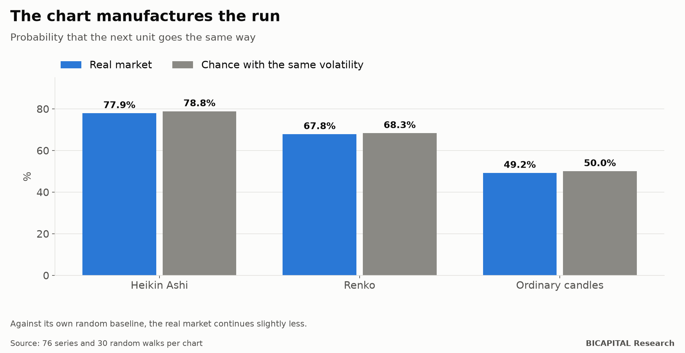

# Renko and Heikin Ashi: the trends the chart draws by itself

Renko and Heikin Ashi charts are famous for "filtering out the noise" and showing the trend. Look at one and you will see
it: long runs of bricks or candles of the same colour, one after another. It looks as if, once a run starts, it usually
continues.

I measured it on 76 market series (FX, indices, metals, commodities, crypto and relative series between them) with 43
chart configurations. Then I did what almost nobody does: **I drew the same charts on prices invented at random.**

## The trap: the chart manufactures the run

Probability that the next unit goes the same way after one:

| Chart | Real market | Random price with the same volatility |
|---|---:|---:|
| Heikin Ashi (candle) | 77.9% | **78.8%** |
| Renko (brick) | 67.8% | **68.3%** |
| Ordinary candles (control) | 49.2% | 50.0% |

**A randomly moving price already "continues" 2 times in 3 on Renko and 3 times in 4 on Heikin Ashi.** That is not
market information: it is how the charts are built.

- **Heikin Ashi** averages each candle with the previous one. Smoothing makes the colours cluster on their own.
- **Renko** only draws a new brick when price travels a fixed size, and to change colour it has to travel twice that. It
  is easier to continue than to turn, even at random.

If you compare 78% continuation with 50%, it looks like a huge edge. Compared with what chance gives on that same chart,
**the real market continues slightly less**, not more.

## What does show up

Against each chart's own random benchmark, what stands out is the opposite of a trend: on many series, after a long run
the real market **turns slightly more** than it would at random. It is short-term mean reversion, mainly in some currencies
and in silver against gold.

But it has to be read carefully:

- It is a difference of a few points, **measured before costs**.
- When, in another laboratory, I tried to trade short-term reversion with real costs, it lost money.
- The figures are from the discovery period; the most recent block of data is still unopened.

## Takeaways

1. **Compare with chance on the same kind of chart, not with 50%.** Every way of drawing has its own baseline.
2. **Smoothing does not create trends; it creates the look of trends.** Long Heikin Ashi runs also appear on invented
   prices.
3. **If a strategy "works" on Renko or Heikin Ashi, test it on a random walk.** If it "works" there too, what you are
   seeing is the chart.

*Héctor Sandoval · BICAPITAL Research*

---

*Educational and research content. Not investment advice or a personalised recommendation. 76 series, 43 chart
configurations and 30 random walks per chart; historical data up to June 2025.*
