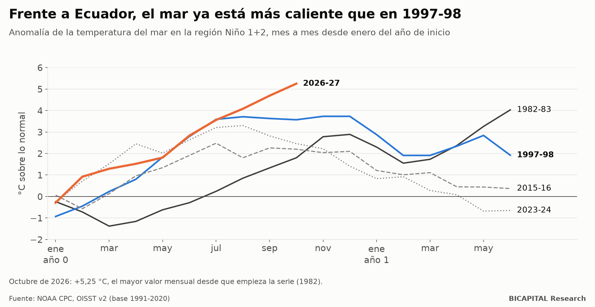
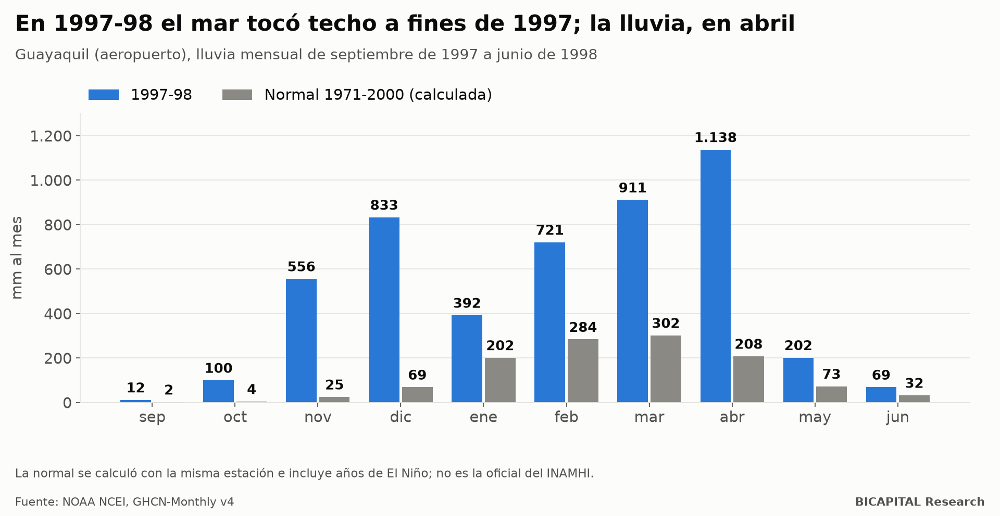
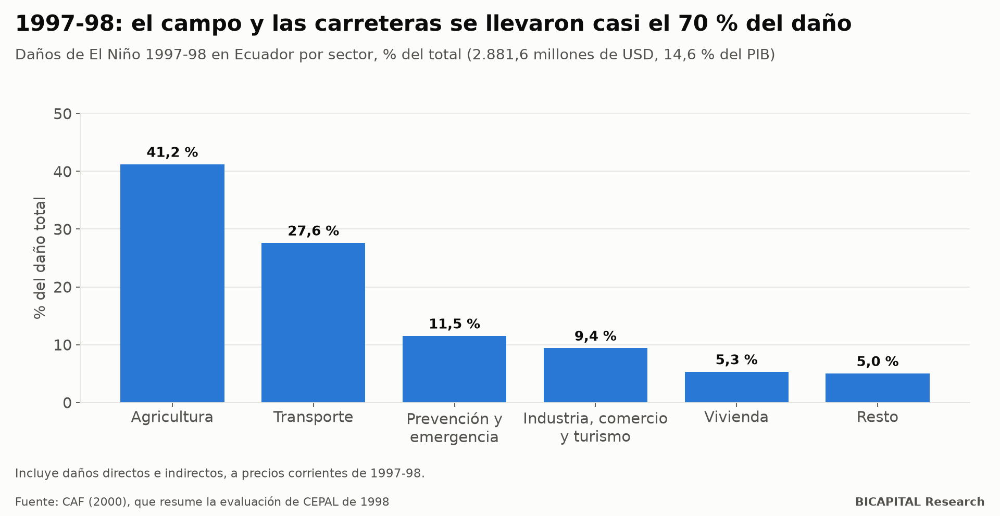
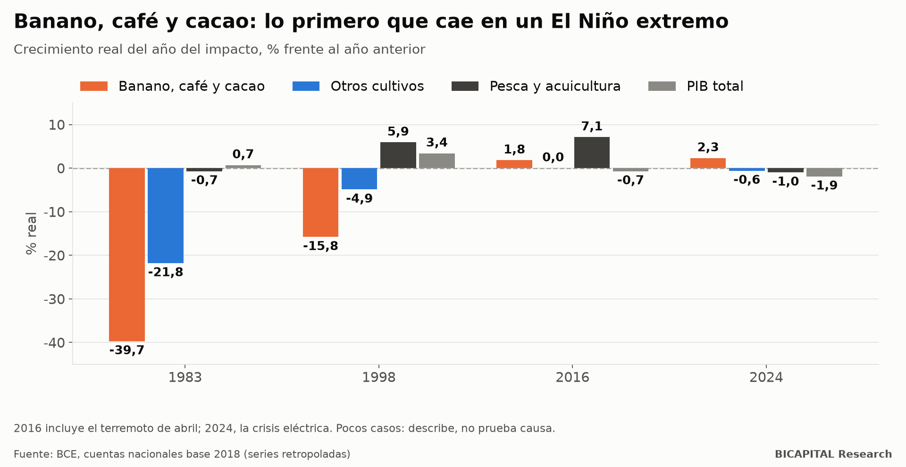
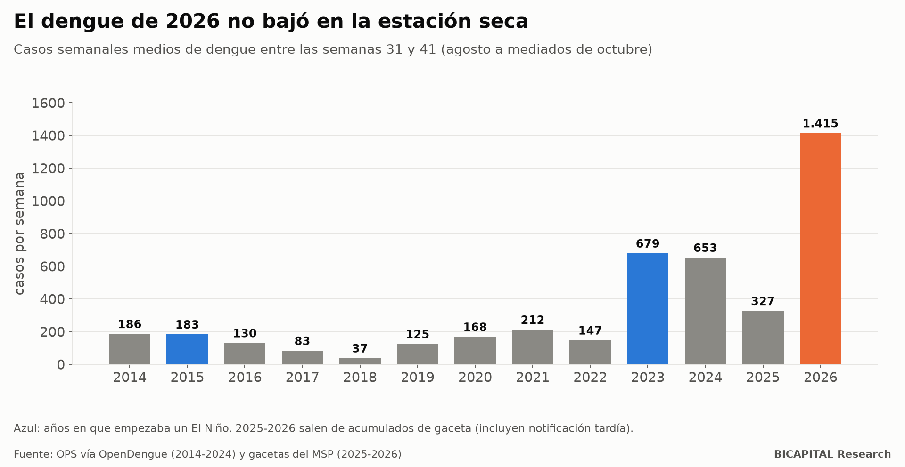

# El Niño 2026-27 en Ecuador: lo que dicen los datos antes de las lluvias

*Informe de datos con 17 bases públicas: el mar frente a Ecuador ya está más caliente que en 1997-98, y lo peor suele
llegar entre enero y abril.*

Este informe no es un pronóstico. Reúne en un solo lugar los datos públicos que hay sobre El Niño en Ecuador (océano,
lluvia, daños, cultivos, salud y precios) y compara el evento actual con los anteriores. Los datos, con la fuente de
cada fila, están abiertos para que cualquiera los revise o los use (enlace al final).

## Resumen

1. **Frente a la costa de Ecuador, el mar ya está más caliente que en 1997-98.** La región Niño 1+2 marcó **+5,25 °C**
   sobre lo normal en octubre de 2026, el valor mensual más alto desde que empieza la serie, en 1982. El máximo de
   1997-98 en esa misma serie fue +3,73 °C.
2. **El daño llega después del pico del mar.** En 1997-98 el océano tocó techo a fines de 1997, pero Guayaquil tuvo sus
   meses más lluviosos en marzo y abril de 1998. Entre septiembre y junio llovió **4,1 veces** lo normal.
3. **1997-98 costó 2.881,6 millones de dólares, el 14,6 % del PIB.** El 41,2 % del daño fue agrícola y el 27,6 %,
   transporte.
4. **Banano, café y cacao son los primeros en caer:** −39,7 % en 1983 y −15,8 % en 1998.
5. **El dengue de 2026 no bajó en la estación seca:** 1.415 casos por semana entre agosto y mediados de octubre, el
   doble que en 2023 y más de seis veces lo más alto de 2014-2022 en esas semanas.
6. **Hay riesgos que no existían en 1997-98:** el hongo Fusarium R4T del banano, confirmado en El Oro en diciembre de
   2025, se dispersa con el agua estancada.

## 1. El mar: el índice que importa para Ecuador

Las noticias suelen citar el índice del Pacífico central (Niño 3.4, con el que se calculan el ONI y el RONI). Para la
costa ecuatoriana pesa más otro: **Niño 1+2**, el mar justo frente a Ecuador y Perú.

| Evento | Máximo mensual de Niño 1+2 (OISST) | Mes |
|---|---:|---|
| 1982-83 | +4,03 °C | junio de 1983 |
| 1997-98 | +3,73 °C | noviembre y diciembre de 1997 |
| 2015-16 | +2,48 °C | julio de 2015 |
| 2023-24 | +3,30 °C | agosto de 2023 |
| **2026-27** | **+5,25 °C** (hasta ahora) | **octubre de 2026** |

Tres matices honestos:

- **La serie OISST empieza en 1982.** En otra serie más larga (ERSST v5), el máximo de 1997-98 fue +4,47 °C. Esa serie
  todavía no tiene publicados los meses de julio a octubre de 2026.
- **El índice central también es de los más altos:** ONI de +2,46 °C en agosto-octubre de 2026. Con el RONI, el índice
  oficial de la NOAA desde 2026, el valor es +2,0 °C. La NOAA daba un **83 %** de probabilidad de un evento «histórico»
  (RONI de +2,5 °C o más) en octubre-diciembre.
- **2015-16 muestra por qué importa la región.** Tuvo el ONI clásico más alto del registro (+2,59 °C), pero Niño 1+2 no pasó de
  +2,48 °C, y la costa no vivió nada parecido a 1997-98.

## 2. El calendario: primero el mar, después la lluvia

En el aeropuerto de Guayaquil, entre septiembre de 1997 y junio de 1998 cayeron **4.933 mm**, frente a unos 1.200 mm
normales en esos meses: **4,1 veces**. Los meses más lluviosos fueron marzo (911 mm) y abril (1.138 mm), cuatro meses
después del máximo del océano.

Lo mismo pasó en el resto de la costa con datos para ese año (lluvia de septiembre a junio frente a su normal):

| Estación | 1997-98 | Veces lo normal |
|---|---:|---:|
| Guayaquil | 4.933 mm | 4,1 |
| Portoviejo | 2.234 mm | 4,1 |
| Machala | 2.679 mm | 3,7 |
| Milagro | 5.396 mm | 3,7 |
| Esmeraldas | 2.819 mm | 3,5 |
| Babahoyo | 6.036 mm | 2,6 |

**Lo que ya está pasando en 2026.** Según el comité ecuatoriano ERFEN:

- Guayaquil tuvo el septiembre más lluvioso desde 1961.
- Guayaquil, Milagro, Portoviejo y La Maná tuvieron su octubre más lluvioso del registro. Milagro acumuló 195,9 mm hasta
  el 20 de octubre, frente a 4,2 mm de un octubre normal.

**Lo que viene, según la NOAA** (RONI, mediana del pronóstico oficial de octubre):

| Trimestre | Mediana | Rango del 5 % al 95 % |
|---|---:|---|
| Oct-dic 2026 | 2,74 | 2,25 a 3,23 |
| Nov 2026-ene 2027 | 2,65 | 2,00 a 3,31 |
| Dic-feb | 2,36 | 1,58 a 3,14 |
| Ene-mar 2027 | 1,90 | 1,13 a 2,67 |
| Feb-abr | 1,33 | 0,66 a 2,00 |

El océano se enfriaría desde febrero, pero si se repite 1997-98, **las lluvias más fuertes de la costa caerían entre
enero y abril de 2027**. El INAMHI no ha publicado un pronóstico cuantitativo de lluvia para esos meses; solo anticipa
lluvias sobre lo normal en el Litoral.

## 3. Lo que costó la última vez

Según la evaluación de la CEPAL de 1998 (resumida por la CAF en 2000):

- **Daño total:** 2.881,6 millones de dólares, el **14,6 % del PIB**. Otra copia del mismo estudio da el 17 %.
- **Muertes:** entre 286 y 292, según la fuente.
- **Reparto:**
  - agricultura, el 41,2 %;
  - transporte (casi todo carreteras), el 27,6 %;
  - prevención y emergencia, el 11,5 %;
  - industria, comercio y turismo, el 9,4 %;
  - vivienda, el 5,3 %.

En 1982-83 la CEPAL valoró el daño en 640,6 millones de dólares de 1983; la CAF lo reexpresó en 1.051 millones de
dólares de 1998. Para 2015-16, 2017 y 2023-24 **no existe una evaluación en dólares**, solo conteos de personas,
viviendas y hectáreas.

## 4. Qué sectores caen

| Año del impacto | Banano, café y cacao | Otros cultivos | Pesca y acuicultura | PIB |
|---|---:|---:|---:|---:|
| 1983 | −39,7 % | −21,8 % | −0,7 % | +0,7 % |
| 1998 | −15,8 % | −4,9 % | +5,9 % | +3,4 % |
| 2016 | +1,8 % | 0,0 % | +7,1 % | −0,7 % |
| 2024 | +2,3 % | −0,6 % | −1,0 % | −1,9 % |

- **Los dos El Niño extremos hundieron los cultivos de exportación.** Los moderados, no.
- **No todo es pérdida.** En 1997-98, el agua cálida aumentó la larva silvestre de camarón, y la producción y las
  exportaciones de camarón subieron un 26 % (BID, 1999).
- **El PIB total confunde más de lo que aclara.** 1999 cayó por la crisis bancaria, 2016 tuvo el terremoto y 2024 la
  crisis eléctrica. Con tan pocos casos, la tabla describe lo que pasó; no prueba qué lo causó.
- **Un riesgo nuevo:** el Fusarium R4T, un hongo que mata el banano Cavendish, se confirmó en Santa Rosa (El Oro) el 18 de
  diciembre de 2025, con un segundo caso en julio de 2026. En octubre se desbordó el estero Medina e inundó unas 1.000 ha
  de banano, incluidos predios en cuarentena (prensa). No se han confirmado nuevos focos.

## 5. Salud: el dengue no esperó a la lluvia

El dengue en la costa sube con la lluvia, normalmente de febrero a mayo. Entre agosto y mediados de octubre (semanas
epidemiológicas 31 a 41) suele estar bajo: entre 37 y 212 casos por semana en 2014-2022.

- **En 2026 fueron 1.415 casos por semana en esas semanas.** Es el doble que en 2023 (679), el otro año en que empezaba
  un El Niño fuerte.
- **Hasta la semana 41 de 2026 se registraron 41.647 casos**, más que en todo 2025 (37.840). El récord es 2024, con
  61.329 casos.
- **Lo que dice la literatura:** el dengue sube de 1 a 2 meses después de una anomalía de lluvia. En Machala, cada +1 °C
  del índice del Pacífico central se asoció a un 27-28 % más de casos tres meses después (Stewart-Ibarra y Lowe, 2013).

**Lo que pasó en 1998 con otras enfermedades** (OPS/MSP):

| Enfermedad | 1997 | 1998 |
|---|---:|---:|
| Malaria | 16.530 casos | 42.987 casos |
| Cólera | 65 casos | 3.738 casos |
| Leptospirosis | 36 casos en los 15 años anteriores | 338 casos y 19 muertes, de enero a septiembre de 1998 |

Este informe **no estima muertes**. Los rangos de mortalidad de un modelo pueden alarmar sin ayudar, y no son cifras
oficiales.

## 6. Precios: la comida sube más que el resto

- **1997-98 no sirve como referencia de precios.** Ecuador no estaba dolarizado y la inflación pasaba del 30 % por otras
  razones.
- **En los El Niño de la dolarización los alimentos subieron más que el índice general:**
  - en agosto de 2023, los alimentos subían un 8,2 % anual con la inflación general en el 2,6 %;
  - en julio de 2015, un 5,1 % frente al 4,4 %.
- **Septiembre de 2026:** los alimentos subieron un 1,14 % en el mes, tras dos meses de bajadas. Las mayores subidas del
  mes, según el INEC:
  - brócoli, +18,5 %;
  - arveja tierna, +16,2 %;
  - tomate riñón, +14,2 %;
  - huevos, +5,1 %;
  - papa, +4,6 %.
- **Un mes no hace una tendencia.** Desde julio de 2026 el INEC cambió la canasta y la base del IPC, y no publicará
  variaciones anuales por división hasta julio de 2027.

## 7. Qué vigilar en los próximos meses

1. **El informe mensual del ERFEN** (INOCAR) y la discusión de la NOAA, la próxima el 12 de noviembre: si Niño 1+2
   sigue por encima de +4 °C en diciembre, el paralelo con 1997-98 se refuerza.
2. **La lluvia de diciembre y enero en Guayaquil, Portoviejo y Machala** frente a su normal.
3. **Las gacetas semanales de dengue del MSP:** si el número de casos semanales sube con las lluvias desde un punto de
   partida ya alto.
4. **Los precios mayoristas del MAG** (arroz, papa, tomate, cebolla) y las exportaciones de banano del BCE.
5. **Los partes de Agrocalidad sobre Fusarium R4T** en El Oro.

## 8. Límites

- **Pocos casos.** Solo hay dos El Niño extremos con datos (1982-83 y 1997-98), en un país distinto: sin dólar, con otra
  economía y menos población urbana.
- **Las normales de lluvia son calculadas,** no las oficiales del INAMHI. Para 2015-16 y 2023-24 no hay series de lluvia
  completas y oficiales en línea.
- **Las cifras de dengue se revisan.** El MSP corrige sus totales, y los datos de 2025-2026 salen de los acumulados de
  sus gacetas, que incluyen notificaciones tardías.
- **Faltan datos:** pronóstico cuantitativo de lluvia, daños en dólares de los eventos recientes, precios por producto
  en 1997-98 y empleo de junio a septiembre de 2026.

## Los datos

Todo está en la carpeta pública **`datasets/el-nino-ecuador-2026`** del repositorio
https://github.com/test201807/bicapital-research, junto con el código que genera las figuras:

- **17 tablas en CSV**, cada fila con su fuente y una nota: índices del océano desde 1950, eventos y daños, lluvia,
  dengue semanal y anual, otras enfermedades, plagas, IPC, canasta, precios, PIB por sector, empleo y exportaciones.
- **Fuentes:** NOAA, INOCAR/ERFEN, INAMHI, CEPAL, CAF, OPS, MSP, INEC, BCE, MAG, Agrocalidad, Banco Mundial y FMI.
- **Corte de datos:** 25 de octubre de 2026, con los valores de la NOAA de octubre añadidos el 5 de noviembre.

Lo actualizaré cuando haya datos de las lluvias.

*Héctor Sandoval · BICAPITAL Research*

---

*Informe de datos con fines educativos e informativos. No es un pronóstico oficial. No es asesoría de inversión. Para alertas
y decisiones de seguridad, sigue a la Secretaría de Gestión de Riesgos, el INAMHI y el INOCAR.*
