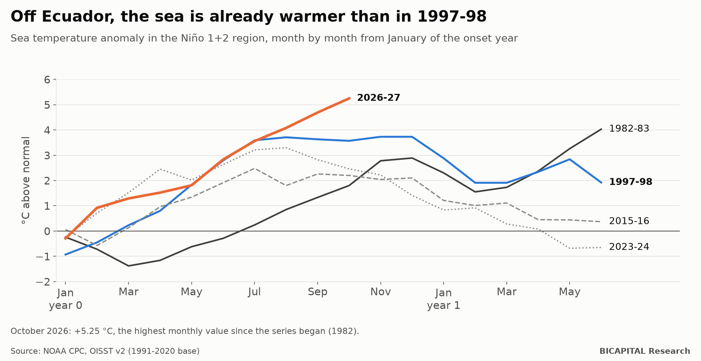
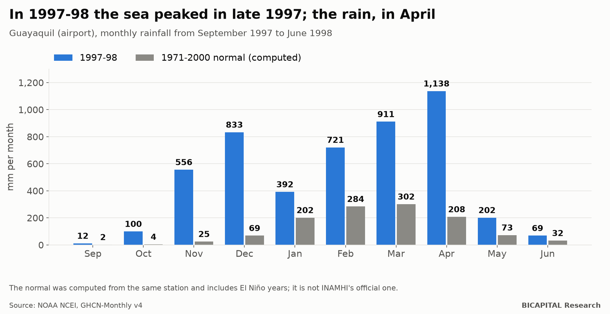
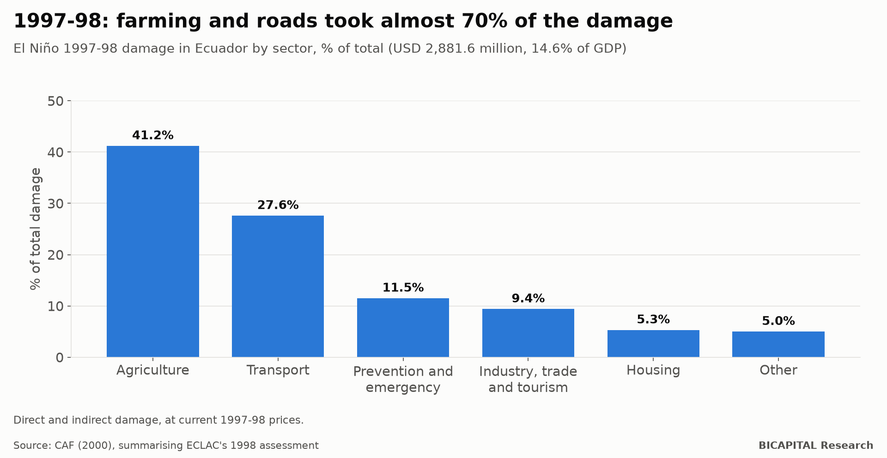
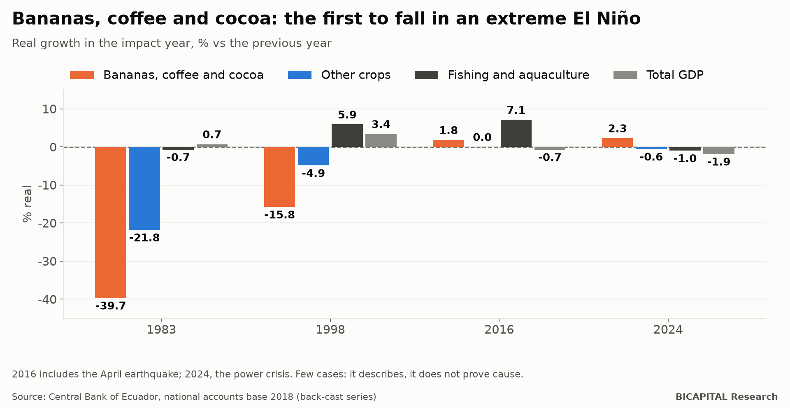
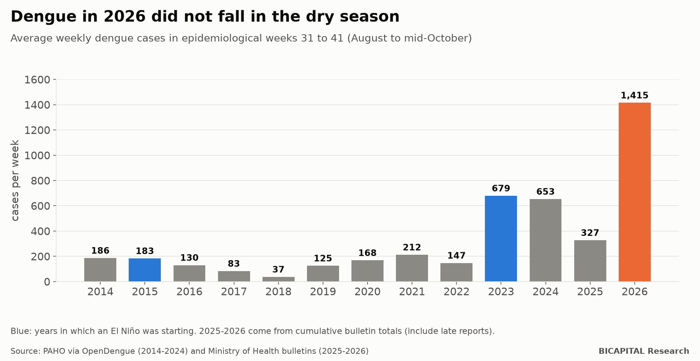

# El Niño 2026-27 in Ecuador: what the data say before the rains

*A data report built on 17 public datasets: the sea off Ecuador is already warmer than in 1997-98, and the worst usually
comes between January and April.*

This report is not a forecast. It brings together the public data on El Niño in Ecuador (ocean, rainfall, damage, crops,
health and prices) and compares the current event with earlier ones. The data, with the source of every row, are open for
anyone to check or reuse (link at the end).

## Summary

1. **Off Ecuador's coast, the sea is already warmer than in 1997-98.** The Niño 1+2 region reached **+5.25 °C** above
   normal in October 2026, the highest monthly value since the series began in 1982. The 1997-98 peak in the same series
   was +3.73 °C.
2. **The damage comes after the ocean peak.** In 1997-98 the ocean peaked in late 1997, but Guayaquil's wettest months
   were March and April 1998. From September to June it rained **4.1 times** the normal amount.
3. **1997-98 cost USD 2,881.6 million, 14.6% of GDP.** Agriculture took 41.2% of the damage and transport 27.6%.
4. **Bananas, coffee and cocoa fall first:** −39.7% in 1983 and −15.8% in 1998.
5. **Dengue in 2026 did not fall in the dry season:** 1,415 cases a week between August and mid-October, twice 2023 and
   more than six times the highest 2014-2022 level for those weeks.
6. **There are risks that did not exist in 1997-98:** the Fusarium R4T banana fungus, confirmed in El Oro in December 2025,
   spreads with standing water.

## 1. The ocean: the index that matters for Ecuador

The news usually quotes the central Pacific index (Niño 3.4, used for the ONI and RONI). For Ecuador's coast another one
matters more: **Niño 1+2**, the sea right off Ecuador and Peru.

| Event | Monthly Niño 1+2 peak (OISST) | Month |
|---|---:|---|
| 1982-83 | +4.03 °C | June 1983 |
| 1997-98 | +3.73 °C | November and December 1997 |
| 2015-16 | +2.48 °C | July 2015 |
| 2023-24 | +3.30 °C | August 2023 |
| **2026-27** | **+5.25 °C** (so far) | **October 2026** |

Three honest caveats:

- **The OISST series starts in 1982.** In a longer series (ERSST v5) the 1997-98 peak was +4.47 °C. That series has not yet
  published July to October 2026.
- **The central index is also among the highest:** ONI of +2.46 °C in August-October 2026. On the RONI, NOAA's official
  index since 2026, it is +2.0 °C. NOAA gave an **83%** chance of a "historic" event (RONI of +2.5 °C or more) in
  October-December.
- **2015-16 shows why the region matters.** It had the highest classic ONI on record (+2.59 °C), but Niño 1+2 never
  exceeded +2.48 °C, and the coast saw nothing like 1997-98.

## 2. The timing: first the sea, then the rain

At Guayaquil airport, **4,933 mm** fell between September 1997 and June 1998, against a normal of about 1,200 mm for those
months: **4.1 times**. The wettest months were March (911 mm) and April (1,138 mm), four months after the ocean peak.

The same happened along the rest of the coast where data exist (September-June rainfall vs its normal):

| Station | 1997-98 | Times normal |
|---|---:|---:|
| Guayaquil | 4,933 mm | 4.1 |
| Portoviejo | 2,234 mm | 4.1 |
| Machala | 2,679 mm | 3.7 |
| Milagro | 5,396 mm | 3.7 |
| Esmeraldas | 2,819 mm | 3.5 |
| Babahoyo | 6,036 mm | 2.6 |

**What is already happening in 2026,** according to Ecuador's ERFEN committee:

- Guayaquil had its wettest September since 1961.
- Guayaquil, Milagro, Portoviejo and La Maná had their wettest October on record. Milagro received 195.9 mm by 20 October,
  against 4.2 mm in a normal October.

**What comes next, according to NOAA** (RONI, median of the official October outlook):

| Season | Median | 5% to 95% range |
|---|---:|---|
| Oct-Dec 2026 | 2.74 | 2.25 to 3.23 |
| Nov 2026-Jan 2027 | 2.65 | 2.00 to 3.31 |
| Dec-Feb | 2.36 | 1.58 to 3.14 |
| Jan-Mar 2027 | 1.90 | 1.13 to 2.67 |
| Feb-Apr | 1.33 | 0.66 to 2.00 |

The ocean would cool from February, but if 1997-98 repeats, **the coast's heaviest rain would fall between January and April
2027**. INAMHI, Ecuador's weather service, has not published a quantitative rainfall forecast for those months; it only
expects above-normal rain on the coast.

## 3. What it cost last time

According to ECLAC's 1998 assessment (summarised by CAF in 2000):

- **Total damage:** USD 2,881.6 million, **14.6% of GDP**. Another copy of the same study gives 17%.
- **Deaths:** between 286 and 292, depending on the source.
- **Breakdown:**
  - agriculture, 41.2%;
  - transport (almost all roads), 27.6%;
  - prevention and emergency, 11.5%;
  - industry, trade and tourism, 9.4%;
  - housing, 5.3%.

For 1982-83, ECLAC valued the damage at USD 640.6 million of 1983; CAF restated it as USD 1,051 million of 1998. For
2015-16, 2017 and 2023-24 **there is no damage assessment in dollars**, only counts of people, homes and hectares.

## 4. Which sectors fall

| Impact year | Bananas, coffee, cocoa | Other crops | Fishing and aquaculture | GDP |
|---|---:|---:|---:|---:|
| 1983 | −39.7% | −21.8% | −0.7% | +0.7% |
| 1998 | −15.8% | −4.9% | +5.9% | +3.4% |
| 2016 | +1.8% | 0.0% | +7.1% | −0.7% |
| 2024 | +2.3% | −0.6% | −1.0% | −1.9% |

- **The two extreme El Niños sank export crops.** The moderate ones did not.
- **Not everything is loss.** In 1997-98 the warm water boosted wild shrimp larvae, and shrimp production and exports rose
  26% (IDB, 1999).
- **Total GDP confuses more than it explains.** 1999 fell because of the banking crisis, 2016 had the earthquake and 2024
  the power crisis. With so few cases, the table describes what happened; it does not prove what caused it.
- **A new risk:** Fusarium R4T, a fungus that kills Cavendish bananas, was confirmed in Santa Rosa (El Oro) on 18 December
  2025, with a second case in July 2026. In October the Medina estuary overflowed and flooded about 1,000 ha of bananas,
  including quarantined farms (press reports). No new outbreaks have been confirmed.

## 5. Health: dengue did not wait for the rain

On the coast, dengue rises with the rain, usually from February to May. Between August and mid-October (epidemiological
weeks 31 to 41) it is usually low: between 37 and 212 cases a week in 2014-2022.

- **In 2026 there were 1,415 cases a week in those weeks.** That is twice 2023 (679), the other year in which a strong El
  Niño was starting.
- **By week 41 of 2026 there were 41,647 cases**, more than in the whole of 2025 (37,840). The record is 2024, with 61,329.
- **What the literature says:** dengue rises 1 to 2 months after a rainfall anomaly. In Machala, each +1 °C of the central
  Pacific index was associated with 27-28% more cases three months later (Stewart-Ibarra and Lowe, 2013).

**What happened in 1998 with other diseases** (PAHO/Ministry of Health):

| Disease | 1997 | 1998 |
|---|---:|---:|
| Malaria | 16,530 cases | 42,987 cases |
| Cholera | 65 cases | 3,738 cases |
| Leptospirosis | 36 cases in the previous 15 years | 338 cases and 19 deaths, January to September 1998 |

This report **does not estimate deaths**. Mortality ranges from a model can alarm without helping, and they are not
official figures.

## 6. Prices: food rises more than everything else

- **1997-98 is no guide to prices.** Ecuador was not yet dollarised and inflation was above 30% for other reasons.
- **In the dollarised-era El Niños, food rose more than the overall index:**
  - in August 2023, food was rising 8.2% a year with overall inflation at 2.6%;
  - in July 2015, 5.1% against 4.4%.
- **September 2026:** food prices rose 1.14% in the month, after two months of declines. The largest increases of the
  month, according to INEC:
  - broccoli, +18.5%;
  - fresh peas, +16.2%;
  - tomatoes, +14.2%;
  - eggs, +5.1%;
  - potatoes, +4.6%.
- **One month is not a trend.** INEC changed the basket and the CPI base in July 2026, and will not publish annual changes
  by category until July 2027.

## 7. What to watch in the coming months

1. **ERFEN's monthly report** (INOCAR) and NOAA's discussion, the next on 12 November: if Niño 1+2 stays above +4 °C in
   December, the parallel with 1997-98 gets stronger.
2. **December and January rainfall in Guayaquil, Portoviejo and Machala** against normal.
3. **The Ministry of Health's weekly dengue bulletins:** whether weekly cases climb with the rains from an already high
   starting point.
4. **Wholesale prices from the Ministry of Agriculture** (rice, potatoes, tomatoes, onions) and banana exports from the
   Central Bank.
5. **Agrocalidad's reports on Fusarium R4T** in El Oro.

## 8. Limits

- **Few cases.** There are only two extreme El Niños with data (1982-83 and 1997-98), in a different country: no dollar, a
  different economy and a smaller urban population.
- **The rainfall normals are computed,** not INAMHI's official ones. For 2015-16 and 2023-24 there are no complete, official
  rainfall series online.
- **Dengue figures get revised.** The Ministry corrects its totals, and the 2025-2026 data come from the cumulative totals
  in its bulletins, which include late reports.
- **Missing data:** a quantitative rainfall forecast, dollar damage for recent events, product prices in 1997-98 and
  employment from June to September 2026.

## The data

Everything is in the public folder **`datasets/el-nino-ecuador-2026`** of the repository
https://github.com/test201807/bicapital-research, together with the code that draws the figures:

- **17 CSV tables**, each row with its source and a note: ocean indices since 1950, events and damage, rainfall, weekly and
  annual dengue, other diseases, pests, CPI, food basket, prices, GDP by sector, employment and exports.
- **Sources:** NOAA, INOCAR/ERFEN, INAMHI, ECLAC, CAF, PAHO, Ministry of Health, INEC, Central Bank of Ecuador, Ministry of
  Agriculture, Agrocalidad, World Bank and IMF.
- **Data cut-off:** 25 October 2026, with NOAA's October values added on 5 November.

I will update it when the rainfall data come in.

*Héctor Sandoval · BICAPITAL Research*

---

*Data report for educational and informational purposes. It is not an official forecast and not investment advice. For
alerts and safety decisions, follow Ecuador's Risk Management Secretariat, INAMHI and INOCAR.*
