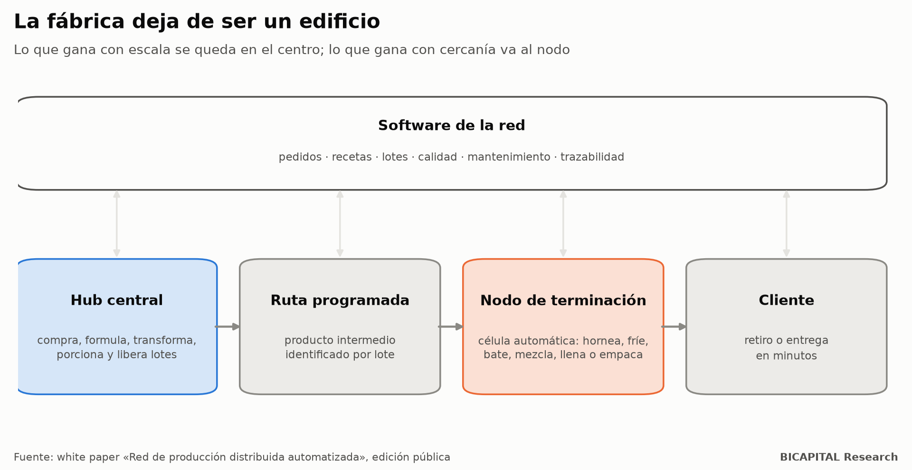
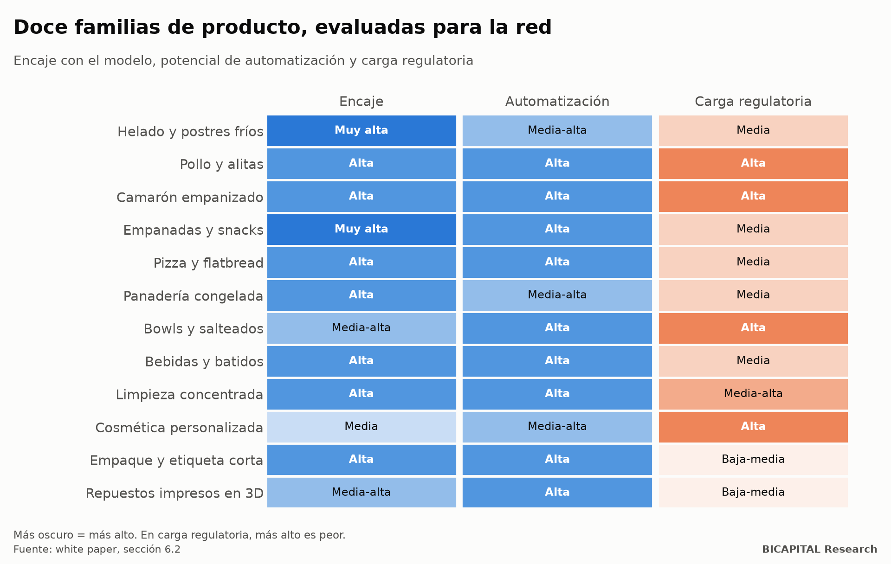
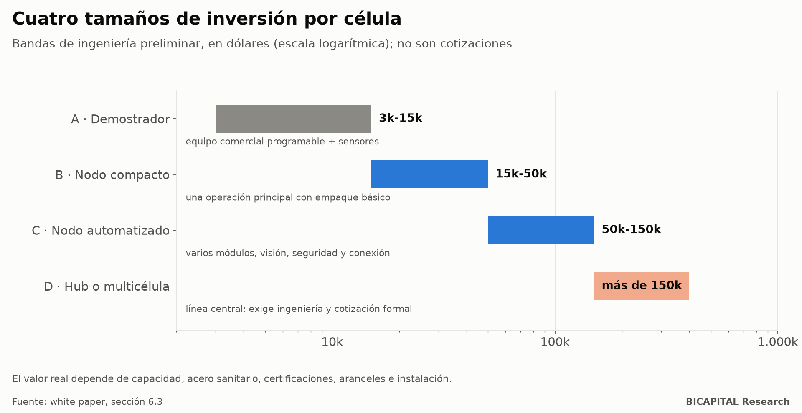
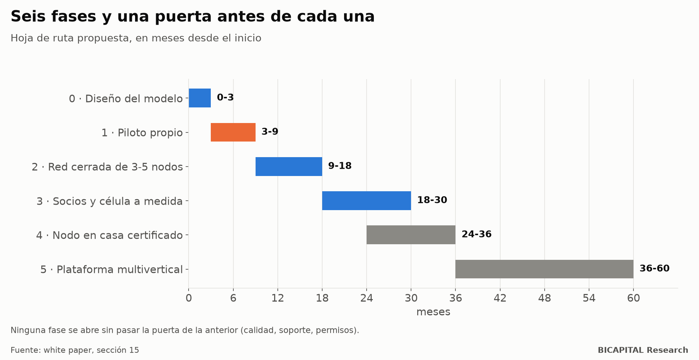

# La fábrica deja de ser un edificio: una red de producción distribuida para Ecuador

*La edición abierta de un white paper: un hub central fabrica el producto intermedio, células automáticas pequeñas lo
terminan cerca del cliente y un software gobierna la red.*

Publico la edición abierta de un white paper que escribí en julio, con doce casos, un mapa regulatorio y una hoja de
ruta con puertas. Este artículo resume el documento. La versión completa en PDF (17 secciones y 6 anexos) está abierta al final. No es un
plan financiero ni una oferta: es un modelo para discutir, con sus riesgos a la vista.

## La idea en un párrafo

Muchas cadenas centralizan parte del proceso porque repetir compras, formulación, preparación y control en cada punto
destruye eficiencia. Pero llevar el producto **totalmente terminado** también sale caro, es rígido o mata la frescura. La
propuesta mueve el punto de corte: **el hub fabrica un producto intermedio muy estandarizado y el nodo local hace solo la
última operación**, la que gana con estar cerca del cliente: hornear, freír, batir, mezclar, llenar o empacar.

El nodo deja de ser «una cocina completa» o «una fábrica pequeña». Es una estación cerrada:

1. recibe un lote identificado;
2. valida el insumo;
3. ejecuta una receta bloqueada;
4. registra las variables críticas;
5. empaca y despacha.

El operador pone presencia, atención de excepciones y entrega; la máquina y el software ponen la estandarización.

## Lo que el modelo no es

| No es | Porque |
|---|---|
| Una franquicia de comida convencional | Esa replica cocina, personal, compras y complejidad en cada local |
| Una dark kitchen | Quita el salón, pero mantiene cocina, personal y variabilidad |
| Una fábrica pequeña | Repite todas las etapas a menor escala |
| Una máquina de vending | Vende un producto ya terminado |
| Un proyecto de robots | Los robots son piezas reemplazables; el valor está en el sistema |

## Por qué ahora

- **La automatización es más accesible.** Según la Federación Internacional de Robótica, en 2024 se instalaron 542.000
  robots industriales en el mundo, 295.000 de ellos en China. Esa escala permite pasar de «diseñar maquinaria desde cero»
  a «especificar, integrar y homologar módulos».
- **Las categorías ya existen comercialmente:** robots de fritura, cocedores digitales, selladoras, visión artificial y
  cobots.
- **Lo escaso es la integración.** Hay cocinas centrales, franquicias, robots, máquinas de empaque y plataformas de
  delivery. Lo que falta es quien diseñe a la vez el intermedio, la célula, el software, el contrato, la logística, la
  certificación y el mantenimiento como **una sola plataforma replicable**.

## Doce familias de producto, evaluadas

El documento desarrolla doce casos. Para cada uno define el corte entre hub y nodo, la célula mínima, el formato de
local, las puertas antes de crecer y el modelo comercial:

- **Alimentos:** helado y postres fríos, pollo y alitas, camarón empanizado, empanadas y snacks congelados, pizza,
  panadería congelada, bowls, y batidos y bebidas.
- **No alimentarios:** limpieza a partir de concentrados, cosmética personalizada, empaque y etiqueta de tirada corta, y
  repuestos impresos en 3D.

Las mejor situadas combinan un intermedio congelado estable con una terminación simple: empanadas y snacks, helado,
bebidas. Las más delicadas cargan proteína cruda, aceite, alérgenos o una regulación exigente: pollo, camarón, cosmética.

## Cuánto cuesta una célula

| Banda | Orden de magnitud | Qué es |
|---|---|---|
| A · Demostrador | USD 3.000-15.000 | Equipo comercial programable con sensores |
| B · Nodo compacto | USD 15.000-50.000 | Una operación principal con empaque básico |
| C · Nodo automatizado | USD 50.000-150.000 | Varios módulos, visión, seguridad y conexión |
| D · Hub o multicélula | más de USD 150.000 | Línea central; exige ingeniería y cotización formal |

Son bandas para ordenar el portafolio, **no cotizaciones**. El valor real depende de la capacidad, el acero sanitario,
las certificaciones, los aranceles y la instalación.

## La regulación, desde el diseño

La pregunta no es «¿cómo evitar permisos?», sino «¿cómo crear una categoría de nodo que pueda cumplir de forma
repetible?». El documento mapea qué toca a cada institución:

| Institución | Qué toca |
|---|---|
| ARCSA | Permiso de funcionamiento, BPM, notificación sanitaria y transporte de alimentos |
| Municipio | Uso de suelo y licencia de actividad (en Quito, la LUAE) |
| SRI | RUC y relación tributaria entre la central y el operador |
| SENAE e INEN | Clasificación arancelaria de las células y reglamentos técnicos de los equipos |
| Bomberos | Carga de fuego, gas y extracción |
| Ministerio del Trabajo | Si el operador es independiente, franquiciado o trabajador |

El nodo **en casa** es el de menor inversión, pero no debe ser el primero. Solo tiene sentido como una categoría
certificada: área separada de la vida doméstica, acceso controlado, agua, drenaje y ventilación, telemetría y auditoría.
La informalidad destruiría la marca, la trazabilidad y la posibilidad de crecer.

## Seis fases, con una puerta antes de cada una

| Fase | Meses | Puerta para pasar a la siguiente |
|---|---|---|
| 0 · Diseño del modelo | 0-3 | Producto piloto, intermedio especificado y ruta regulatoria preliminar |
| 1 · Piloto propio | 3-9 | Producto conforme, operación repetible, trazabilidad completa y cero dudas críticas de permisos |
| 2 · Red cerrada de 3-5 nodos | 9-18 | El soporte por nodo baja y la calidad entre nodos está dentro de especificación |
| 3 · Socios y célula a medida | 18-30 | El socio opera sin presencia diaria del fundador |
| 4 · Nodo en casa certificado | 24-36 | Cumple y cuesta lo mismo o menos de soportar que un microlocal |
| 5 · Plataforma multivertical | 36-60 | Se reutilizan software, contratos y mantenimiento en otra familia |

La regla que más importa: **no vender franquicias porque el prototipo funciona.** Se escala solo cuando operación,
limpieza, calidad, demanda, logística, mantenimiento, software y regulación aguantan a la vez, con una carga de soporte
por nodo que baja.

## Riesgos

El documento lista doce riesgos y su control, y es honesto con los más serios:

- **Sanitario y regulatorio**, sobre todo en casas.
- **Utilización baja:** una célula barata no compensa una máquina ociosa.
- **Dependencia del fabricante:** repuestos, firmware o soporte lentos.
- **Sobreautomatizar:** se automatiza solo lo que ya está estable.
- **Errores que se propagan:** un error central contagia toda la red.

## Evaluación fría

- **Necesidad y tecnología:** favorables.
- **Riesgo de demanda:** alto, porque cada nodo necesita densidad.
- **Riesgo regulatorio:** alto en casas.
- **Conclusión:** la idea justifica **un piloto profesional, no una expansión inmediata**.

## El documento completo

La edición pública (PDF, licencia CC BY 4.0) está en
https://github.com/test201807/bicapital-research/tree/master/whitepapers/produccion-distribuida-ecuador. Incluye:

- los doce casos completos;
- la arquitectura del software y los agentes de inteligencia artificial, con sus límites;
- el modelo contractual por capas;
- la matriz de expediente por tipo de nodo;
- una lista de selección de producto, una plantilla de solicitud de cotización para la célula y una lista de auditoría
  del nodo;
- las 31 fuentes, con su nivel de evidencia.

Si trabajas en alimentos, automatización, franquicias o regulación en Ecuador y ves un error o una oportunidad,
escríbeme: es un documento vivo.

*Héctor Sandoval · BICAPITAL Research*

---

*Documento de discusión con fines educativos. No es asesoría de inversión, ni legal ni regulatoria. Las bandas
de inversión son preliminares y las referencias regulatorias se revisaron en julio de 2026: verifícalas antes de
cualquier implementación.*
