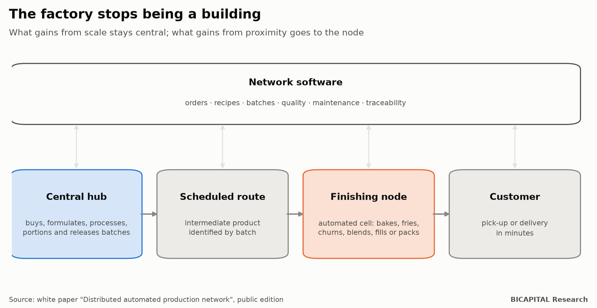
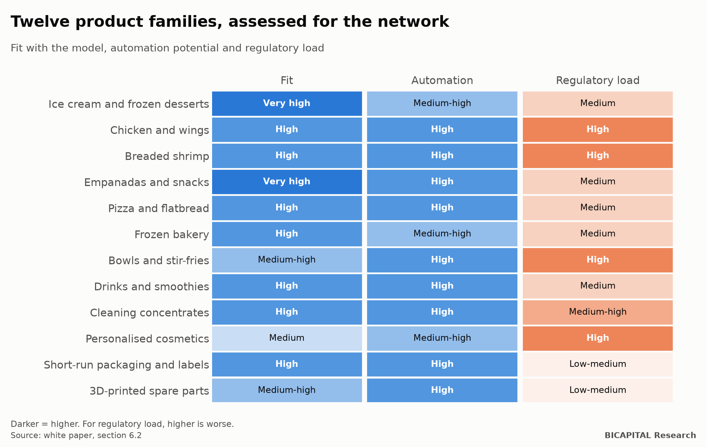
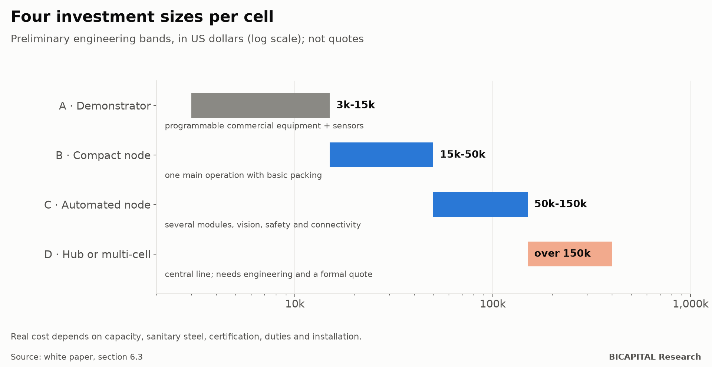
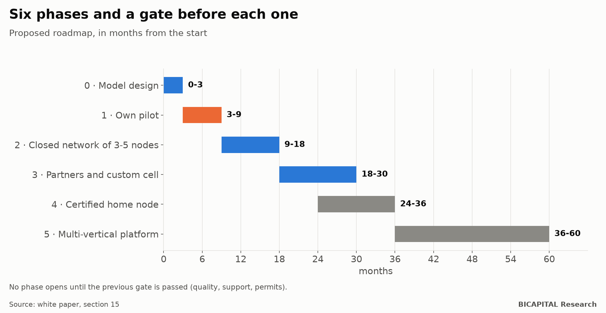

# The factory stops being a building: a distributed production network for Ecuador

*I am publishing the open edition of a white paper I wrote in July: a central hub that makes the intermediate product,
small automated cells that finish it near the customer, and software that runs the network. Twelve cases, a regulatory
map and a roadmap with gates.*

This article summarises the document. The full version (a PDF in Spanish, with 17 sections and 6 annexes) is linked at the
end. It is not a financial plan or an offer: it is a model for discussion, with its risks in plain sight.

## The idea in one paragraph

Many chains centralise part of the process because repeating purchasing, formulation, preparation and control at every
outlet destroys efficiency. But shipping the **fully finished** product is also expensive, rigid or bad for freshness.
The proposal moves the cut-off point: **the hub makes a highly standardised intermediate product and the local node does
only the last operation**, the one that gains from being close to the customer: baking, frying, churning, blending,
filling or packing.

The node stops being "a full kitchen" or "a small factory". It is a closed station:

1. it receives an identified batch;
2. it validates the input;
3. it runs a locked recipe;
4. it records the critical variables;
5. it packs and dispatches.

The operator provides presence, exception handling and delivery; the machine and the software provide the
standardisation.

## What the model is not

| It is not | Because |
|---|---|
| A conventional food franchise | That replicates kitchen, staff, purchasing and complexity in every outlet |
| A dark kitchen | It removes the dining room but keeps the kitchen, staff and variability |
| A small factory | It repeats every stage at a smaller scale |
| A vending machine | It sells an already finished product |
| A robotics project | Robots are replaceable parts; the value is in the system |

## Why now

- **Automation is more accessible.** According to the International Federation of Robotics, 542,000 industrial robots
  were installed worldwide in 2024, 295,000 of them in China. That scale makes it possible to move from "designing
  machinery from scratch" to "specifying, integrating and qualifying modules".
- **The categories already exist commercially:** frying robots, digital cookers, sealers, machine vision and cobots.
- **What is scarce is integration.** There are central kitchens, franchises, robots, packing machines and delivery
  platforms. What is missing is someone who designs the intermediate, the cell, the software, the contract, the
  logistics, the certification and the maintenance together, as **one replicable platform**.

## Twelve product families, assessed

The document develops twelve cases. For each one it defines the hub-node split, the minimum cell, the site format, the
gates before scaling and the business model:

- **Food:** ice cream and frozen desserts, chicken and wings, breaded shrimp, frozen empanadas and snacks, pizza, frozen
  bakery, bowls, and smoothies and drinks.
- **Non-food:** cleaning products from concentrates, personalised cosmetics, short-run packaging and labels, and
  3D-printed spare parts.

The best placed ones combine a stable frozen intermediate with a simple finish: empanadas and snacks, ice cream,
drinks. The most delicate carry raw protein, oil, allergens or demanding regulation: chicken, shrimp, cosmetics.

## What a cell costs

| Band | Order of magnitude | What it is |
|---|---|---|
| A · Demonstrator | USD 3,000-15,000 | Programmable commercial equipment with sensors |
| B · Compact node | USD 15,000-50,000 | One main operation with basic packing |
| C · Automated node | USD 50,000-150,000 | Several modules, vision, safety and connectivity |
| D · Hub or multi-cell | over USD 150,000 | Central line; needs engineering and a formal quote |

These are bands to organise the portfolio, **not quotes**. The real cost depends on capacity, sanitary steel,
certification, import duties and installation.

## Regulation, by design

The question is not "how do we avoid permits?" but "how do we create a node category that can comply repeatably?". The
document maps what each institution covers:

| Institution | What it covers |
|---|---|
| ARCSA (health regulator) | Operating permit, good manufacturing practice, food registration and transport |
| Municipality | Land use and business licence (in Quito, the LUAE) |
| SRI (tax authority) | Taxpayer ID and the tax relationship between the centre and the operator |
| SENAE and INEN (customs and standards) | Tariff classification of the cells and technical regulations for the equipment |
| Fire service | Fire load, gas and extraction |
| Labour ministry | Whether the operator is independent, a franchisee or an employee |

The **home** node needs the least investment, but it should not come first. It only makes sense as a certified category:
an area separated from domestic life, controlled access, water, drainage and ventilation, telemetry and audits. Operating
informally would destroy the brand, the traceability and any chance of scaling.

## Six phases, with a gate before each one

| Phase | Months | Gate to move to the next |
|---|---|---|
| 0 · Model design | 0-3 | Pilot product, specified intermediate and preliminary regulatory route |
| 1 · Own pilot | 3-9 | Conforming product, repeatable operation, full traceability and no critical permit doubts |
| 2 · Closed network of 3-5 nodes | 9-18 | Support per node falls and quality across nodes is within specification |
| 3 · Partners and custom cell | 18-30 | The partner operates without the founder present every day |
| 4 · Certified home node | 24-36 | It complies and costs the same or less to support than a micro-site |
| 5 · Multi-vertical platform | 36-60 | Software, contracts and maintenance are reused in another family |

The rule that matters most: **do not sell franchises because the prototype works.** Scale only when operation, cleaning,
quality, demand, logistics, maintenance, software and regulation all hold at once, with support per node going down.

## Risks

The document lists twelve risks and their controls, and is candid about the most serious:

- **Sanitary and regulatory risk**, especially in homes.
- **Low utilisation:** a cheap cell does not make up for an idle machine.
- **Supplier dependence:** slow spare parts, firmware or support.
- **Over-automation:** only automate what is already stable.
- **Errors that spread:** a central error contaminates the whole network.

## A cold assessment

- **Need and technology:** favourable.
- **Demand risk:** high, because every node needs density.
- **Regulatory risk:** high for homes.
- **Conclusion:** the idea justifies **a professional pilot, not immediate expansion**.

## The full document

The public edition (a PDF in Spanish, CC BY 4.0 licence) is at
https://github.com/test201807/bicapital-research/tree/master/whitepapers/produccion-distribuida-ecuador. It includes:

- the twelve full cases;
- the software architecture and the AI agents, with their limits;
- the layered contract model;
- the permit file required for each node type;
- a product-selection checklist, a request-for-quotation template for the cell and a node audit checklist;
- the 31 sources, with their level of evidence.

If you work in food, automation, franchising or regulation in Ecuador and you see a mistake or an opportunity, write to
me: this is a living document.

*Héctor Sandoval · BICAPITAL Research*

---

*Discussion paper for educational purposes. Not investment advice, and not legal or regulatory advice. The investment
bands are preliminary, and the regulatory references were checked in July 2026: verify them before any implementation.*
