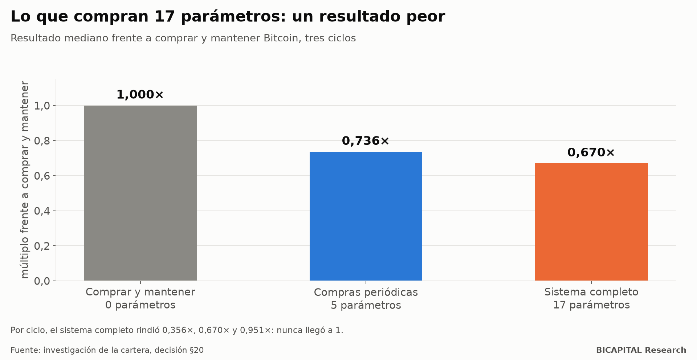

# Mi sistema de 17 parámetros no batió a comprar y mantener Bitcoin

Antes de invertir dinero real en criptomonedas, pasé meses diseñando un sistema para gestionar Bitcoin «de forma activa».
Tenía de todo: una compuerta de entrada con indicadores on-chain, compras escalonadas, una regla de riesgo y un plan de
salida por tramos. **Diecisiete parámetros y dos fuentes de datos.**

Lo comparé con la alternativa más tonta posible: comprar Bitcoin y no tocarlo. **Perdió en los tres ciclos que pude
probar.**

Este artículo cuenta por qué, y por qué es la pieza que más credibilidad me da como gestor: porque la publiqué contra mí.

## Simple frente a complejo

| Arquitectura | Parámetros libres | Fuentes de datos | Resultado frente a comprar y mantener (mediana) |
|---|---:|---:|---:|
| Comprar y mantener | 0 | 1 | 1,000× |
| Compras periódicas (DCA) | 5 | 1 | 0,736× |
| Compuerta + DCA + regla de riesgo + salida por tramos | **17** | **2** | **0,670×** |

Por ciclo, el sistema completo rindió **0,356×, 0,670× y 0,951×** lo que comprar y mantener. Nunca llegó a 1. Diecisiete
parámetros y una segunda fuente de datos compraron un resultado peor, y además dos maneras nuevas de fallar: que el dato
on-chain se caiga, o que la compuerta no se abra nunca.

## Por qué perdió

1. **La compuerta de entrada no se abrió en 2 de 3 ciclos.** Sus dos condiciones eran casi incompatibles entre sí. No era
   mala suerte: era un defecto de diseño.
2. **La salida empezaba en el máximo… que solo se conoce después.** Y aun con esa ventaja imposible, la salida por tramos
   rindió menos que no vender, en los tres ciclos.
3. **Las compras escalonadas perdieron en los tres ciclos.** Entrar poco a poco te da un precio medio, no el suelo.
4. **La caja esperando se iba vaciando de oportunidad**, de forma constante.
5. **Los costes no explican nada.** Eran pequeños. Lo que fallaba era la idea.

## Lo que hace la historia todavía peor

Una versión anterior del sistema, con datos reales de dos ciclos, había multiplicado el capital **7,2 veces (2019-2021) y
3,6 veces (2022-2024)**. Suena espectacular. Pero frente a Bitcoin comprado y mantenido perdía por **620 y 105 puntos**.

Y luego descubrí algo peor: esos 7,2× estaban **inflados**. Las fechas de inicio se habían elegido sabiendo cómo terminaba
el ciclo, y la lista de monedas solo incluía las que habían sobrevivido. Ojo: la comparación de comprar y mantener también
tenía fechas elegidas a posteriori. **Ninguna de las dos cifras era limpia.** La lección no cambia: el sistema complejo no
justificó su complejidad.

## Entonces, ¿por qué no tengo solo Bitcoin?

Buena pregunta, y la contesto en mi diario de cartera. Mi cartera real es 40 % Bitcoin y 60 % altcoins, y eso es **una
apuesta de gestor** que mi propia investigación cuestiona. La publico con su riesgo y con el criterio que me haría
cambiarla. Lo que no hago es venderte la complejidad como si fuera ventaja.

## Qué significa para ti

1. **Cada parámetro tiene que pagar su alquiler.** Si no mejora frente a la alternativa simple, sobra.
2. **Compara siempre con no hacer nada.** Comprar y mantener es el rival más difícil de batir, y casi nadie lo pone en su
   gráfico.
3. **Desconfía de las fechas bonitas.** «Desde el suelo de 2019» o «desde marzo de 2020» casi siempre son fechas elegidas
   sabiendo el final.
4. **Publica lo que no funcionó.** Es la única forma de que te crean cuando algo sí funcione.

*Héctor Sandoval · BICAPITAL Research*

---

*Contenido educativo y de investigación. No es asesoría de inversión ni una recomendación personalizada. Los resultados de
backtest y simulación son hipotéticos y pasados; no garantizan resultados futuros. Las criptomonedas pueden hacer perder
todo el capital.*
