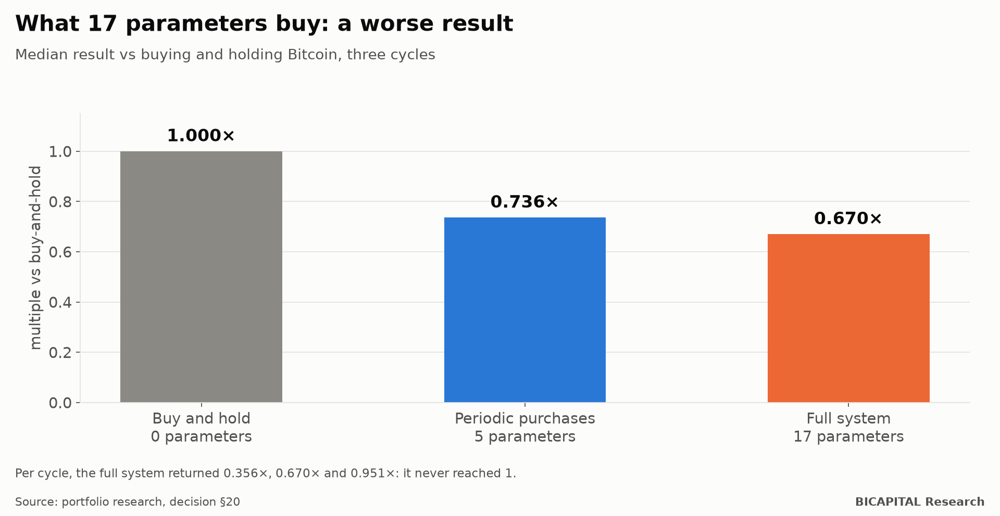

# My 17-parameter system did not beat buying and holding Bitcoin

Before putting real money into crypto, I spent months designing a system to manage Bitcoin "actively". It had
everything: an entry gate based on on-chain indicators, staggered purchases, a risk rule and a staged exit plan.
**Seventeen parameters and two data sources.**

I compared it with the dumbest possible alternative: buying Bitcoin and leaving it alone. **It lost in all three cycles I
could test.**

This article explains why, and why it is the piece that gives me the most credibility as a manager: because I published
it against myself.

## Simple vs complex

| Architecture | Free parameters | Data sources | Result vs buy-and-hold (median) |
|---|---:|---:|---:|
| Buy and hold | 0 | 1 | 1.000× |
| Periodic purchases (DCA) | 5 | 1 | 0.736× |
| Gate + DCA + risk rule + staged exit | **17** | **2** | **0.670×** |

Per cycle, the full system returned **0.356×, 0.670× and 0.951×** what buy-and-hold did. It never reached 1. Seventeen
parameters and a second data source bought a worse result, plus two new ways to fail: the on-chain feed going down, or
the gate never opening.

## Why it lost

1. **The entry gate did not open in 2 of 3 cycles.** Its two conditions were almost mutually exclusive. It was not bad
   luck: it was a design defect.
2. **The exit started at the peak… which is only known afterwards.** And even with that impossible advantage, the staged
   exit returned less than not selling, in all three cycles.
3. **Staggered buying lost in all three cycles.** Entering bit by bit gives you an average price, not the bottom.
4. **The waiting cash kept bleeding opportunity**, steadily.
5. **Costs explain nothing.** They were small. What failed was the idea.

## What makes the story even worse

An earlier version of the system, on real data from two cycles, had multiplied capital **7.2 times (2019-2021) and 3.6
times (2022-2024)**. It sounds spectacular. But against Bitcoin bought and held it lost by **620 and 105 points**.

And then I found something worse: those 7.2× were **inflated**. The start dates had been chosen knowing how the cycle
ended, and the coin list only included the ones that survived. Mind you: the buy-and-hold comparison also had dates
chosen after the fact. **Neither figure was clean.** The lesson does not change: the complex system did not justify its
complexity.

## So why don't I hold only Bitcoin?

Good question, and I answer it in my portfolio diary. My real portfolio is 40% Bitcoin and 60% altcoins, and that is **a
manager's bet** that my own research questions. I publish it with its risk and the criterion that would make me change
it. What I do not do is sell you complexity as if it were an edge.

## What this means for you

1. **Every parameter has to pay its rent.** If it does not improve on the simple alternative, it goes.
2. **Always compare with doing nothing.** Buy-and-hold is the hardest rival to beat, and almost nobody puts it on their
   chart.
3. **Distrust pretty dates.** "Since the 2019 bottom" or "since March 2020" are almost always dates chosen knowing the
   end.
4. **Publish what did not work.** It is the only way people will believe you when something does.

*Héctor Sandoval · BICAPITAL Research*

---

*Educational and research content. This is not investment advice or a personal recommendation. Backtest and simulation
results are hypothetical and past; they do not guarantee future results. Crypto assets can lose all of your capital.*
