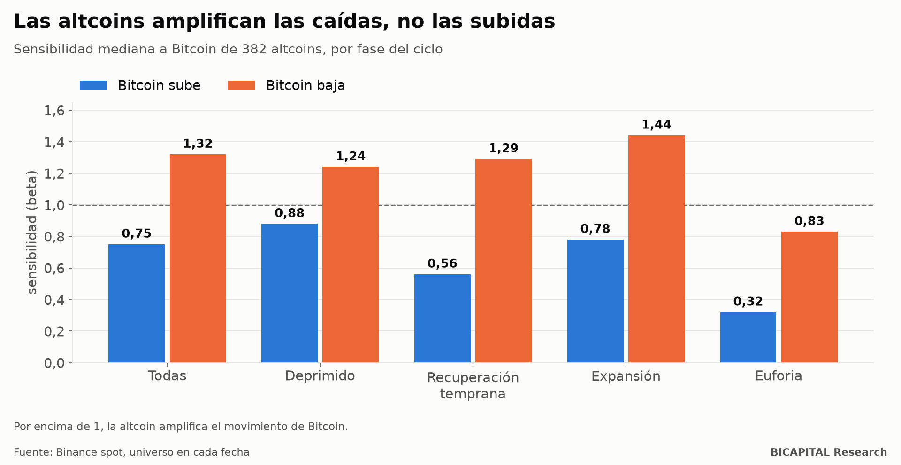
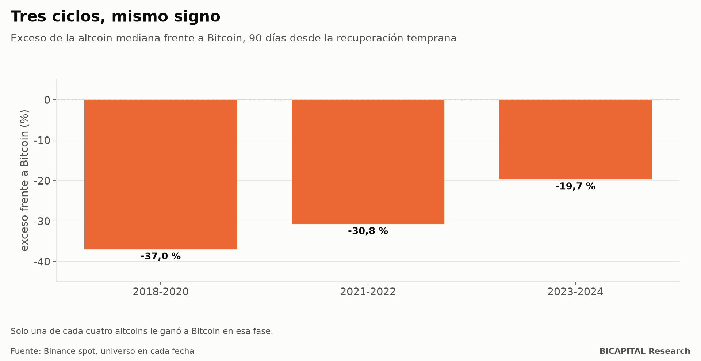

# El mito de la temporada de altcoins: amplifican las caídas, no las subidas

En cripto se repite una historia: primero sube Bitcoin y, cuando sale del suelo, las altcoins lo siguen multiplicando la
subida. Es la famosa «temporada de altcoins». Mi propia cartera se apoya en una versión de esa idea: el 60 % de cada compra
nueva va a altcoins.

Así que la puse a prueba con datos, intentando que me diera la razón. **No me la dio.** Con 382 altcoins de Binance,
incluidas las que ya dejaron de cotizar, la historia sale al revés:

- **En las caídas, las altcoins caen más que Bitcoin.** En las subidas, suben menos.
- **Justo después del suelo**, que es donde la historia promete el gran impulso, su sensibilidad a Bitcoin es de **1,29 a
  la baja y de 0,56 al alza**.
- A 90 días, la altcoin mediana **rinde un 23 % menos que Bitcoin** en esa fase. Y pasó lo mismo en los tres ciclos que
  pude medir.

## Cómo lo medí

- **Universo:** 382 altcoins con datos de Binance, tomadas tal como existían en cada fecha. Las que se deslistaron cuentan
  mientras cotizaron. Si solo miras las que siguen vivas hoy, el resultado mejora artificialmente (lo explico en el
  artículo sobre el sesgo de supervivencia).
- **Fases del ciclo:** cada día se clasifica según el estado de Bitcoin: deprimido, suelo, recuperación temprana,
  expansión y euforia.
- **Sensibilidad (beta):** cuánto se mueve una altcoin cuando Bitcoin se mueve un 1 %. La calculé por separado para los
  días en que Bitcoin sube y los días en que baja.

## Lo que salió

| Fase de Bitcoin | Sensibilidad al alza | Sensibilidad a la baja | Altcoins que amplifican la subida |
|---|---:|---:|---:|
| Todas las fases | 0,75 | 1,32 | 10 % |
| Deprimido | 0,88 | 1,24 | 33 % |
| **Recuperación temprana** | **0,56** | **1,29** | **8,5 %** |
| Expansión | 0,78 | 1,44 | 18 % |
| Euforia | 0,32 | 0,83 | 9 % |

Una sensibilidad mayor que 1 significa amplificar. **Las altcoins amplifican las caídas en todas las fases menos la
euforia, y amortiguan las subidas en todas.** En la fase que la historia señala como el momento de las altcoins, solo el
8,5 % amplifica la subida de Bitcoin.

**La correlación también sube cuando duele.** Con Bitcoin al alza, la correlación de las altcoins con él es de 0,30; a la
baja, de 0,45. Pasa en todas las fases medidas, sin excepción. La diversificación desaparece justo cuando la necesitas.

**Bitcoin no avisa.** Toda la correlación es del mismo día (0,50); con un día de retraso es prácticamente cero (−0,03). No
hay una ventana para ver subir a Bitcoin y comprar altcoins después: se mueven a la vez.

## Tres ciclos, mismo signo

A 90 días desde la recuperación temprana, la altcoin mediana frente a Bitcoin:

| Ciclo | Exceso frente a Bitcoin | Altcoins que le ganan |
|---|---:|---:|
| 2018-2020 | −37,0 % | 25 % |
| 2021-2022 | −30,8 % | 9 % |
| 2023-2024 | −19,7 % | 25 % |

No es mala suerte de un ciclo. En las 18.306 observaciones de esa fase, solo una de cada cuatro altcoins le ganó a Bitcoin.

## La temporada de altcoins sí existe, pero no donde dicen

Hay una fase en la que las altcoins sí le ganan a Bitcoin: **la euforia**, con un exceso mediano del **+18 %** a 90 días y
un 59 % de altcoins por delante. Es la «temporada de altcoins» del folclore, y aparece en los datos.

Pero tiene tres problemas:

1. **Llega al final del ciclo**, cuando Bitcoin está caro y cerca de máximos, no después del suelo.
2. **Las altcoins ganan perdiendo menos.** Desde la euforia, Bitcoin cae un 19 % a 90 días.
3. **Es poco tiempo:** 304 de 5.871 días.

No la convierto en estrategia. Sería sustituir una idea refutada por otra sin probar.

## Entonces, ¿por qué tengo un 60 % en altcoins?

Es una pregunta justa, y prefiero hacérmela yo en público. Mi respuesta honesta:

- **Este resultado va en contra de mi cartera.** Lo publico igual.
- **Mi apuesta no es comprar altcoins al azar:** es una lista filtrada por liquidez, oferta y desbloqueos. Este estudio no
  prueba que esa selección fracase, pero sí deja claro lo alto que está el listón: tiene que compensar que la altcoin
  mediana pierde contra Bitcoin.
- **Tengo un criterio escrito para equivocarme.** Revisaré la tesis si mi cesta sigue mostrando más sensibilidad a la
  baja que al alza, baja supervivencia de las monedas, dilución o falta de liquidez. Al cierre del ciclo la compararé con
  Bitcoin comprado y mantenido, y lo publicaré salga como salga. Lo iré contando en el diario mensual.

## Qué te llevas

- **Una altcoin no es un Bitcoin con más gasolina.** En los datos, es un Bitcoin con peores caídas.
- **Diversificar entre altcoins protege menos de lo que parece**, porque se sincronizan en las caídas.
- **Desconfía de las reglas de «cuando Bitcoin suba, compra altcoins»:** no hay retraso que aprovechar.

*Héctor Sandoval · BICAPITAL Research*

---

*Contenido educativo y de investigación. No es asesoría de inversión ni una recomendación personalizada. Resultados en
datos históricos de Binance (spot, sin costes) por fase del ciclo de Bitcoin; el futuro puede comportarse de otra forma. El
autor invierte capital propio en criptomonedas, incluidas altcoins.*
