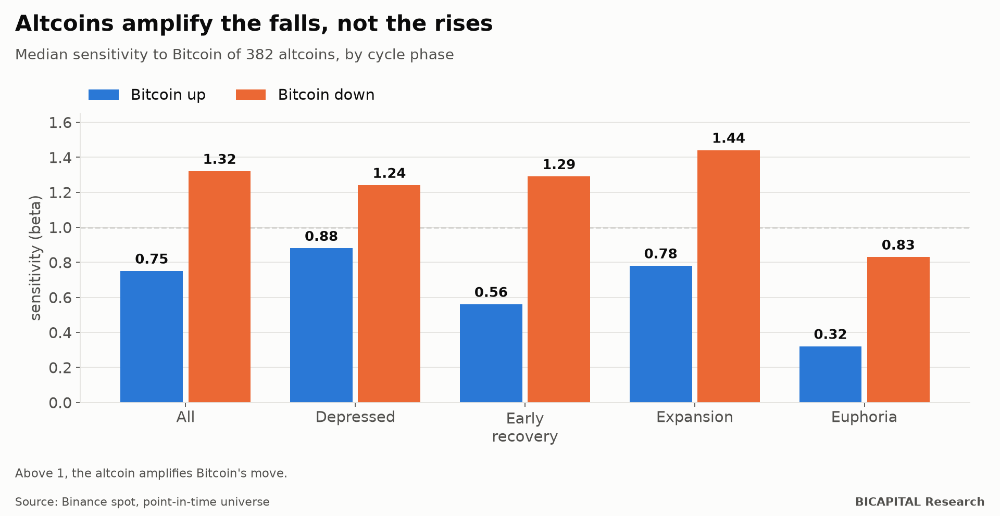
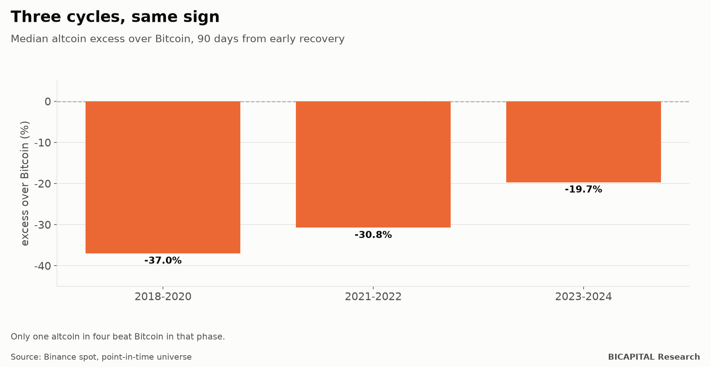

# The altcoin season myth: altcoins amplify the falls, not the rises

Crypto has a story everyone repeats: Bitcoin rises first and, once it leaves the bottom, altcoins follow and multiply the
move. That is the famous "altcoin season". My own portfolio rests on a version of that idea: 60% of every new purchase goes
to altcoins.

So I tested it with data, trying to prove myself right. **It did not prove me right.** With 382 Binance altcoins,
including the ones that no longer trade, the story comes out the other way round:

- **When Bitcoin falls, altcoins fall more.** When it rises, they rise less.
- **Right after the bottom**, exactly where the story promises the big move, their sensitivity to Bitcoin is **1.29 on the
  way down and 0.56 on the way up**.
- At 90 days, the median altcoin **returns 23% less than Bitcoin** in that phase. The same happened in all three cycles I
  could measure.

## How I measured it

- **Universe:** 382 altcoins with Binance data, taken as they existed on each date. Delisted coins count while they
  traded. If you only look at the coins still alive today, the result improves artificially (I explain this in the article
  on survivorship bias).
- **Cycle phases:** each day is classified by Bitcoin's state: depressed, bottoming, early recovery, expansion and
  euphoria.
- **Sensitivity (beta):** how much an altcoin moves when Bitcoin moves 1%. I computed it separately for the days Bitcoin
  rises and the days it falls.

## What came out

| Bitcoin phase | Upside sensitivity | Downside sensitivity | Altcoins that amplify the rise |
|---|---:|---:|---:|
| All phases | 0.75 | 1.32 | 10% |
| Depressed | 0.88 | 1.24 | 33% |
| **Early recovery** | **0.56** | **1.29** | **8.5%** |
| Expansion | 0.78 | 1.44 | 18% |
| Euphoria | 0.32 | 0.83 | 9% |

A sensitivity above 1 means amplifying. **Altcoins amplify the falls in every phase except euphoria, and dampen the rises
in all of them.** In the phase the story calls the altcoin moment, only 8.5% of altcoins amplify Bitcoin's rise.

**Correlation also rises when it hurts.** On Bitcoin's up days, altcoins correlate 0.30 with it; on its down days, 0.45.
It holds in every phase measured, without exception. Diversification disappears exactly when you need it.

**Bitcoin gives no warning.** All the correlation is same-day (0.50); with a one-day lag it is practically zero (−0.03).
There is no window to watch Bitcoin rise and buy altcoins afterwards: they move together.

## Three cycles, same sign

At 90 days from early recovery, the median altcoin versus Bitcoin:

| Cycle | Excess over Bitcoin | Altcoins that beat it |
|---|---:|---:|
| 2018-2020 | −37.0% | 25% |
| 2021-2022 | −30.8% | 9% |
| 2023-2024 | −19.7% | 25% |

It is not one unlucky cycle. Across the 18,306 observations of that phase, only one altcoin in four beat Bitcoin.

## Altcoin season does exist, just not where they say

There is one phase in which altcoins do beat Bitcoin: **euphoria**, with a median excess of **+18%** at 90 days and 59% of
altcoins ahead. That is the "altcoin season" of crypto folklore, and it shows up in the data.

But it has three problems:

1. **It comes at the end of the cycle**, when Bitcoin is expensive and near its highs, not after the bottom.
2. **Altcoins win by losing less.** From euphoria, Bitcoin falls 19% over the next 90 days.
3. **It is short:** 304 of 5,871 days.

I do not turn it into a strategy. That would replace a refuted idea with another untested one.

## So why do I hold 60% in altcoins?

It is a fair question, and I would rather ask it myself, in public. My honest answer:

- **This result goes against my portfolio.** I am publishing it anyway.
- **My bet is not buying random altcoins:** it is a list filtered by liquidity, supply and token unlocks. This study does
  not prove that selection fails, but it makes clear how high the bar is: it has to make up for the fact that the median
  altcoin loses to Bitcoin.
- **I have a written criterion for being wrong.** I will review the thesis if my basket keeps showing more downside than
  upside sensitivity, low coin survival, dilution or poor liquidity. At the end of the cycle I will compare it with buying
  and holding Bitcoin, and publish the result either way. I will report on it in the monthly diary.

## Takeaways

- **An altcoin is not Bitcoin with extra fuel.** In the data, it is Bitcoin with worse drawdowns.
- **Diversifying across altcoins protects less than it seems**, because they synchronise in the falls.
- **Be wary of "when Bitcoin rises, buy altcoins" rules:** there is no lag to exploit.

*Héctor Sandoval · BICAPITAL Research*

---

*Educational and research content. Not investment advice or a personalised recommendation. Results on historical Binance
data (spot, no costs) by Bitcoin cycle phase; the future may behave differently. The author invests personal capital in
cryptocurrencies, including altcoins.*
