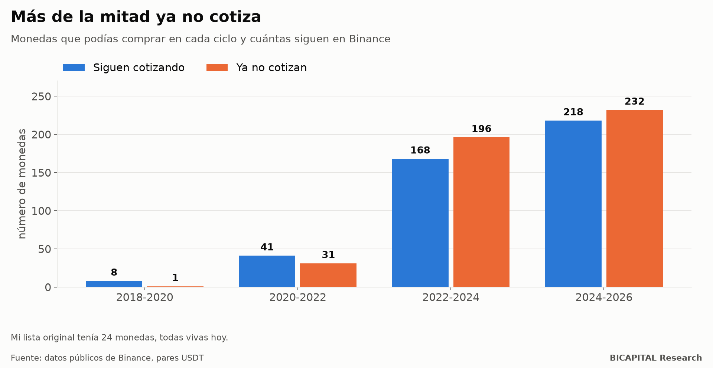
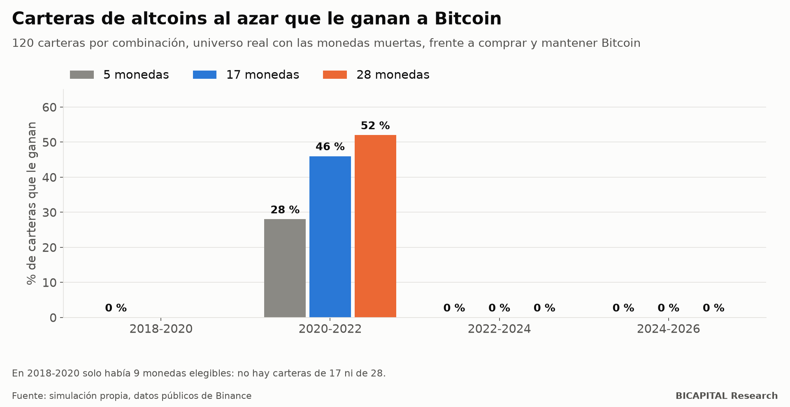

# Sesgo de supervivencia en cripto: más de la mitad de las monedas de 2022-24 ya no cotiza

Durante meses probé mis carteras de altcoins con una lista de 24 monedas. Luego descubrí el problema: **las 24 siguen
vivas hoy.** Es el error más viejo de la inversión, el sesgo de supervivencia, y lo cometí yo.

Cuando repetí las pruebas con todas las monedas que existían en cada momento, incluidas las que desaparecieron, el
resultado fue mucho peor de lo que la lista sugería.

## El error: una lista de supervivientes

Mi simulador usaba una lista de 24 monedas elegidas a mano: Aave, Cardano, Avalanche, Chainlink, Solana, Polkadot y otras
igual de conocidas. **Las 24 siguen cotizando hoy.**

Eso no es un universo de inversión: es una lista de ganadoras vistas desde el futuro. En 2022 nadie sabía cuáles iban a
sobrevivir.

## El universo real

Descargué los datos públicos de Binance de todos los pares contra USDT: **733 monedas, de las que 243 ya fueron
deslistadas o suspendidas.** Después reconstruí qué monedas podías comprar en cada ciclo (con al menos 180 días de
historia antes de empezar a comprar):

| Ciclo | Monedas que podías comprar | Ya no cotizan | % |
|---|---:|---:|---:|
| 2018-2020 | 9 | 1 | 11 % |
| 2020-2022 | 72 | 31 | 43 % |
| **2022-2024** | **364** | **196** | **54 %** |
| 2024-2026 | 450 | 232 | 52 % |

**En el ciclo 2022-2024 había 364 monedas elegibles, no 24. Más de la mitad ya no existe en el exchange.**

## Qué pasa con las carteras cuando incluyes a las muertas

Repetí la simulación con carteras de altcoins elegidas al azar del universo real (120 carteras por combinación) y las
comparé con comprar y mantener Bitcoin:

| Monedas en la cartera | 2018-2020 | 2020-2022 | 2022-2024 | 2024-2026 |
|---|---:|---:|---:|---:|
| 5 | 0 % | 28 % | 0 % | 0 % |
| 17 | — | 46 % | 0 % | 0 % |
| 28 | — | 52 % | 0 % | 0 % |

En tres de los cuatro ciclos, **ninguna** cartera al azar le ganó a Bitcoin, tuviera 5 o 28 monedas. Solo en 2020-2022
compitieron, y ahí la diferencia entre tener 5 o 28 monedas fue menor que la diferencia con Bitcoin.

Y las caídas: en 2024-2026, la caída máxima mediana de esas carteras fue de **un 87 %**, tuvieran las monedas que tuvieran.
Al subir el peso de Bitcoin, la caída mejora en los cuatro ciclos: en 2024-2026 pasa del −91 % con un 30 % en Bitcoin al
−51 % con un 100 %.

## Lo que este resultado no demuestra

Hay que decirlo con la misma claridad:

- **Elegir al azar no es lo que hace un gestor.** Una lista filtrada por liquidez, oferta y seguridad podría hacerlo mejor.
  Este estudio no lo prueba ni lo descarta.
- **Pero sí fija el listón.** Cualquier selección tiene que compensar que la moneda mediana del universo real se hundió o
  murió.
- **Hay pocos ciclos.** Con tres ciclos utilizables, cualquier conclusión estadística es frágil. La dirección, eso sí, fue la
  misma en tres de cuatro, y no por poco.

## Cómo evitar el sesgo en tus propias pruebas

1. **Empieza por el universo, no por la lista.** Pregúntate qué podías comprar en esa fecha, no qué existe hoy.
2. **Deja que las muertas cuenten** mientras cotizaron. Si una moneda se fue a cero, tu cartera también lo vivió.
3. **Desconfía de cualquier backtest de altcoins** que no diga cuántas monedas deslistadas incluye.
4. **Compara siempre con Bitcoin comprado y mantenido.** Si tu cesta no le gana con el universo real, no le gana.

Esta corrección me llevó a otras dos: que las altcoins amplifican más las caídas que las subidas (lo cuento en otro
artículo) y que mi propio sistema de 17 parámetros no batió a comprar y mantener.

*Héctor Sandoval · BICAPITAL Research*

---

*Contenido educativo y de investigación. No es asesoría de inversión ni una recomendación personalizada. Datos públicos de
Binance (spot) hasta agosto de 2026; el ciclo 2024-2026 no estaba cerrado. Simulaciones históricas con supuestos propios. El
autor invierte capital propio en criptomonedas, incluidas altcoins.*
