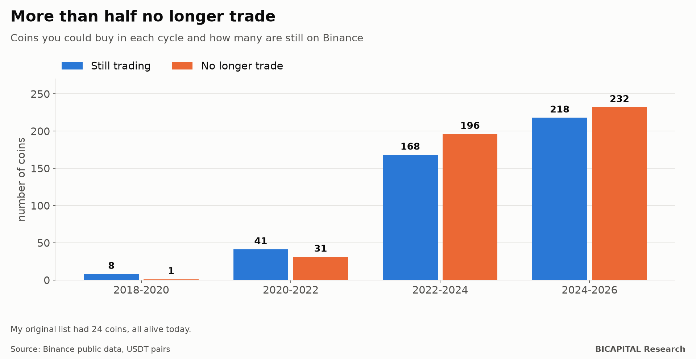
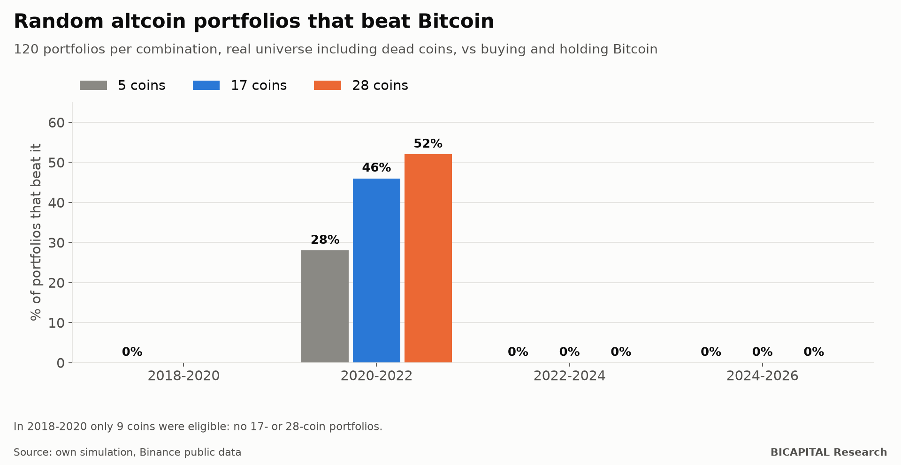

# Survivorship bias in crypto: more than half the coins of 2022-24 no longer trade

For months I tested my altcoin portfolios with a list of 24 coins. Then I found the problem: **all 24 are still alive
today.** It is the oldest mistake in investing, survivorship bias, and I made it.

When I repeated the tests with every coin that existed at each point in time, including the ones that disappeared, the
result was much worse than the list suggested.

## The mistake: a list of survivors

My simulator used a hand-picked list of 24 coins: Aave, Cardano, Avalanche, Chainlink, Solana, Polkadot and others just as
well known. **All 24 still trade today.**

That is not an investment universe: it is a list of winners seen from the future. In 2022, nobody knew which ones would
survive.

## The real universe

I downloaded Binance's public data for every pair against USDT: **733 coins, 243 of which have been delisted or
suspended.** Then I rebuilt which coins you could actually buy in each cycle (with at least 180 days of history before
purchases began):

| Cycle | Coins you could buy | No longer trade | % |
|---|---:|---:|---:|
| 2018-2020 | 9 | 1 | 11% |
| 2020-2022 | 72 | 31 | 43% |
| **2022-2024** | **364** | **196** | **54%** |
| 2024-2026 | 450 | 232 | 52% |

**In the 2022-2024 cycle there were 364 eligible coins, not 24. More than half no longer exist on the exchange.**

## What happens to portfolios once the dead coins are included

I re-ran the simulation with altcoin portfolios picked at random from the real universe (120 portfolios per combination)
and compared them with buying and holding Bitcoin:

| Coins in the portfolio | 2018-2020 | 2020-2022 | 2022-2024 | 2024-2026 |
|---|---:|---:|---:|---:|
| 5 | 0% | 28% | 0% | 0% |
| 17 | — | 46% | 0% | 0% |
| 28 | — | 52% | 0% | 0% |

In three of the four cycles, **no** random portfolio beat Bitcoin, whether it held 5 coins or 28. Only in 2020-2022 did
they compete, and there the gap between holding 5 or 28 coins was smaller than the gap to Bitcoin.

And the drawdowns: in 2024-2026, the median maximum drawdown of those portfolios was **87%**, whatever the number of coins.
Raising the Bitcoin weight improves the drawdown in all four cycles: in 2024-2026 it goes from −91% with 30% in Bitcoin
to −51% with 100%.

## What this result does not show

It has to be said just as clearly:

- **Picking at random is not what a manager does.** A list filtered by liquidity, supply and security could do better.
  This study neither proves nor rules that out.
- **But it does set the bar.** Any selection has to make up for the fact that the median coin of the real universe sank or
  died.
- **There are few cycles.** With three usable cycles, any statistical conclusion is fragile. The direction, though, was the
  same in three of four, and not by a small margin.

## How to avoid the bias in your own tests

1. **Start from the universe, not from the list.** Ask what you could buy on that date, not what exists today.
2. **Let the dead coins count** while they traded. If a coin went to zero, your portfolio lived through it too.
3. **Distrust any altcoin backtest** that does not say how many delisted coins it includes.
4. **Always compare with buying and holding Bitcoin.** If your basket does not beat it on the real universe, it does not
   beat it.

This correction led me to two more: that altcoins amplify falls more than rises (covered in another article) and that my
own 17-parameter system did not beat buy-and-hold.

*Héctor Sandoval · BICAPITAL Research*

---

*Educational and research content. Not investment advice or a personalised recommendation. Binance public data (spot) up
to August 2026; the 2024-2026 cycle was not closed. Historical simulations with my own assumptions. The author invests
personal capital in cryptocurrencies, including altcoins.*
