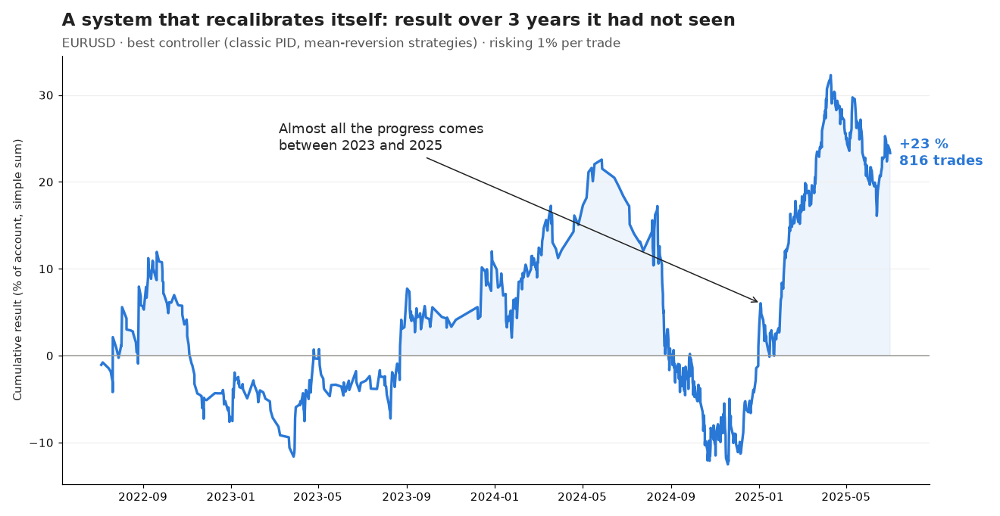
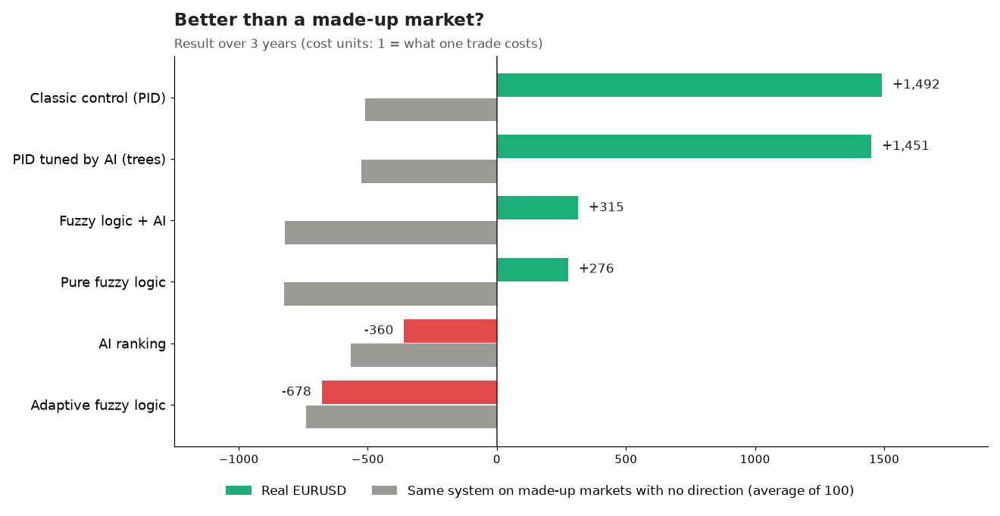
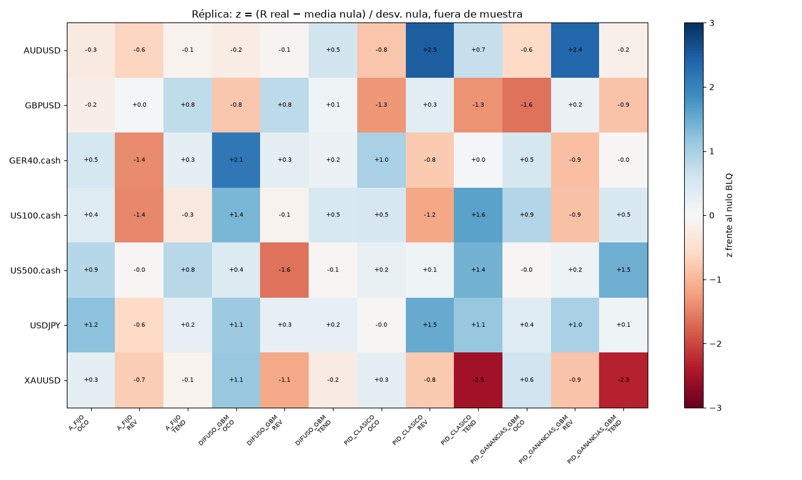
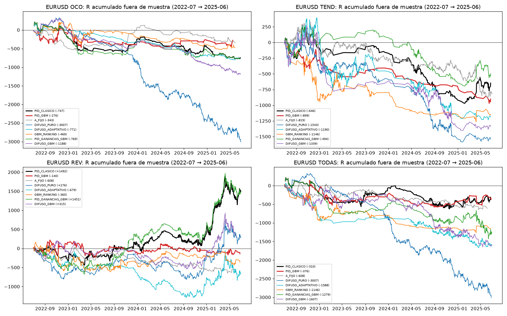
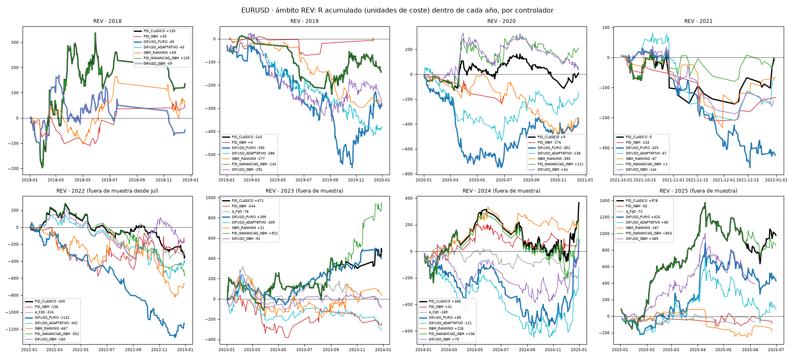

# I taught a system to recalibrate itself: what happened over 3 years of EURUSD

*A control like a thermostat's, artificial intelligence and fuzzy logic deciding when to adjust a strategy. Honest results, explained for anyone.*

Almost everyone who trades does the same thing when a strategy stops working: they adjust it. They change the stop, the target or the indicator, and carry on. The question of this lab was simple: **can a machine make that adjustment on its own, and do it better than a person?**

## What we tested

First we built a "menu" of 2,720 strategy versions for EURUSD, on 15-minute and 1-hour candles. They come in three kinds:

- **Breakout:** enter when price leaves a range, whichever way it goes.
- **Trend:** follow the direction when two moving averages cross.
- **Bounce (mean reversion):** buy after a sharp fall and sell after a sharp rise, expecting price to come back.

Each version combines a way to enter with a way to exit (stop, target, a stop that follows price, partial exit...).

On top of that menu we put several **"pilots"** that decide when to switch versions:

- **PID control:** the same idea as a home thermostat or a car's cruise control. It measures how far the result drifts from what was expected and corrects in proportion.
- **Decision trees and a neural network (artificial intelligence):** they learn from history which versions tend to work in the following weeks.
- **Fuzzy logic:** rules similar to a person's, such as "if it is going a bit badly, adjust a little; if it is going very badly, switch family".

## How we measured it

- **Learn and sit the exam on different data.** The pilots learned on data from 2018 to mid-2022. The exam was the next 3 years (July 2022 to June 2025), which they had never seen.
- **With real costs.** We used the spread and commission of a real account. Results are in "cost units": 1 means a trade made exactly what it cost to place.
- **With a control group.** We repeated the whole process on 100 made-up markets that move as strongly as EURUSD but have no direction at all. It is like the control group in a medical trial: if the system wins just as much on a made-up market, the gain does not come from the market.

## What came out

The best pilot was the simplest one: **classic PID control applied to the bounce strategies.**

- In the 3 exam years it made **816 trades** and earned **+1,492 cost units**.
- Risking 1% of the account per trade, that is about **+23%** in total, with a drop of around 30% along the way, in late 2024.
- On the made-up markets, the same process **lost −510 on average**. In other words, on real EURUSD it did clearly better than on a market with no direction.

## Luck or real?

This is where caution matters. We tested many variants at once (more than 200), and when you test that many, some will shine by luck, like when many people toss a coin and one of them gets ten heads in a row. Once we account for how many tests we ran, the result **is not yet enough to call it a confirmed edge**.

There is another reason for caution: almost all the progress came in 2023-2025, mostly in 2025. Before that it was flat.

So the fair reading is: **promising, not proven.** That is why a second round is running.

## What about artificial intelligence?

- **The decision trees did learn something:** they ranked a little better which versions were going to work. But they did it just as well as a very simple rule: "use what worked over the last 26 weeks".
- **With a tweak to what they learned** (comparing each version with the others instead of chasing absolute gains), they stopped "getting scared" and sitting still. Even so, they did not beat classic PID.
- **Fuzzy logic** did not improve on it either: in bounce and breakout it fell behind.

Lesson: more sophisticated is not always better. Sometimes the simple rule, well measured, wins.

## In 7 other markets

We repeated the test on AUDUSD, GBPUSD, USDJPY, gold, DAX, Nasdaq and the S&P 500. The map shows how far each combination lands from its control group: blue is better than the made-up market and red is worse.

Some good results show up here and there: bounce on AUDUSD (+951) and USDJPY (+594), trend on the Nasdaq (+1,380) and the S&P 500 (+637). But they change from one market to another (bounce in currencies, trend in indices), so there is no common pattern yet.

## The lab's charts

For anyone who wants the detail, these are the curves of every pilot over the 3 exam years, by type of strategy:

And the bounce strategies year by year (the black line is classic PID):

## What I take away

1. **Letting a system adjust itself is possible and orderly:** every change is logged with its reason and can be reviewed.
2. **The simplest approach gave the best result.** Classic PID beat artificial intelligence.
3. **A good result needs confirmation** on other markets and other periods before real money goes in.

**What's next:** the third round tests the same thing on every market and on five timeframes. The report should arrive around 18 November, and I will publish it whatever it shows.

The best pilot's script, with every recalibration marked on the chart, is published on TradingView (author hectorldu).

*Educational content. Not investment advice.*
