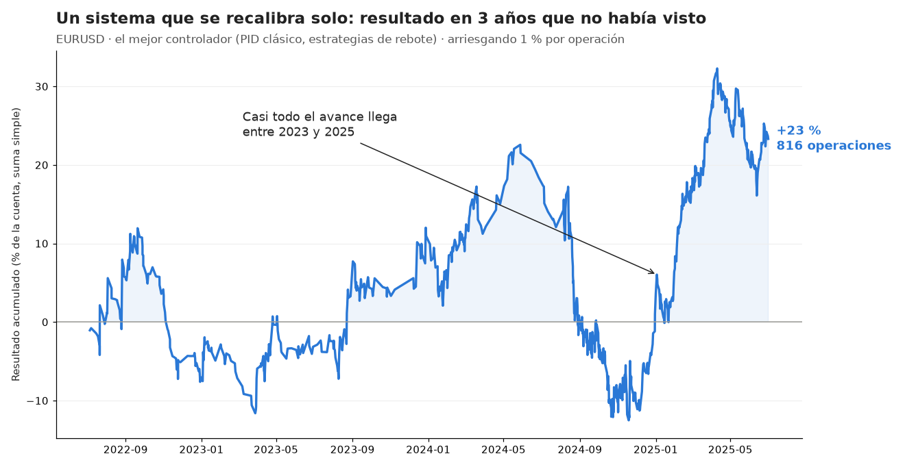
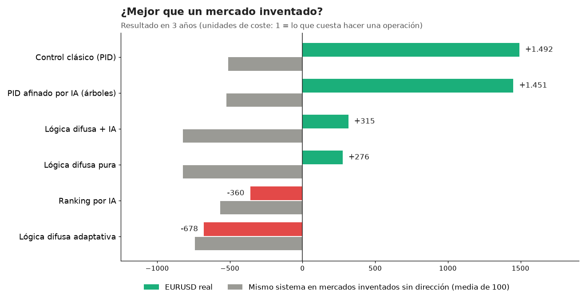
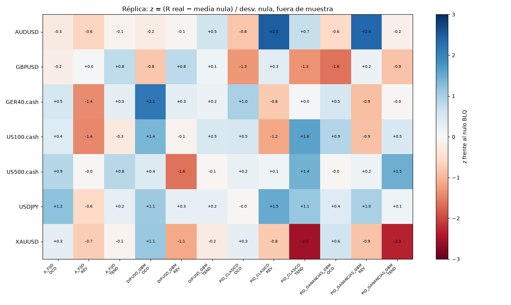
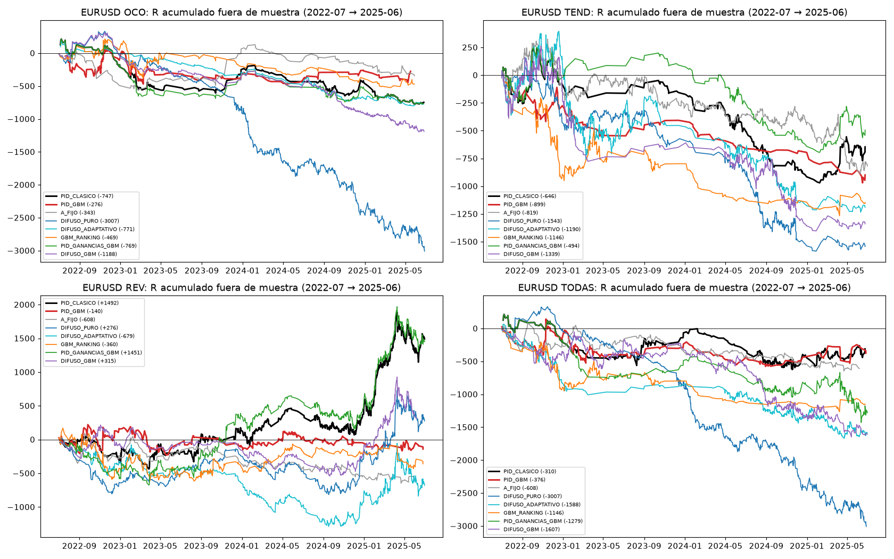
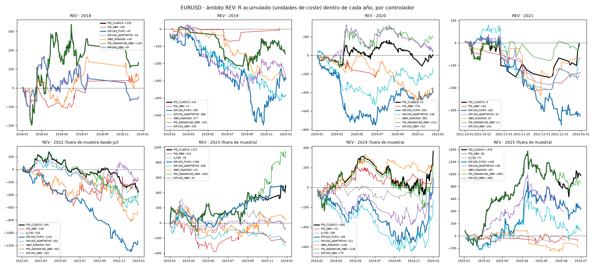

# Le enseñé a un sistema a recalibrarse solo: esto pasó en 3 años de EURUSD

*Un control como el de un termostato, inteligencia artificial y lógica difusa decidiendo cuándo ajustar una estrategia. Resultados honestos, explicados para cualquiera.*

Casi todos los que operan hacen lo mismo cuando una estrategia deja de funcionar: la ajustan. Cambian el stop, el objetivo o el indicador, y siguen. La pregunta de este laboratorio fue sencilla: **¿puede una máquina hacer ese ajuste sola, y hacerlo mejor que una persona?**

## Qué probamos

Primero construimos un «menú» de 2.720 versiones de estrategias para EURUSD, en velas de 15 minutos y de 1 hora. Son de tres tipos:

- **Ruptura:** entrar cuando el precio sale de un rango, hacia el lado que sea.
- **Tendencia:** seguir la dirección cuando dos medias móviles se cruzan.
- **Rebote (reversión):** comprar después de una caída fuerte y vender después de una subida fuerte, esperando que el precio vuelva.

Cada versión combina una forma de entrar con una forma de salir (stop, objetivo, stop que acompaña al precio, salida parcial...).

Encima de ese menú pusimos varios **«pilotos»** que deciden cuándo cambiar de versión:

- **Control PID:** es la misma idea que el termostato de una casa o el control de crucero de un coche. Mide cuánto se aleja el resultado de lo esperado y corrige en proporción.
- **Árboles de decisión y red neuronal (inteligencia artificial):** aprenden de la historia qué versiones suelen funcionar en las semanas siguientes.
- **Lógica difusa:** reglas parecidas a las de una persona, del tipo «si va un poco mal, ajusta un poco; si va muy mal, cambia de familia».

## Cómo lo medimos

- **Aprender y examinarse con datos distintos.** Los pilotos aprendieron con datos de 2018 a mediados de 2022. El examen fue con los 3 años siguientes (julio de 2022 a junio de 2025), que no habían visto.
- **Con costes reales.** Usamos el spread y la comisión de una cuenta real. Los resultados van en «unidades de coste»: 1 significa que una operación ganó exactamente lo que costó hacerla.
- **Con grupo de control.** Repetimos todo el proceso en 100 mercados inventados que se mueven igual de fuerte que EURUSD, pero sin ninguna dirección. Es como el grupo de control de un ensayo médico: si el sistema gana igual en un mercado inventado, la ganancia no viene del mercado.

## Lo que salió

El mejor piloto fue el más sencillo: **el control PID clásico, aplicado a las estrategias de rebote.**

- En los 3 años de examen hizo **816 operaciones** y ganó **+1.492 unidades de coste**.
- Arriesgando un 1 % de la cuenta por operación, eso equivale a cerca de **+23 %** en total, con una caída de alrededor de un 30 % por el camino, a finales de 2024.
- En los mercados inventados, el mismo proceso **perdía de media −510**. Es decir, en EURUSD real lo hizo bastante mejor que en un mercado sin dirección.

## ¿Es suerte o es real?

Aquí hay que ser prudentes. Probamos muchas variantes a la vez (más de 200), y cuando se prueban tantas, alguna brilla aunque sea por suerte, como cuando muchas personas lanzan una moneda y alguna saca diez caras seguidas. Al tener en cuenta cuántas pruebas hicimos, el resultado todavía **no alcanza para llamarlo una ventaja confirmada**.

Hay otra señal de cautela: casi todo el avance llegó en 2023-2025, y sobre todo en 2025. Antes iba en plano.

Así que la lectura justa es: **prometedor, pero no probado.** Por eso hay una segunda ronda en marcha.

## ¿Y la inteligencia artificial?

- **Los árboles de decisión sí aprendieron algo:** ordenaban un poco mejor qué versiones iban a funcionar. Pero lo hacían igual de bien que una regla muy simple: «usa lo que funcionó en las últimas 26 semanas».
- **Con un ajuste en lo que aprendían** (comparar cada versión con las demás en lugar de buscar ganancias absolutas), dejaron de «asustarse» y de quedarse quietos. Aun así, no superaron al PID clásico.
- **La lógica difusa** tampoco lo mejoró: en rebote y en rupturas quedó por detrás.

Lección: más sofisticado no siempre es mejor. A veces la regla sencilla, bien medida, gana.

## En otros 7 mercados

Repetimos la prueba en AUDUSD, GBPUSD, USDJPY, oro, DAX, Nasdaq y S&P 500. El mapa muestra cuánto se aleja cada combinación de su grupo de control: azul es mejor que el mercado inventado y rojo, peor.

Aparecen buenos resultados sueltos: rebote en AUDUSD (+951) y USDJPY (+594), tendencia en Nasdaq (+1.380) y S&P 500 (+637). Pero cambian de un mercado a otro (rebote en divisas, tendencia en índices), así que todavía no hay un patrón común.

## Los gráficos del laboratorio

Para quien quiera ver el detalle, estas son las curvas de todos los pilotos en los 3 años de examen, por tipo de estrategia:

Y las estrategias de rebote año por año (la línea negra es el PID clásico):

## Lo que me llevo

1. **Dejar que un sistema se ajuste solo es posible y ordenado:** cada cambio queda registrado, con su motivo, y se puede revisar.
2. **Lo más simple dio el mejor resultado.** El PID clásico superó a la inteligencia artificial.
3. **Un buen resultado necesita confirmación** en otros mercados y otros periodos antes de poner dinero.

**Qué sigue:** la tercera ronda prueba lo mismo en todos los mercados y en cinco temporalidades. El informe llegará hacia el 18 de noviembre, y lo publicaré igual, salga como salga.

El script del mejor piloto, con cada recalibración marcada en el gráfico, está publicado en TradingView (autor hectorldu).

*Contenido educativo. No es asesoría de inversión.*
