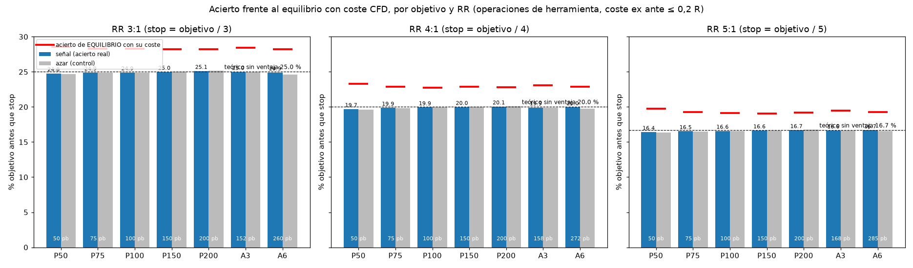

# Always look for "3 to 1"? The target is hit 25 times out of 100, same as at random

*Almost every course repeats the rule of risking 1 to make 3. I tested it on millions of trades with a fair comparison against chance.*

"Always look for 3-to-1 trades." It means risking 1 to try to make 3: if the stop is 10 pips away, the target is 30 pips away. It is one of the most repeated rules in trading. I wanted to know whether, on its own, it gives an edge.

## A simple calculation first

Imagine a price with no direction at all: at each step it goes up or down as if a coin were tossed. How often will it reach a target 3 steps up before a stop 1 step down?

The answer is **1 time in 4, 25%**. It does not depend on the market or the strategy: it comes only from the distance between stop and target. With 4 to 1 it would be 1 in 5 (20%), and with 5 to 1, 1 in 6 (16.7%).

## What I tested

- **285,088 combinations** of tool, market and exit, with millions of trades and the real costs of an account (spread, commission and overnight cost).
- **How "chance" is calculated.** On the same market and with exactly the same stop and target, instead of waiting for the signal, I entered at moments picked at random, like drawing a time out of a hat. If the signal is useful, it has to hit the target more often than those random entries.

## What came out

**How to read the chart:** each pair of bars is one target size. The blue bar is how many times out of 100 the target was hit with the signal; the grey one, with random entries. The dotted line is the simple calculation (25, 20 and 16.7). The red dash is the hit rate needed to cover costs.

- With 3 to 1, the signal hit the target **24.9 times out of 100**. Random entries: **24.9**. Exactly the same.
- With 4 to 1: 19.9 against the 20 of the simple calculation. With 5 to 1: 16.6 against 16.7.
- To cover costs with 3 to 1 you would need about **28 out of 100**. About 3 points are missing, at every target size.

## What I take away

1. **3 to 1 changes how often you win, not whether you win.** You win less often but more each time; without a good entry it evens out and the cost remains.
2. **The edge has to come from the entry:** from something that hits more often than that simple 25%.
3. **Meanwhile, cutting costs helps the most.** A couple of points of hit rate is exactly what the spread eats.

This does not mean 3 to 1 is bad: it is a way to manage risk. It just is not a source of profit on its own.

*Educational content. Not investment advice.*
