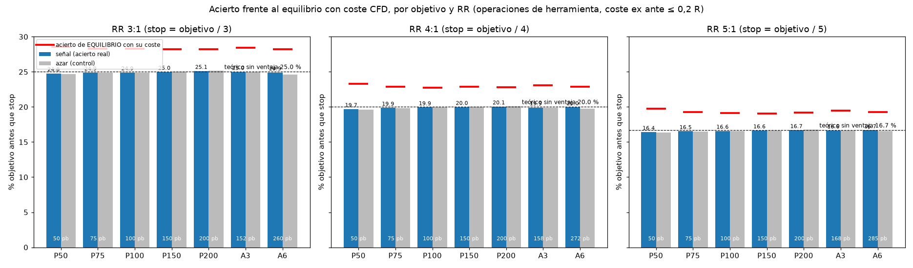

# ¿Buscar siempre «3 a 1»? El objetivo llega 25 de cada 100 veces, igual que al azar

*Casi todos los cursos repiten la regla de arriesgar 1 para ganar 3. La puse a prueba con millones de operaciones y una comparación justa con el azar.*

«Busca siempre operaciones 3 a 1». Significa arriesgar 1 para intentar ganar 3: si el stop está a 10 pips, el objetivo está a 30. Es de las reglas más repetidas del trading. Quise saber si, por sí sola, da ventaja.

## Una cuenta sencilla antes de empezar

Imagina un precio que no tiene ninguna dirección: en cada paso, sube o baja como si se tirara una moneda. ¿Cuántas veces llegará antes a un objetivo 3 pasos arriba que a un stop 1 paso abajo?

La respuesta es **1 de cada 4, un 25 %**. No depende del mercado ni de la estrategia: sale solo de la distancia entre el stop y el objetivo. Con 4 a 1 sería 1 de cada 5 (20 %), y con 5 a 1, 1 de cada 6 (16,7 %).

## Lo que probé

- **285.088 combinaciones** de herramienta, mercado y forma de salir, con millones de operaciones y los costes reales de una cuenta (spread, comisión y coste de mantener de noche).
- **Cómo se calcula «el azar».** En el mismo mercado y con exactamente el mismo stop y objetivo, en lugar de esperar la señal, entré en momentos elegidos al azar, como sacar una hora de un sombrero. Si la señal sirve, tiene que acertar más que esas entradas al azar.

## Lo que salió

**Cómo leer el gráfico:** cada pareja de barras es un tamaño de objetivo. La barra azul es cuántas veces de cada 100 llegó el objetivo con la señal; la gris, con entradas al azar. La línea punteada es la cuenta sencilla (25, 20 y 16,7). La raya roja es lo que haría falta acertar para cubrir los costes.

- Con 3 a 1, la señal llegó al objetivo **24,9 de cada 100 veces**. Las entradas al azar, **24,9**. Exactamente igual.
- Con 4 a 1: 19,9 frente al 20 de la cuenta sencilla. Con 5 a 1: 16,6 frente a 16,7.
- Para cubrir los costes con 3 a 1 harían falta unas **28 de cada 100**. Faltan unos 3 puntos, en todos los tamaños de objetivo.

## Qué me llevo

1. **El 3 a 1 cambia cuántas veces ganas, no si ganas.** Ganas menos veces, pero más cada vez; sin una buena entrada, se compensa y queda el coste.
2. **La ventaja tiene que venir de la entrada:** de algo que acierte más que esa cuenta sencilla del 25 %.
3. **Mientras tanto, lo que más ayuda es bajar costes.** Un par de puntos de acierto es justo lo que se come el spread.

Esto no significa que el 3 a 1 sea malo: es una forma de gestionar el riesgo. Solo que no es una fuente de ganancias por sí misma.

*Contenido educativo. No es asesoría de inversión.*
