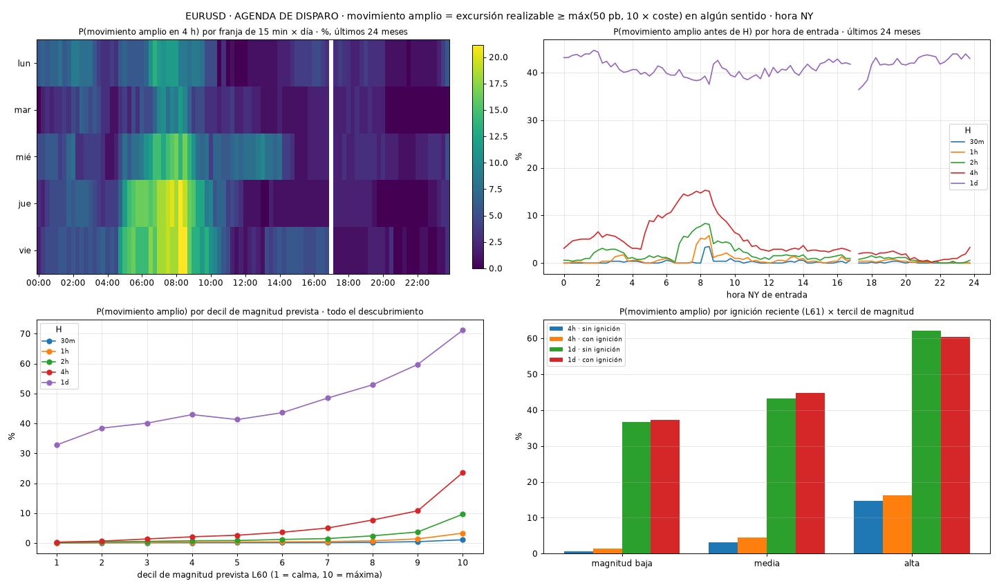

# What time each market moves (and why that does not tell you which way)

*There are time slots when a big move is four times more likely. Knowing it helps, but it does not say whether price will rise or fall.*

A practical question: are there times when a big price move is much more likely? I measured it on dozens of markets, with minute data and the real costs of trading.

## What I call a "big move"

A move of at least 0.5% (or 10 times the cost of trading, whichever is larger), in either direction, within the next 4 hours. Measured with real buy and sell prices, that is, a move that could really be captured.

## What I found

Times are New York time. The figures come from data the system had not used to learn: each quarter it picked the best slot using only what it knew up to then.

- **EURUSD:** at any given moment there is a big move about **6 times out of 100**. In the best slot, Thursdays at 08:15, about **24 out of 100**: four times more.
- **GBPUSD:** 22 out of 100 in its best slot (Friday 08:15), against 7 on average.
- **AUDUSD:** 29 out of 100 (Friday 08:30), against 11 on average.

Those times match the release of US economic data at 08:30.

**How to read the chart:** top left, each row is a day of the week and each column a 15-minute slot; the more yellow, the more likely a big move in the next 4 hours. Top right, the same idea by hour of the day (the red line is the 4-hour horizon). Bottom, how the probability rises when the system already expects a lot of volatility.

## The important part: direction

Knowing that price is going to move does not say whether it will go up or down.

**How chance is calculated here:** guessing the side with a coin toss is right 50 times out of 100. My rules for picking the side were right between **53 and 55 times out of 100** on EURUSD, GBPUSD and USDJPY: a little better than the coin, but after costs the result was still negative.

## What I take away

1. **Knowing when there will be movement is useful:** to pay attention, to adjust position size, or to avoid entering right before an important data release.
2. **On its own, it does not tell you whether to buy or sell.**
3. **Volatility keeps a schedule; direction, not so much.** It is the same conclusion as when I tested artificial intelligence: how much price moves is easier to predict than where.

*Educational content. Not investment advice.*
