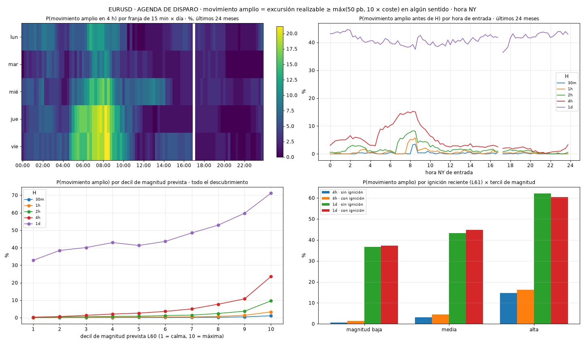

# A qué hora se mueve cada mercado (y por qué eso no dice hacia dónde)

*Hay franjas en las que un movimiento grande es cuatro veces más probable. Saberlo ayuda, pero no dice si el precio subirá o bajará.*

Pregunta práctica: ¿hay horas en las que es mucho más probable que el precio haga un movimiento grande? Lo medí en decenas de mercados, con datos de minuto y los costes reales de operar.

## Qué llamo «movimiento grande»

Un recorrido de al menos un 0,5 % (o de 10 veces el coste de operar, lo que sea mayor), en cualquier dirección, en las 4 horas siguientes. Medido con precios reales de compra y venta, es decir, un movimiento que de verdad se podía cobrar.

## Lo que encontré

Las horas son de Nueva York. Las cifras son de datos que el sistema no había usado para aprender: cada trimestre elegía la mejor franja solo con lo que sabía hasta ese momento.

- **EURUSD:** en un momento cualquiera, hay movimiento grande unas **6 veces de cada 100**. En la mejor franja, los jueves a las 08:15, unas **24 de cada 100**: cuatro veces más.
- **GBPUSD:** 22 de cada 100 en su mejor franja (viernes 08:15), frente a 7 de media.
- **AUDUSD:** 29 de cada 100 (viernes 08:30), frente a 11 de media.

Esas horas coinciden con la publicación de datos económicos de EE. UU., a las 08:30.

**Cómo leer el gráfico:** arriba a la izquierda, cada fila es un día de la semana y cada columna una franja de 15 minutos; cuanto más amarillo, más probable un movimiento grande en las 4 horas siguientes. Arriba a la derecha, la misma idea por hora del día (la línea roja es el horizonte de 4 horas). Abajo, cómo sube la probabilidad cuando el sistema ya espera mucha volatilidad.

## La parte importante: la dirección

Saber que el precio se va a mover no dice si subirá o bajará.

**Cómo se calcula el azar aquí:** adivinar el lado tirando una moneda acierta 50 de cada 100 veces. Mis reglas para elegir el lado acertaron entre **53 y 55 de cada 100** en EURUSD, GBPUSD y USDJPY: un poco mejor que la moneda, pero después de costes el resultado seguía en negativo.

## Qué me llevo

1. **Saber cuándo hay movimiento es útil:** para estar atento, para ajustar el tamaño de la posición o para no entrar justo antes de un dato importante.
2. **No sirve, por sí solo, para decidir si comprar o vender.**
3. **La volatilidad tiene horario; la dirección, no tanto.** Es la misma conclusión que salió al probar inteligencia artificial: se predice mejor cuánto se mueve el precio que hacia dónde.

*Contenido educativo. No es asesoría de inversión.*
