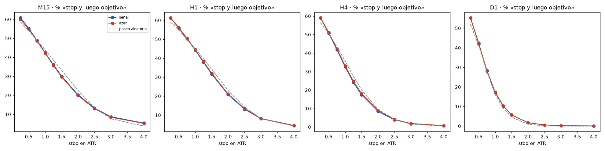

# "My stop got hit and then price went my way": it happens at random too

*More than 13 million trades show it is what you should expect, not a trap. And they explain why.*

It is one of the most common complaints: price touches your stop and, right after, goes where you thought it would. It feels like you got "hunted". I measured it to see how much of that is bad luck and how much is simply normal.

## Two words first

- **ATR:** the average size of recent candles. It is a way to measure how much price moves. A 1-ATR stop is one typical candle away.
- **Random walk:** a made-up price with no direction at all. At each step a coin is tossed to decide whether it goes up or down, with the same size of moves as the real market.

## The test

- More than **13 million trades** on 1-hour charts (and millions more on 15-minute, 4-hour and daily charts), with the stop at 1 ATR and the target at 2 ATR.
- I compared three things: entries with a signal, entries at moments picked at random, and the random walk.
- I counted how often price touched the stop and **then**, within the same time window, reached the target.

## What came out

On 1-hour charts:

- With a signal: **44 out of 100** trades.
- With random entries: **45 out of 100**.
- In the random walk with no direction: **45 out of 100**.

With a tighter stop, a quarter of an ATR, it happens about **61 times out of 100**, with a signal and at random.

**How to read the chart:** each panel is one timeframe. To the left the stop is closer; to the right, further away. The three lines almost touch: the signal, random entries and the made-up price with no direction give practically the same. The closer the stop, the more often it happens.

## Why it happens

Nobody is going after your stop. Price always oscillates: if the stop is close and the target further away, the normal thing is to touch the stop first and then keep moving. It is geometry, and it shows up just the same in a price made up by a coin.

## What I take away

1. **When it happens to you, it is not bad luck or a trap:** it is expected, almost half the time with a 1-ATR stop.
2. **A stop that is too tight for the volatility gets hit a lot.** Setting it by ATR helps you know what to expect.
3. **What decides the result is the entry and the costs,** not the "unfairness" of one particular stop.

*Educational content. Not investment advice.*
