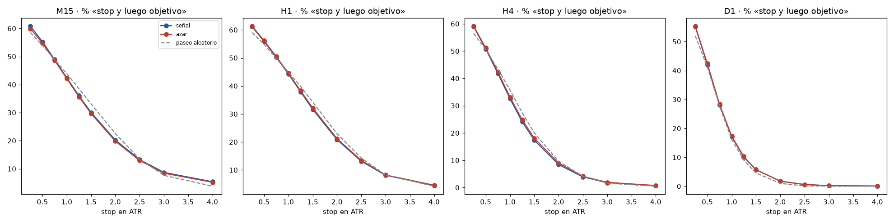

# «Me saltó el stop y luego fue a mi favor»: también pasa al azar

*Más de 13 millones de operaciones muestran que es lo esperable, no una trampa. Y explican por qué.*

Es una de las quejas más comunes: el precio toca tu stop y, justo después, se va hacia donde tú pensabas. Parece que «te cazaron». Lo medí para saber cuánto de eso es mala suerte y cuánto es simplemente normal.

## Dos palabras antes

- **ATR:** el tamaño medio de las velas recientes. Es una forma de medir cuánto se mueve el precio. Un stop de 1 ATR está a la distancia de una vela típica.
- **Paseo aleatorio:** un precio inventado sin ninguna dirección. En cada paso se tira una moneda para decidir si sube o baja, con el mismo tamaño de movimiento que el mercado real.

## La prueba

- Más de **13 millones de operaciones** en gráficos de 1 hora (y millones más en 15 minutos, 4 horas y diario), con stop a 1 ATR y objetivo a 2 ATR.
- Comparé tres cosas: entradas con señal, entradas en momentos elegidos al azar y el paseo aleatorio.
- Conté cuántas veces el precio tocaba el stop y **después**, dentro del mismo plazo, llegaba al objetivo.

## Lo que salió

En gráficos de 1 hora:

- Con señal: **44 de cada 100** operaciones.
- Con entradas al azar: **45 de cada 100**.
- En el paseo aleatorio sin dirección: **45 de cada 100**.

Con un stop más pegado, a un cuarto de ATR, pasa unas **61 de cada 100 veces**, con señal y al azar.

**Cómo leer el gráfico:** cada panel es una temporalidad. Hacia la izquierda, el stop está más cerca; hacia la derecha, más lejos. Las tres líneas casi se tocan: la señal, el azar y el precio inventado sin dirección dan prácticamente lo mismo. Cuanto más cerca el stop, más a menudo pasa.

## Por qué pasa

No es que alguien vaya a por tu stop. El precio oscila siempre: si el stop está cerca y el objetivo más lejos, lo normal es que primero toque el stop y después siga moviéndose. Es geometría, y aparece igual en un precio inventado por una moneda.

## Qué me llevo

1. **Cuando te pase, no es mala suerte ni una trampa:** es lo esperable, casi la mitad de las veces con un stop de 1 ATR.
2. **Un stop demasiado pegado a la volatilidad se toca muchísimo.** Ponerlo según el ATR ayuda a saber qué esperar.
3. **Lo que decide el resultado es la entrada y los costes,** no la «injusticia» de un stop concreto.

*Contenido educativo. No es asesoría de inversión.*
