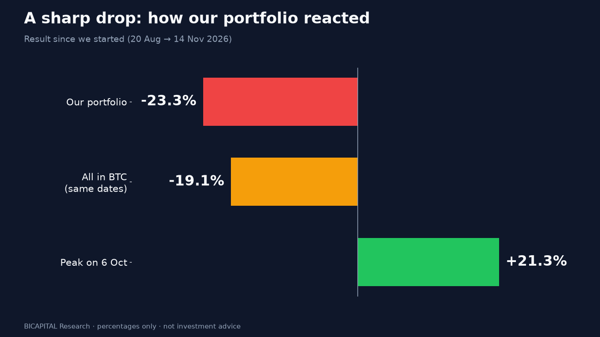
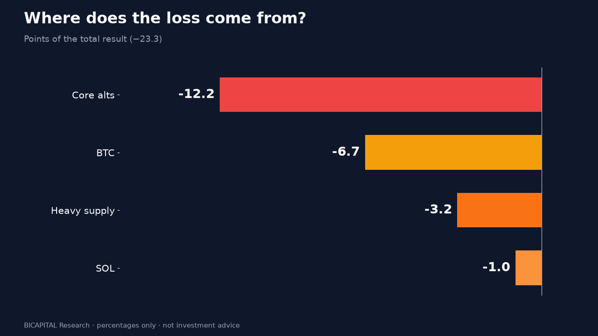
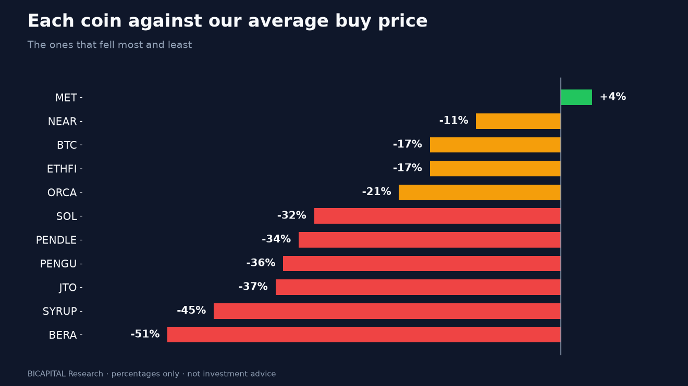
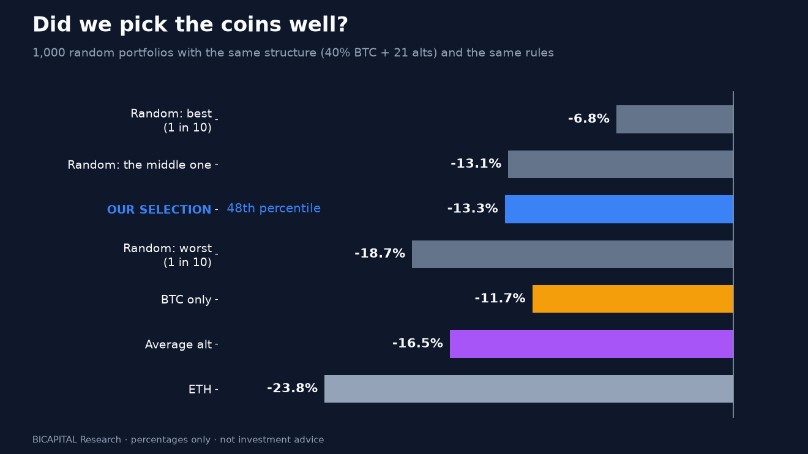

# A sharp crypto drop: how our real portfolio is doing and what we learned

*BTC fell 14% in three days. We tell, without makeup, how the portfolio reacted, whether we picked the coins well (against 1,000 random portfolios) and why we are not selling.*

Today, 14 November, the crypto market fell hard: the price of BTC touched 64,400, 14% less than three days ago, and the whole market lost 9% in 24 hours. This is the update of our real portfolio, in percentages only.

## Where we stand

- **Our portfolio: −23.3%** on what we invested.
- **If everything had gone into BTC**, on the same buying dates: −19.1%.
- On 6 October we were **+21.3%**. From that peak, the drop is 36.7%.
- Today alone, the portfolio fell about 9 points and BTC about 5.

It is what we already knew: the portfolio rises more than BTC when the market rises and falls more when it falls. Altcoins amplify moves both ways, and BTC acts as the anchor.

## Where does the loss come from?

Of the −23.3 points, the core altcoins explain −12.2, BTC −6.7, the coins with heavy token supply ahead −3.2 and SOL −1.0.

The ones falling most against our buy price are BERA (−51%), SYRUP (−45%), JTO (−37%) and PENGU (−36%). MET is the only one in profit (+4%), and NEAR (−11%) and BTC (−17%) hold up best.

## Did we pick the coins well? We measured it against chance

**How chance is calculated here:** we built 1,000 portfolios with the same structure as ours (40% in BTC and 21 altcoins), but drawing the 21 altcoins at random from the 150 with the most volume on Binance before 20 August. We applied the same rebalancing rules to all of them, from 20 August to today. Our selection went through the same simulation. That way we compare only the choice of coins, not when we bought.

**Result: our selection landed at the 48th percentile**, practically in the middle. Neither better nor worse than picking at random. Against the market, we fell less than ETH (−23.8%) and the average altcoin (−16.5%), and a bit more than BTC alone (−11.7%).

It matches what we had already researched: picking coins "on fundamentals" did not beat chance in any cycle. What does count is holding many of them, and the 21 altcoins give us that.

## Why is our −23.3% worse than the −13.3% of the simulation?

Because of **when** the money went in, not **which** coins we chose. A good part of the capital was invested between September and October, at higher prices than on 20 August. BTC alone shows the same: with our own entry dates it gives −19.1%, and bought all at once on 20 August, −11.7%.

## What we do now

- **We do not panic-sell.** This is the drop the plan exists for. Selling today would turn a fall into a permanent loss.
- **No rebalancing is due:** everything fell together and the weights are still inside their bands (BTC weighs 41.2%).
- **We do not change the rules in the middle of the drop.** We already made six changes in 77 days, and in the lab no more complicated rule beat the current one.
- **If new money goes in, it will be in drops, in tranches and with more weight in BTC.** The data say that when money goes in is what moves the result most.

## What we have learned so far

1. **The portfolio does what we expected:** it rises more and falls more than BTC.
2. **Picking coins gives no edge; holding many does.**
3. **Timing of entries weighed the most.**
4. **Simple rules beat complicated ones.**
5. **This drop is the whole market,** not particular coins: solid and weak theses fell almost the same.

We will keep publishing, good or bad. What is needed now is time and discipline.

*Own capital. Not investment advice, an offer, or portfolio management for third parties.*
