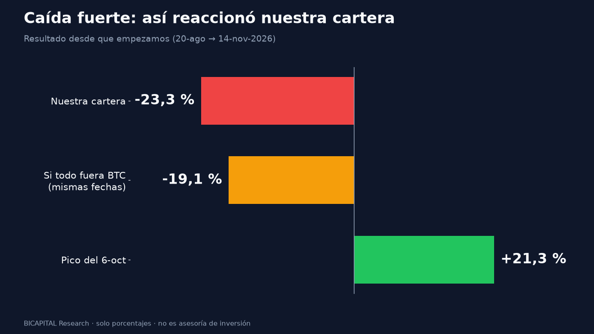
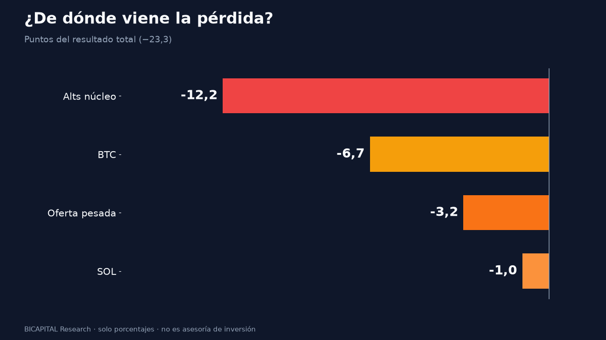
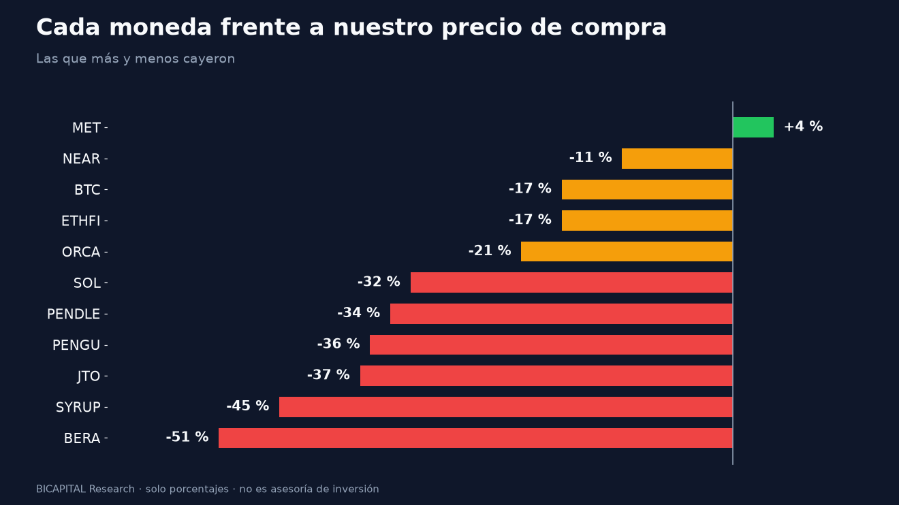
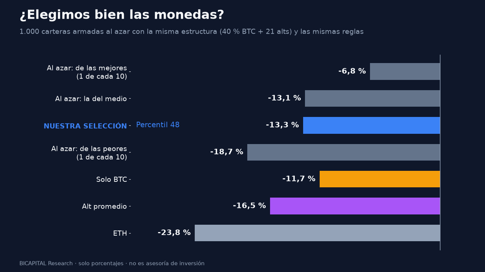

# Caída fuerte en cripto: cómo va nuestra cartera real y qué aprendimos

*BTC bajó un 14 % en tres días. Contamos sin maquillaje cómo reaccionó la cartera, si elegimos bien las monedas (frente a 1.000 carteras al azar) y por qué no vendemos.*

Hoy, 14 de noviembre, el mercado cripto cayó fuerte: BTC tocó los 64.400 dólares, un 14 % menos que hace tres días, y el mercado completo perdió un 9 % en 24 horas. Esta es la actualización de nuestra cartera real, solo en porcentajes.

## Cómo vamos

- **Nuestra cartera: −23,3 %** sobre lo invertido.
- **Si todo hubiera ido a BTC**, con las mismas fechas de compra: −19,1 %.
- El 6 de octubre íbamos **+21,3 %**. Desde ese pico, la caída es de un 36,7 %.
- Solo hoy, la cartera bajó cerca de 9 puntos y BTC unos 5.

Es lo que ya sabíamos: la cartera sube más que BTC cuando el mercado sube y cae más cuando baja. Las altcoins amplifican los movimientos en las dos direcciones, y BTC hace de ancla.

## ¿De dónde viene la pérdida?

De los −23,3 puntos, las altcoins principales explican −12,2, BTC −6,7, las monedas con mucha oferta por liberar −3,2 y SOL −1,0.

Las que más caen frente a nuestro precio de compra son BERA (−51 %), SYRUP (−45 %), JTO (−37 %) y PENGU (−36 %). MET es la única en ganancia (+4 %), y NEAR (−11 %) y BTC (−17 %) son las que mejor aguantan.

## ¿Elegimos bien las monedas? Lo medimos contra el azar

**Cómo se calcula el azar aquí:** armamos 1.000 carteras con la misma estructura que la nuestra (40 % en BTC y 21 altcoins), pero sorteando las 21 altcoins entre las 150 con más volumen en Binance antes del 20 de agosto. A todas les aplicamos las mismas reglas de rebalanceo, desde el 20 de agosto hasta hoy. Nuestra selección pasó por la misma simulación. Así comparamos solo la elección de monedas, sin contar cuándo compramos.

**Resultado: nuestra selección quedó en el percentil 48**, prácticamente en la mitad. Ni mejor ni peor que elegir al azar. Frente al mercado, caemos menos que ETH (−23,8 %) y que la altcoin promedio (−16,5 %), y algo más que BTC solo (−11,7 %).

Coincide con lo que ya habíamos investigado: elegir monedas «por fundamentales» no le ganó al azar en ningún ciclo. Lo que sí cuenta es tener muchas, y eso nos lo dan las 21 altcoins.

## ¿Por qué nuestro −23,3 % es peor que el −13,3 % de la simulación?

Por **cuándo** entró el dinero, no por **qué** monedas elegimos. Buena parte del capital se invirtió entre septiembre y octubre, más caro que el 20 de agosto. Con BTC solo pasa igual: con nuestras mismas fechas de entrada da −19,1 %, y comprado de una vez el 20 de agosto, −11,7 %.

## Lo que hacemos ahora

- **No vendemos en pánico.** Esta es la caída para la que existe el plan. Vender hoy convertiría una caída en una pérdida definitiva.
- **No toca rebalancear:** todo cayó a la vez y los pesos siguen dentro de sus bandas (BTC pesa un 41,2 %).
- **No cambiamos las reglas en mitad de la caída.** Ya hicimos seis cambios en 77 días, y en el laboratorio ninguna regla más complicada le ganó a la actual.
- **Si entra dinero nuevo, será en caídas, por tramos y con más peso en BTC.** Los datos dicen que lo que más mueve el resultado es cuándo entra el dinero.

## Lo que aprendimos hasta hoy

1. **La cartera hace lo que esperábamos:** sube más y cae más que BTC.
2. **Elegir monedas no da ventaja; tener muchas, sí.**
3. **Lo que más pesó fue el momento de entrada.**
4. **Las reglas simples le ganaron a las complicadas.**
5. **Esta caída es del mercado entero,** no de monedas concretas: las de tesis sólida y las débiles cayeron casi igual.

Seguiremos publicando, salga bien o mal. Lo que falta ahora es tiempo y disciplina.

*Capital propio. No es asesoría de inversión, ni una oferta, ni gestión de carteras para terceros.*
