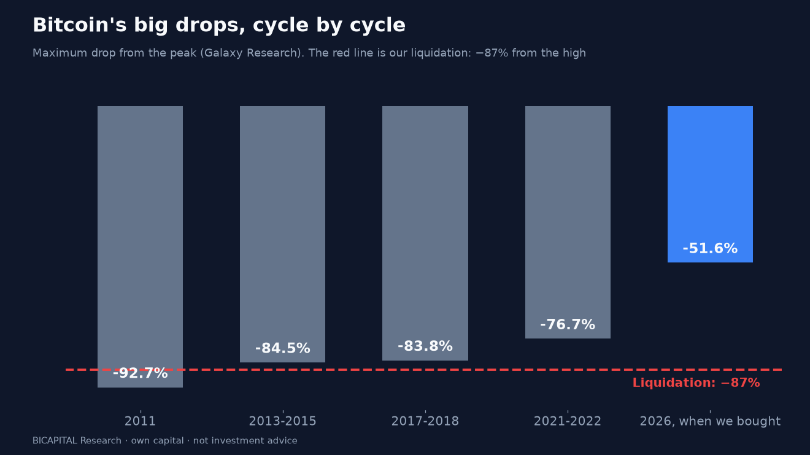
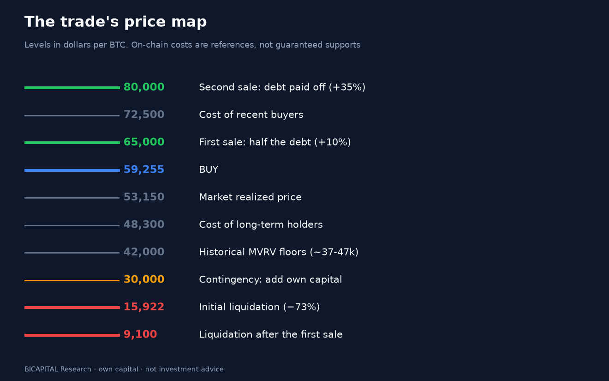
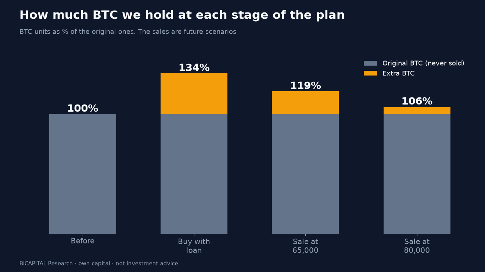

# We bought Bitcoin at half price with a small loan: why and how

*On 24 November, with BTC 52% below its high, we financed a purchase with a small debt and a plan to repay it on the first rebound. We publish it before knowing how it ends.*

Telling a trade after it worked proves nothing: anyone can pick their wins afterwards. So we publish this one **before** the result, with the thesis, the size, the risk and the plan. If it goes badly, it will show whether it was a bad decision or a good decision with bad luck.

## Why: Bitcoin is the portfolio's anchor

Our crypto portfolio has two parts: **Bitcoin, about 40%, is the anchor**, what holds the portfolio up in the drops, and **21 altcoins, 60%, are the bet**, which can fall 50, 70 or 90%. When BTC fell to half its high, we decided to accumulate more of the anchor. The debt is used only for BTC, never for altcoins.

The idea, in the manager's words: *"I'm not saying this is the bottom; I'm saying we are buying as close to the bottom as we can. I'm not proving we will win; I'm proving it is very hard to lose."*

The thesis rests on five things:

1. **Valuation:** after falling 52%, BTC trades close to what all its holders paid on average. Historically, that is an accumulation zone.
2. **Market stress:** more BTC is at a loss than in profit and the mood is fear, as in the lower part of previous cycles.
3. **Maturity:** the 2026 market is far bigger than in 2013 or 2017. Drops have been shrinking from cycle to cycle.
4. **Timing:** 2027 is the year before the halving. In the three previous cycles, that year ended positive.
5. **Financial engineering:** the loan is small and cheap, and it is repaid on the first rebound.

**How to read the chart:** each bar is the worst drop of a cycle. The blue one is where we were when we bought (−52%). The red line is where BTC would have to go for us to be liquidated: −87% from the high. Since 2011, when BTC was a tiny market, no drop has gone that low.

## How: the trade, step by step

1. **Collateral.** We moved our BTC to an **isolated margin** account. "Isolated" means the risk stays locked in that account: if something goes wrong, it does not touch the altcoins.
2. **Loan.** We borrowed, in digital dollars (USDT), the equivalent of **34% of the value of that BTC**. Binance allowed almost three times as much; we ruled that out because it brought liquidation too close.
3. **Purchase.** With the whole loan we bought BTC at **59,255**. The portfolio's BTC units rose 34%.
4. **Exits already placed.** We left two sell orders: one at **65,000** that repays half the debt and another at **80,000** that repays the rest. Together they sell less BTC than we bought, so the original BTC is never sold voluntarily.

**How to read the map:** at the top, in green, the two sales that pay off the debt. In blue, the purchase. In grey, references for what other investors paid. Below, in orange, the point where we would add our own capital for protection, and in red, the liquidation: 73% below the purchase price.

## What we gain if the plan is completed

If both sales fill, we end up **debt-free with 5.8% more BTC for good**, without adding new money, and with an average cost per BTC 5.4% lower. A 10% rebound is enough to repay half the loan, and a 35% one repays it in full.

## What we admit up front

This trade **goes against our own rulebook**, which says "spot only, no margin". It is an exception by the manager, and we submitted it to an independent audit that rates it this way: the calculations pass; rule compliance does not; the edge is not proven. We explain it in the next article, together with everything that argues against it.

**How we will judge it**, set today: if it rises and the sales fill, we will not call it "brilliant", but say the plan worked as intended. If BTC moves sideways, on 24 December we will decide whether to repay the debt with our own capital. If there were a liquidation, we will call it a design error, not bad luck.

The full research note, 16 sections in Spanish, is published with its integrity fingerprint (SHA-256 `3b501deb6bbe69dbec44858f1ec5fc77c2fd12f2746081913b451ce4c133a63e`), so anyone can check we did not change it after the result: [full note](https://test201807.github.io/bicapital-research/research/btc-2026-11-24/).

*Own capital. Not an offer, portfolio management for third parties, or investment advice. Trading on margin can lose all the capital posted as collateral.*
