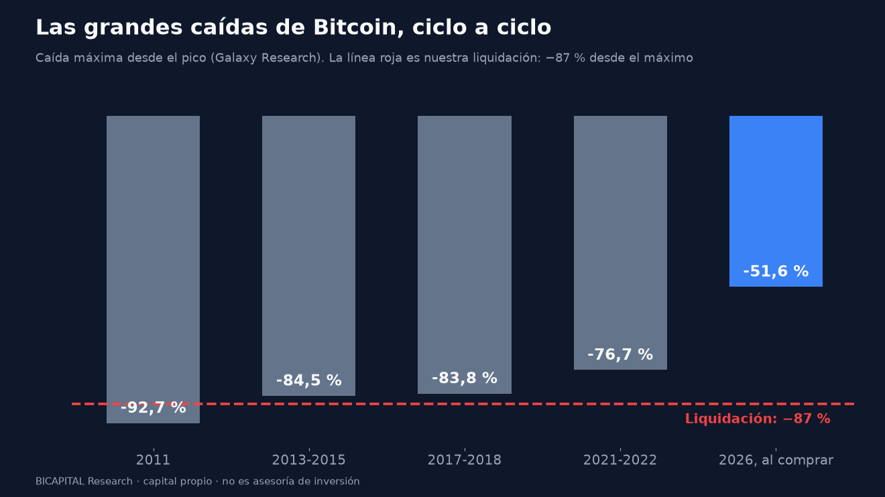
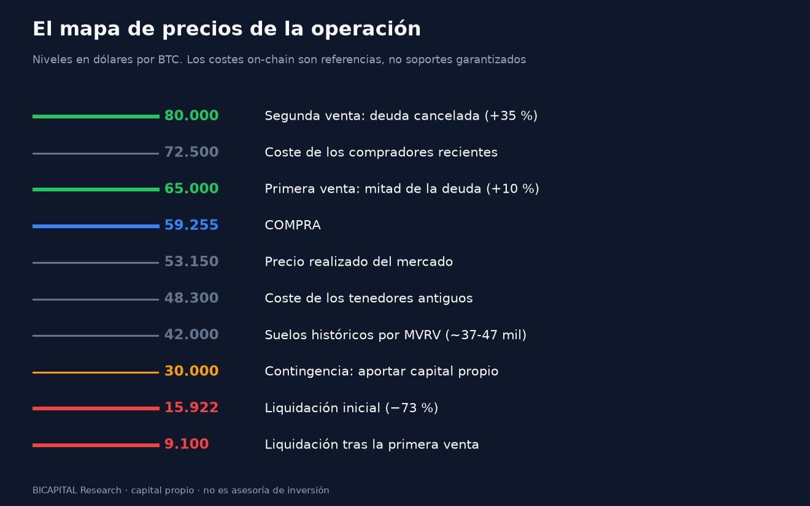
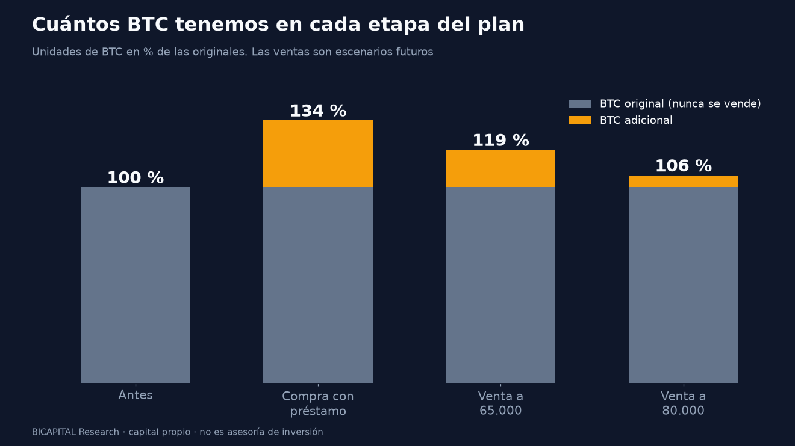

# Compramos Bitcoin a mitad de precio con un préstamo pequeño: por qué y cómo

*El 24 de noviembre, con BTC un 52 % bajo su máximo, financiamos una compra con deuda pequeña y un plan para devolverla en el primer rebote. Lo publicamos antes de saber cómo termina.*

Contar una operación cuando ya salió bien no demuestra nada: cualquiera puede elegir sus aciertos después. Por eso publicamos esta **antes** del resultado, con la tesis, el tamaño, el riesgo y el plan. Si sale mal, se verá si fue una mala decisión o una buena decisión con mala suerte.

## Por qué: Bitcoin es el ancla del portafolio

Nuestro portafolio cripto tiene dos partes: **Bitcoin, cerca del 40 %, es el ancla**, lo que sostiene la cartera en las caídas, y **21 altcoins, el 60 %, son la apuesta**, que pueden caer un 50, 70 o 90 %. Cuando BTC cayó a la mitad de su máximo, decidimos acumular más del ancla. La deuda se usa solo para BTC, nunca para altcoins.

La idea, en palabras del gestor: *«No digo que es el suelo, digo que estamos comprando lo más cerca del suelo. No estoy probando que vayamos a ganar; estoy probando que es muy difícil perder.»*

La tesis se apoya en cinco cosas:

1. **Valoración:** tras caer un 52 %, BTC cotiza cerca de lo que pagaron en promedio todos sus tenedores. Históricamente, esa es una zona de acumulación.
2. **Estrés del mercado:** hay más BTC en pérdida que en ganancia y el ánimo es de miedo, como en la parte baja de los ciclos anteriores.
3. **Maduración:** el mercado de 2026 es mucho más grande que el de 2013 o 2017. Las caídas se han ido reduciendo de ciclo en ciclo.
4. **Tiempo:** 2027 es el año previo al halving. En los tres ciclos anteriores, ese año terminó en positivo.
5. **Ingeniería financiera:** el préstamo es pequeño y barato, y se devuelve en el primer rebote.

**Cómo leer el gráfico:** cada barra es la peor caída de un ciclo. La azul es dónde estábamos al comprar (−52 %). La línea roja es dónde tendría que llegar BTC para que nos liquidaran: −87 % desde el máximo. Desde 2011, cuando BTC era un mercado diminuto, ninguna caída llegó tan abajo.

## Cómo: la operación, paso a paso

1. **Garantía.** Pasamos nuestro BTC a una cuenta de **margen aislado**. «Aislado» significa que el riesgo queda encerrado en esa cuenta: si algo sale mal, no toca las altcoins.
2. **Préstamo.** Pedimos prestado, en dólares digitales (USDT), el equivalente a un **34 % del valor de ese BTC**. Binance permitía casi el triple; lo descartamos porque acercaba demasiado la liquidación.
3. **Compra.** Con todo el préstamo compramos BTC a **59.255**. Las unidades de BTC del portafolio subieron un 34 %.
4. **Salidas ya colocadas.** Dejamos dos órdenes de venta: una a **65.000** que devuelve la mitad de la deuda y otra a **80.000** que devuelve el resto. Las dos juntas venden menos BTC del que compramos, así que el BTC original nunca se vende voluntariamente.

**Cómo leer el mapa:** arriba, en verde, las dos ventas que cancelan la deuda. En azul, la compra. En gris, referencias de lo que pagaron otros inversores. Abajo, en naranja, el punto donde aportaríamos capital propio para protegernos, y en rojo, la liquidación: un 73 % más abajo del precio de compra.

## Qué ganamos si el plan se completa

Si las dos ventas se ejecutan, terminamos **sin deuda y con un 5,8 % más de BTC para siempre**, sin haber puesto dinero nuevo, y con un coste medio por BTC un 5,4 % más bajo. Basta un rebote de un 10 % para devolver la mitad del préstamo, y uno de un 35 % para devolverlo entero.

## Lo que reconocemos de entrada

Esta operación **va contra nuestro propio reglamento**, que dice «solo spot, sin margen». Es una excepción del gestor, y la sometimos a una auditoría independiente que la califica así: los cálculos pasan; el cumplimiento del reglamento no pasa; la ventaja no está demostrada. Lo explicamos en el siguiente artículo, junto con todo lo que juega en contra.

**Cómo la vamos a juzgar**, fijado hoy: si sube y se ejecutan las ventas, no la llamaremos «genial», sino que diremos que el plan funcionó como estaba previsto. Si BTC queda de lado, el 24 de diciembre decidiremos si pagamos la deuda con capital propio. Si hubiera liquidación, la reconoceremos como un error de diseño, no como mala suerte.

La nota de investigación completa, con 16 secciones, está publicada con su huella de integridad (SHA-256 `3b501deb6bbe69dbec44858f1ec5fc77c2fd12f2746081913b451ce4c133a63e`), para que cualquiera pueda comprobar que no la cambiamos al conocer el resultado: [nota completa](https://test201807.github.io/bicapital-research/research/btc-2026-11-24/).

*Capital propio. No es una oferta, ni gestión de carteras para terceros, ni asesoría de inversión. Operar con margen puede hacer perder todo el capital dado en garantía.*
