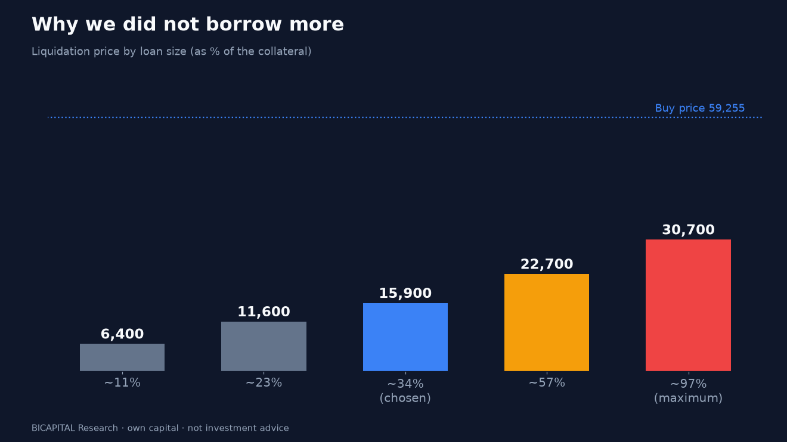
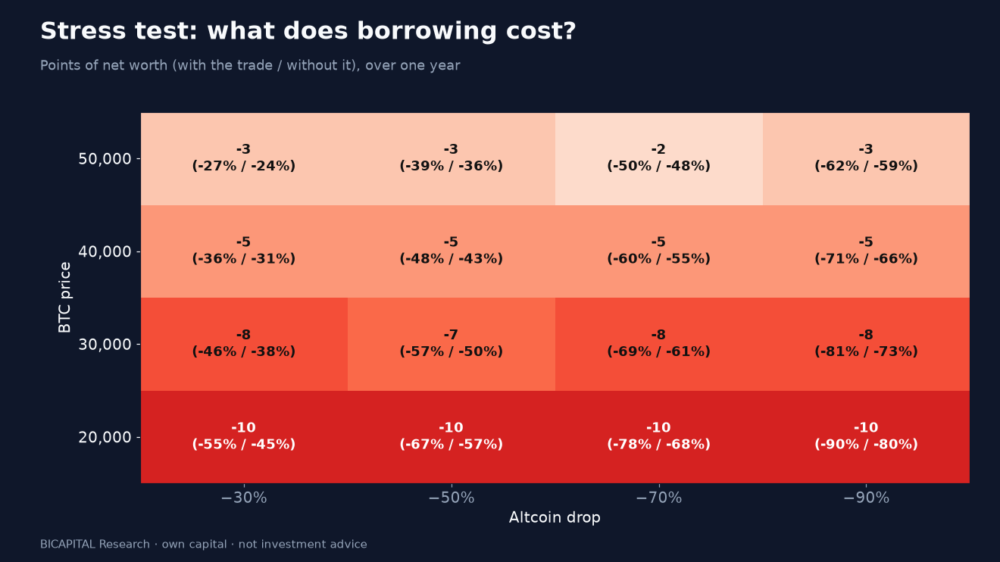

# How much risk is really in our Bitcoin purchase with a loan

*What argues against it, a stress test with the whole portfolio, contingencies written in advance and an independent audit's verdict, including its "fails".*

In the previous article we explained why and how we bought Bitcoin with a small loan. A thesis that only lists what supports it is not a thesis, it is a hope. This is what argues against it, and we publish it anyway.

## Three risks that are not the same

- **Volatility:** price going down and up. We accept it; the horizon is years.
- **Temporary loss:** the portfolio being worth less for months. We accept it too: as long as we keep the BTC, we keep the chance to recover.
- **Irreversible loss:** a **liquidation** forcing the sale of the BTC at the worst moment. Liquidation is when the exchange sells your collateral because the debt weighs too much. This is the only thing the trade tries to avoid.

## Evidence against

- **Valuation is not at capitulation yet.** Previous cycle bottoms formed with MVRV (BTC's price divided by what its holders paid on average) lower than today. Today, those levels would mean BTC between about 37,000 and 47,000.
- **The trend is still down:** price is below a 200-day average that keeps falling. Our own entry rules said to wait.
- **US Bitcoin ETFs had outflows** of 1.3 to 1.7 billion per week in November.
- **Custody:** the collateral is at Binance, which suffered a large hack on 29 October. If the exchange freezes in the middle of a crash, it could stop us from reacting in time.
- **Recent history:** in our study, entries in similar situations were followed by further drops of 54% to 64% before recovering. Buying in the value zone has worked, but almost never at the bottom.
- **The most delicate point:** the asset that stabilises the portfolio, BTC, is exactly the one we post as collateral.

## Why we did not borrow more

**How to read the chart:** each bar is the price at which we would be liquidated depending on how much we borrowed. The dotted line is the purchase price. With the maximum Binance allowed, liquidation would be around 30,700, too close. With the 34% chosen it is around 15,900, 73% lower.

## Stress test with the whole portfolio

**How to read the table:** each cell combines a BTC price one year from now with a drop in the altcoins. The big number is how many points of net worth borrowing costs versus not doing it. In brackets, the result with the trade and without it.

As long as BTC stays above 20,000, borrowing costs between 2 and 10 points of net worth. It hurts, but it is bounded and does not threaten the portfolio's survival. With BTC at 30,000, the account would still have almost twice the minimum margin.

## What statistics cannot say

How likely is it that, after falling 50%, BTC falls another 73%? There are many days of data, but **only 4 cycles**. With so few cycles, statistics can only say that probability is below 53%, which is not much use. And the drops are not independent: in crises, extreme moves become more likely, not less.

That is why the trade does not rest on a calculated probability but on **survival by design:** small debt, distant liquidation, written contingencies and early repayment.

## Contingencies written before they are needed

| If this happens | We do this |
|---|---|
| BTC reaches 65,000 | The first sale fills; we review the second |
| 30 days without the first sale (24 Dec) | Mandatory review; consider repaying with own capital |
| BTC falls to 30,000 | Buy BTC with own capital and add it to the collateral |
| The loan rate rises a lot | Prioritise reducing the debt |
| Any new drop | Never increase the loan |

## The audit's verdict, unedited

- **Calculations:** pass. Everything matches the exchange records.
- **Rule compliance:** fails. The rulebook forbids margin and BTC ends up at 56% (the band is 35 to 45%).
- **Thesis quality:** undetermined. There is a value zone, but no capitulation.
- **Operational robustness:** fails. The monitor could not see the margin account and there was exchange risk.
- **Proven edge:** not proven.
- **Capital management:** passes, with reservations.

The audit's conclusion: *"It is a financially bounded exception, survivable on almost every historical path, but it goes against the portfolio's architecture and has no proven edge."*

## What we have learned so far

1. **Design first to survive, then to win.**
2. **You do not need to call the bottom:** buying in the value zone with a structure that can wait is enough.
3. **A low probability of liquidation is not a low probability of loss.**
4. **With few cycles, more simulation does not bring more certainty.** The responsible thing is to size well, write the rules and publish the decision.

We will publish the follow-up on 24 December, or at the first sale if it happens earlier, and at the close. [Full research note](https://test201807.github.io/bicapital-research/research/btc-2026-11-24/).

*Own capital. Not an offer, portfolio management for third parties, or investment advice. Trading on margin can lose all the capital posted as collateral.*
