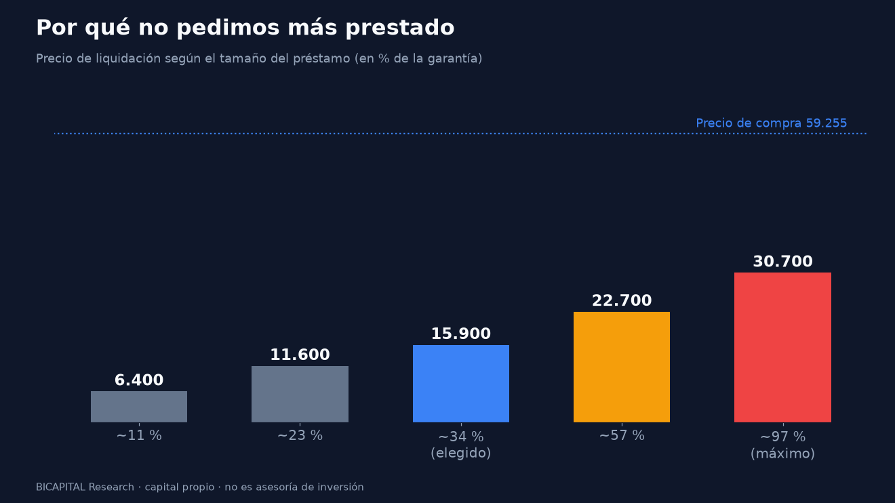
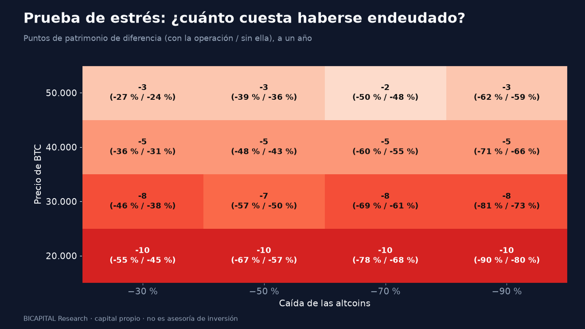

# Cuánto riesgo hay de verdad en nuestra compra de Bitcoin con préstamo

*Lo que juega en contra, la prueba de estrés con todo el portafolio, las contingencias escritas de antemano y el dictamen de una auditoría independiente, con sus «no pasa».*

En el artículo anterior contamos por qué y cómo compramos Bitcoin con un préstamo pequeño. Una tesis que solo enumera lo que la favorece no es una tesis, es una esperanza. Esto es lo que juega en contra, y lo publicamos igual.

## Tres riesgos que no son lo mismo

- **Volatilidad:** que el precio baje y suba. La aceptamos; el horizonte es de años.
- **Pérdida temporal:** que el patrimonio valga menos durante meses. También la aceptamos: mientras conservemos el BTC, conservamos la posibilidad de recuperarlo.
- **Pérdida irreversible:** que una **liquidación** venda el BTC a la fuerza en el peor momento. La liquidación es cuando el exchange vende tu garantía porque la deuda pesa demasiado. Esto es lo único que la operación busca evitar.

## Evidencia en contra

- **La valoración todavía no es de capitulación.** Los suelos de ciclos anteriores se formaron con el MVRV (precio de BTC dividido por lo que pagaron en promedio sus tenedores) más bajo que hoy. Hoy, esos niveles equivaldrían a BTC entre unos 37.000 y 47.000.
- **La tendencia sigue a la baja:** el precio está bajo una media de 200 días que sigue cayendo. Nuestras propias reglas de entrada decían esperar.
- **Los fondos cotizados de BTC en EE. UU. tenían salidas** de entre 1.300 y 1.700 millones por semana en noviembre.
- **La custodia:** la garantía está en Binance, que sufrió un hackeo grande el 29 de octubre. Si el exchange se paraliza en plena caída, podría impedirnos reaccionar a tiempo.
- **La historia reciente:** en nuestro estudio, las entradas en situaciones parecidas fueron seguidas de caídas adicionales de entre un 54 % y un 64 % antes de recuperarse. Comprar en zona de valor ha funcionado, pero casi nunca en el mínimo.
- **El punto más delicado:** el activo que estabiliza el portafolio, BTC, es justo el que ponemos como garantía.

## Por qué no pedimos más prestado

**Cómo leer el gráfico:** cada barra es el precio al que nos liquidarían según cuánto pidiéramos prestado. La línea punteada es el precio de compra. Con el máximo que permitía Binance, la liquidación estaría en unos 30.700, demasiado cerca. Con el 34 % elegido está en unos 15.900, un 73 % más abajo.

## Prueba de estrés con todo el portafolio

**Cómo leer la tabla:** cada casilla combina un precio de BTC dentro de un año con una caída de las altcoins. El número grande es cuántos puntos de patrimonio cuesta haberse endeudado frente a no hacerlo. Entre paréntesis, el resultado con la operación y sin ella.

Mientras BTC no baje de 20.000, endeudarse cuesta entre 2 y 10 puntos de patrimonio. Duele, pero está acotado y no amenaza la supervivencia del portafolio. Con BTC a 30.000, la cuenta seguiría con casi el doble del margen mínimo.

## Lo que la estadística no puede decir

¿Qué tan probable es que, después de caer un 50 %, BTC caiga otro 73 %? Hay muchos días de datos, pero **solo 4 ciclos**. Con tan pocos ciclos, la estadística solo permite decir que esa probabilidad está por debajo del 53 %, lo cual no sirve de mucho. Además, las caídas no son independientes: en las crisis, los movimientos extremos se vuelven más probables, no menos.

Por eso la operación no se apoya en una probabilidad calculada, sino en **sobrevivir por diseño:** deuda pequeña, liquidación lejos, contingencias escritas y devolución temprana.

## Contingencias escritas antes de necesitarlas

| Si pasa esto | Hacemos esto |
|---|---|
| BTC llega a 65.000 | Se ejecuta la primera venta; revisamos la segunda |
| 30 días sin la primera venta (24-dic) | Revisión obligatoria; considerar pagar con capital propio |
| BTC cae a 30.000 | Comprar BTC con capital propio y añadirlo a la garantía |
| La tasa del préstamo sube mucho | Priorizar reducir la deuda |
| Cualquier caída nueva | Nunca ampliar el préstamo |

## El dictamen de la auditoría, sin editar

- **Cálculos:** pasa. Todo coincide con los registros del exchange.
- **Cumplimiento del reglamento:** no pasa. El reglamento prohíbe el margen y BTC queda en el 56 % (la banda es del 35 al 45 %).
- **Calidad de la tesis:** indeterminado. Hay zona de valor, pero no capitulación.
- **Robustez operativa:** no pasa. El monitor no veía la cuenta de margen y había riesgo de exchange.
- **Ventaja demostrada:** no demostrada.
- **Gestión del capital:** pasa, con reservas.

La conclusión de la auditoría: *«Es una excepción financieramente acotada y sobrevivible en casi todos los caminos históricos, pero va contra la arquitectura del portafolio y no tiene una ventaja demostrada.»*

## Qué aprendimos hasta hoy

1. **Diseñar primero para sobrevivir y después para ganar.**
2. **No hace falta acertar el suelo:** basta con comprar en zona de valor y que la estructura aguante el tiempo.
3. **Una probabilidad baja de liquidación no es una probabilidad baja de pérdida.**
4. **Con pocos ciclos, simular más no da más certeza.** Lo responsable es dimensionar bien, escribir las reglas y publicar la decisión.

Publicaremos el seguimiento el 24 de diciembre, o en la primera venta si ocurre antes, y al cierre. [Nota de investigación completa](https://test201807.github.io/bicapital-research/research/btc-2026-11-24/).

*Capital propio. No es una oferta, ni gestión de carteras para terceros, ni asesoría de inversión. Operar con margen puede hacer perder todo el capital dado en garantía.*
