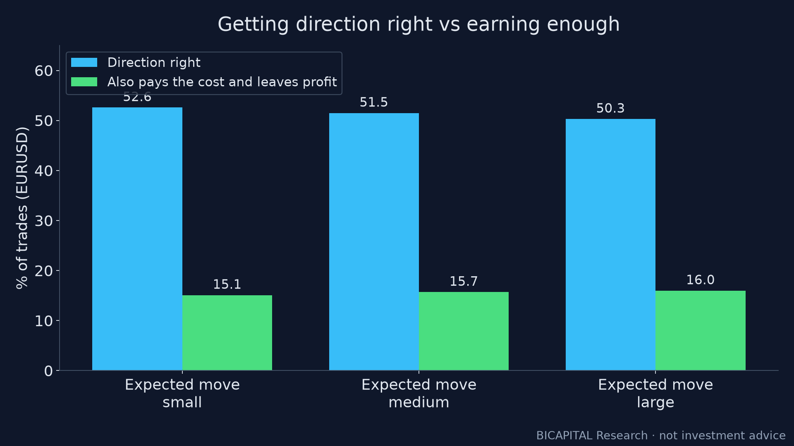
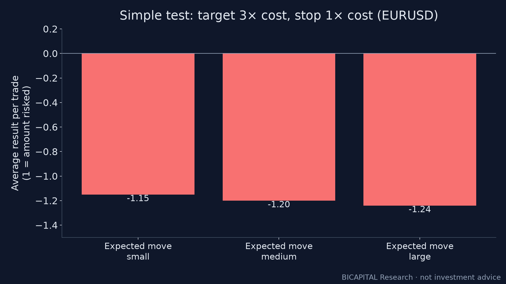
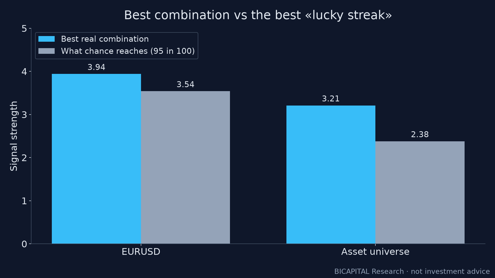
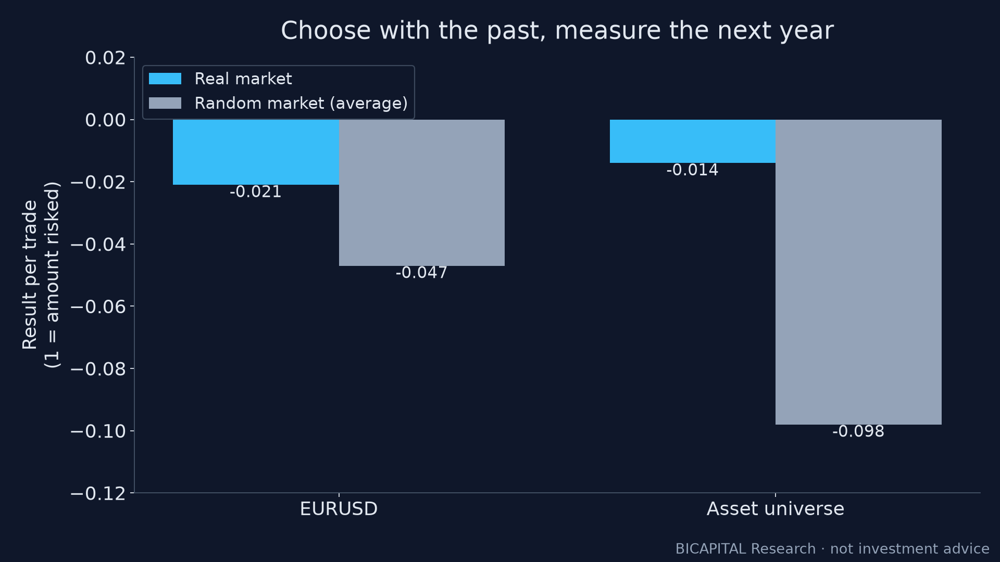
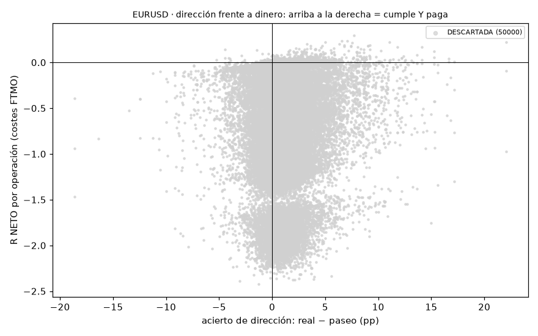

# Getting the direction right is not enough: you must also pay the cost

*We searched over 235,000 combinations for signals that got the direction right and also earned enough to pay the cost. With corrected data, none made it.*

Almost everyone starting out thinks trading is about being right: if it goes up, I buy; if it goes down, I sell. And if I am right more than half the time, I win. Sounds reasonable, but a piece is missing.

Every trade has a **cost**. The most important one is the *spread*: the gap between the price you buy at and the price you sell at in the same instant. It is like an airport currency exchange: if you change euros to dollars and straight back again, you end up with fewer euros than you started with, even though the dollar has not moved.

So, to win, guessing where price goes is not enough. Price has to move **far enough** in that direction to pay the cost and leave something over. This lab measures exactly that.

## A note on the data

On 7 November we found that the broker's data had the spread wrong in parts of 2021 and in November and December 2023. This article uses the corrected version of the lab, recalculated with the real spread of each minute on every trade.

## What we looked for

We took the direction signals that had done best in earlier labs and combined them with filters (for example, time of day or the size of the expected move) and with different ways of exiting the trade (fixed target, moving stop, time exit). On euro-dollar this produced more than 235,000 combinations with data; across the set of markets, more than 252,000.

Each trade was measured in two ways:

- **Is it right?** Did it get the direction right?
- **Does it pay?** Did it move enough to cover the cost and leave a profit?

## How we built chance

When you test 235,000 combinations, some will look spectacular by pure luck. It is like flipping 235,000 coins: one will land ten heads in a row. That does not make it a magic coin.

So we repeated exactly the same search in invented markets: 100 random walks (prices with moves the same size as the real ones, but random direction), 10 worlds that copy how the market chains one day to the next, and 10 «placebos» (fake signals at the same times). In each one we kept the best combination. That tells us how good the best combination can look by luck alone.

## Result 1: being right is easy; paying is not

**How to read the chart:** we used the best direction signals from earlier labs with a simple exit: target of 3 times the cost, stop of 1 times the cost, 4 hours maximum. The blue bars are the share of trades that got the direction right: around 51-53 %. The green ones, those that also paid the cost and left a profit: only 15-16 %. Across the set of markets it is worse: about 51 % right, and only 7.7 % to 9.2 % pay.

Notice something else too: expecting a big move does not help. With a large expected move, the cost is paid 16.0 % of the time; with a small one, 15.1 %. Almost the same.

**How to read the chart:** this is the same simple test, measured in «risk units», where 1 means winning as much as you risk. All three bars are red and very negative: −1.15, −1.20 and −1.24 per trade. They lose more than one unit because, on top of the stop, you pay the cost of getting in and out.

## Result 2: the best combination looked good…

**How to read the chart:** the blue bar is the strength of the best combination we found in the real market; the grey one, what the best chance combination reaches in 95 out of 100 searches. Here blue does come out on top: 3.94 vs 3.54 on euro-dollar and 3.21 vs 2.38 across the set of markets. Only about 2 out of 100 invented markets got that high.

That sounds like good news. But with another kind of chance (the one copying how days chain together), euro-dollar's best combination was no longer so rare: about 8 out of 100 invented worlds matched it. And the toughest test was still to come.

## Result 3: …but it failed the following year

The toughest test is this: choose the best combination using only past years and measure it in the following year, which has not been looked at. It is like studying with old exams and then sitting a new one.

**How to read the chart:** the blue bars are the real result per trade in the unseen years; the grey ones, the average of chance doing the same. On euro-dollar, −0.021 per trade (6 of 12 years positive). Across the set of markets, −0.014 (5 of 12 years positive). Real comes out somewhat better than chance, but it still loses money. A strategy that loses less than chance is still a losing strategy.

## Result 4: the full cloud

**How to read the chart:** each grey dot is a combination (50,000 are shown; labels in Spanish). To the right, better direction than chance. Upwards, more money after costs. The ideal would be a dot in the top right: right AND paying. Almost the whole cloud is below the zero line. Many combinations beat chance on direction (they are to the right), but stay low: they are right and still lose.

Final result with corrected data: **zero** combinations that get the direction right, pay the cost with a profit, stand out from chance and survive entering 5 minutes late. Not on euro-dollar, not across the set of markets. Simulating an account risking 1 % per trade, the portfolio would lose 34.2 % a year.

## My takeaways

- Getting the direction right slightly more than half the time is relatively easy. Making money is something else.
- Costs eat small edges: of the trades that are right, most do not move enough to pay for them.
- When you test thousands of combinations, the best one always shines. You must compare it with what shines by chance and test it on unseen years.
- With corrected data, no combination passed.
- Before asking «am I right?», ask «how far does price move when I am right, and how much does it cost me to get in and out?».

*Educational content. Not investment advice.*
