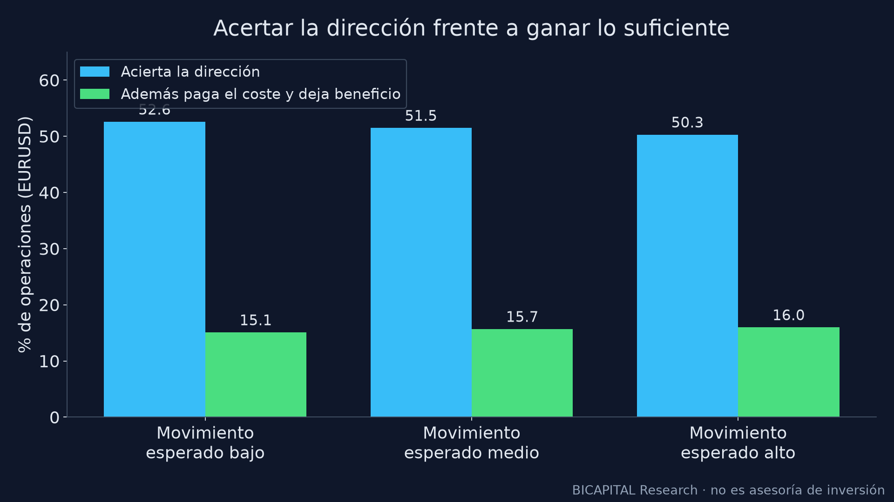
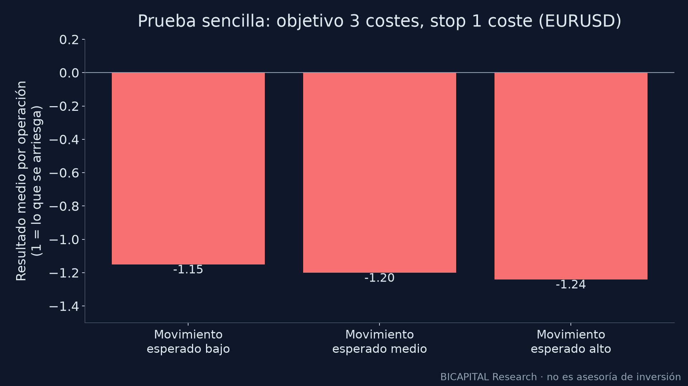
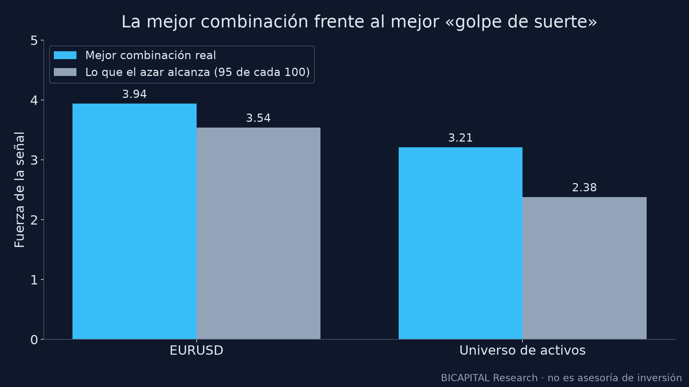
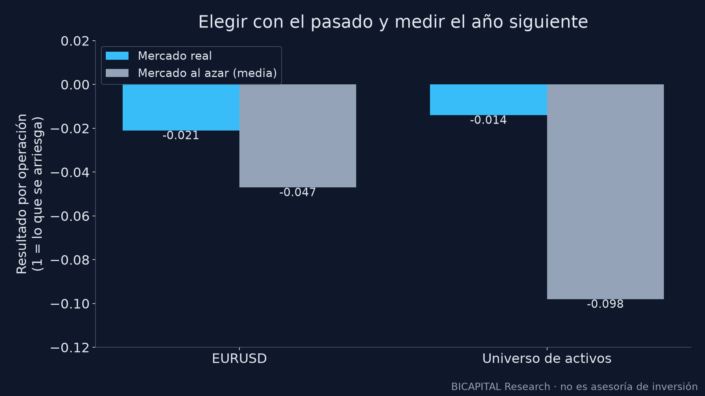
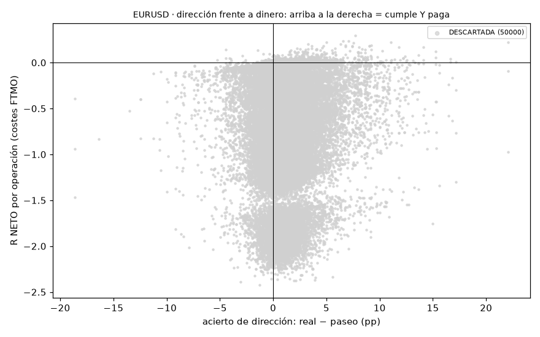

# Acertar la dirección no basta: también hay que pagar el coste

*Buscamos entre más de 235.000 combinaciones señales que acertaran la dirección y además ganaran lo suficiente para pagar el coste. Con datos corregidos, ninguna lo logró.*

Casi todo el mundo que empieza piensa que el trading consiste en acertar: si sube, compro; si baja, vendo. Y si acierto más de la mitad de las veces, gano. Suena razonable, pero falta una pieza.

Cada operación tiene un **coste**. El más importante es el *spread*: la diferencia entre el precio al que compras y el precio al que vendes en el mismo instante. Es como en una casa de cambio del aeropuerto: si cambias euros a dólares y enseguida los vuelves a cambiar, tienes menos euros que al principio, aunque el dólar no se haya movido.

Por eso, para ganar no basta con acertar hacia dónde va el precio. El precio tiene que moverse **lo suficiente** en esa dirección para pagar el coste y que sobre algo. Este laboratorio mide justo eso.

## Una nota sobre los datos

El 7 de noviembre descubrimos que los datos del bróker tenían el spread mal en algunas partes de 2021 y en noviembre y diciembre de 2023. Este artículo usa la versión corregida del laboratorio, recalculada con el spread real de cada minuto en cada operación.

## Qué buscamos

Tomamos las señales de dirección que habían salido mejor en laboratorios anteriores y las combinamos con filtros (por ejemplo, la hora del día o el tamaño del movimiento esperado) y con distintas formas de salir de la operación (objetivo fijo, stop que se va moviendo, salida por tiempo). En el euro-dólar salieron más de 235.000 combinaciones con datos; en el conjunto de mercados, más de 252.000.

Cada operación se midió de dos formas:

- **¿Cumple?** ¿Acertó la dirección?
- **¿Paga?** ¿Se movió lo bastante para cubrir el coste y dejar beneficio?

## Cómo fabricamos el azar

Cuando pruebas 235.000 combinaciones, alguna saldrá espectacular por pura suerte. Es como lanzar 235.000 monedas: alguna sacará diez caras seguidas. Eso no la convierte en una moneda mágica.

Por eso repetimos exactamente la misma búsqueda en mercados inventados: 100 paseos aleatorios (precios con movimientos del mismo tamaño que los reales, pero dirección al azar), 10 mundos que copian cómo encadena el mercado unos días con otros, y 10 «placebos» (señales falsas a las mismas horas). En cada uno nos quedamos con la mejor combinación. Así sabemos cuán buena puede parecer la mejor combinación solo por suerte.

## Resultado 1: acertar es fácil; pagar, no

**Cómo leer el gráfico:** usamos las mejores señales de dirección de laboratorios anteriores con una salida sencilla: objetivo de 3 veces el coste, stop de 1 vez el coste, máximo 4 horas. Las barras azules son el porcentaje de operaciones que acertaron la dirección: alrededor del 51-53 %. Las verdes, las que además pagaron el coste y dejaron beneficio: solo un 15-16 %. En el conjunto de mercados es peor: aciertan cerca del 51 % y pagan solo entre el 7,7 % y el 9,2 %.

Fíjate también en otra cosa: esperar un movimiento grande no ayuda. Con movimiento esperado alto, se paga el 16,0 % de las veces; con bajo, el 15,1 %. Casi igual.

**Cómo leer el gráfico:** es la misma prueba sencilla, medida en «unidades de riesgo», donde 1 es ganar lo mismo que arriesgas. Las tres barras son rojas y muy negativas: −1,15, −1,20 y −1,24 por operación. Pierden más de una unidad porque, además del stop, se paga el coste de entrar y salir.

## Resultado 2: la mejor combinación parecía buena…

**Cómo leer el gráfico:** la barra azul es la fuerza de la mejor combinación que encontramos en el mercado real; la gris, lo que alcanza la mejor combinación del azar en 95 de cada 100 búsquedas. Aquí la azul sí queda por encima: 3,94 frente a 3,54 en el euro-dólar y 3,21 frente a 2,38 en el conjunto de mercados. Solo unos 2 de cada 100 mercados inventados llegaron tan alto.

Parece una buena noticia. Pero con otro tipo de azar (el que copia cómo se encadenan los días), la mejor combinación del euro-dólar ya no era tan rara: unos 8 de cada 100 mundos inventados la igualaban. Y faltaba la prueba más dura.

## Resultado 3: …pero falló al año siguiente

La prueba más dura es esta: elegir la mejor combinación solo con los años pasados y medirla en el año siguiente, que no se ha mirado. Es como estudiar con exámenes antiguos y presentarse a uno nuevo.

**Cómo leer el gráfico:** las barras azules son el resultado real por operación en los años no vistos; las grises, la media del azar haciendo lo mismo. En el euro-dólar, −0,021 por operación (6 de 12 años positivos). En el conjunto de mercados, −0,014 (5 de 12 años positivos). El real queda algo mejor que el azar, pero sigue perdiendo dinero. Una estrategia que pierde menos que el azar sigue siendo una estrategia que pierde.

## Resultado 4: la nube completa

**Cómo leer el gráfico:** cada punto gris es una combinación (se muestran 50.000). Hacia la derecha, más acierto de dirección que el azar. Hacia arriba, más dinero tras costes. Lo ideal sería un punto arriba a la derecha: acierta Y paga. Casi toda la nube está bajo la línea del cero. Muchas combinaciones aciertan más que el azar (están a la derecha), pero se quedan abajo: aciertan y aun así pierden.

Resultado final con datos corregidos: **cero** combinaciones que acierten la dirección, paguen el coste con beneficio, se distingan del azar y aguanten entrando 5 minutos tarde. Ni en el euro-dólar ni en el conjunto de mercados. Simulando una cuenta con un 1 % de riesgo por operación, la cartera perdería un 34,2 % al año.

## Qué me llevo

- Acertar la dirección algo más de la mitad de las veces es relativamente fácil. Ganar dinero es otra cosa.
- El coste se come las ventajas pequeñas: de las operaciones que aciertan, la mayoría no se mueve lo bastante para pagarlo.
- Cuando pruebas miles de combinaciones, la mejor siempre brilla. Hay que compararla con lo que brilla en el azar y probarla en años no vistos.
- Con los datos corregidos, ninguna combinación pasó.
- Antes de preguntarte «¿acierto?», pregúntate «¿cuánto se mueve el precio cuando acierto, y cuánto me cuesta entrar y salir?».

*Contenido educativo. No es asesoría de inversión.*
