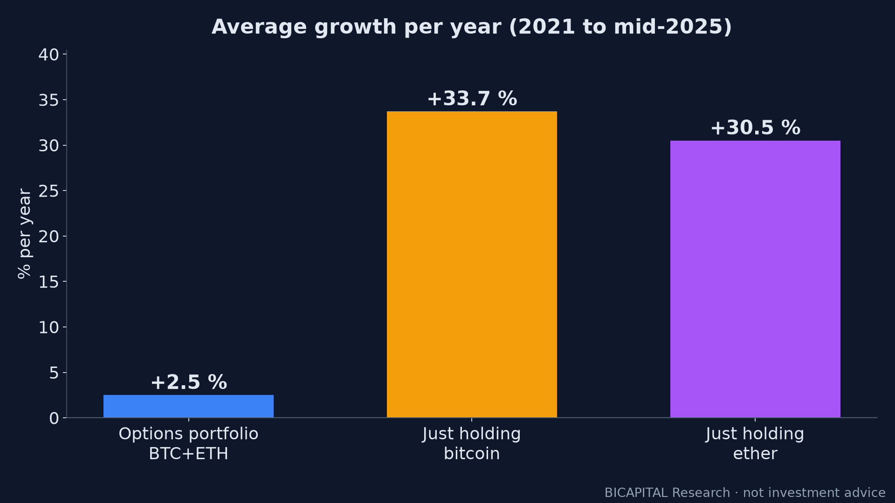
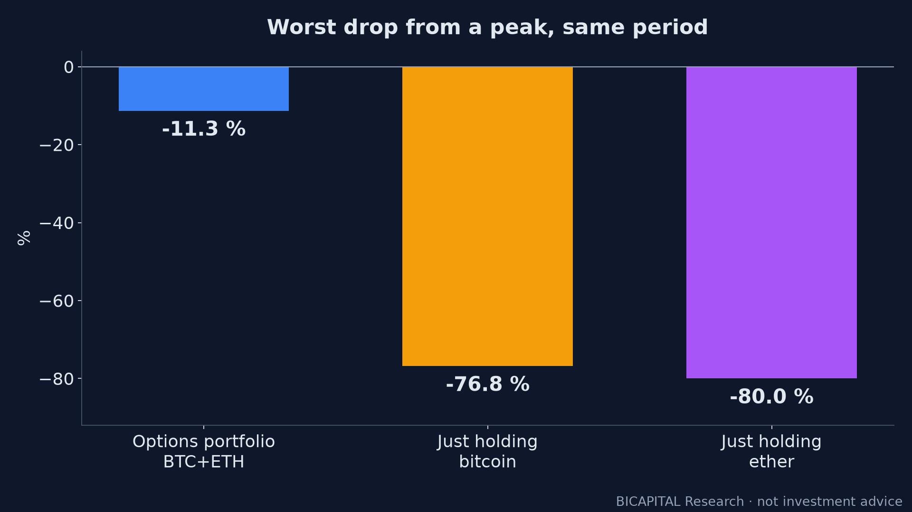
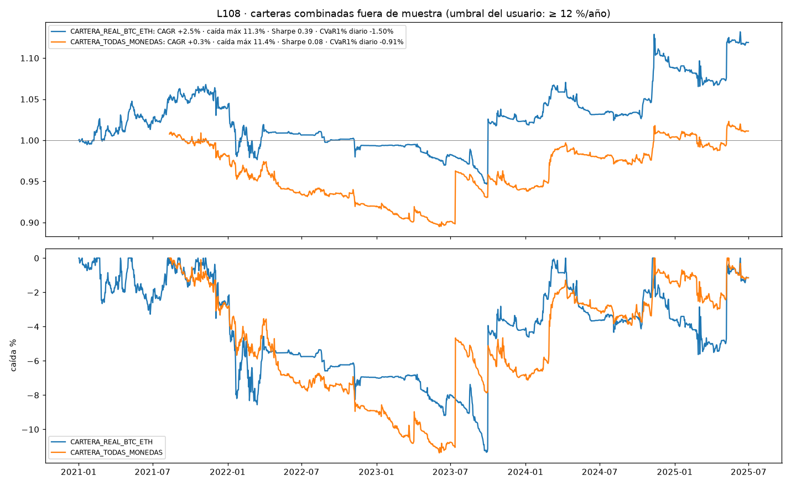
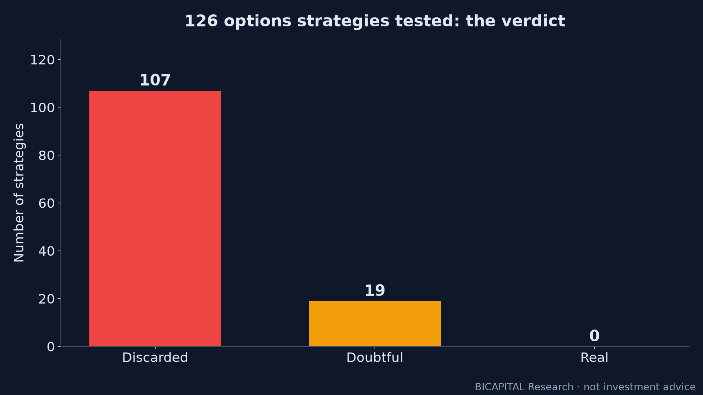
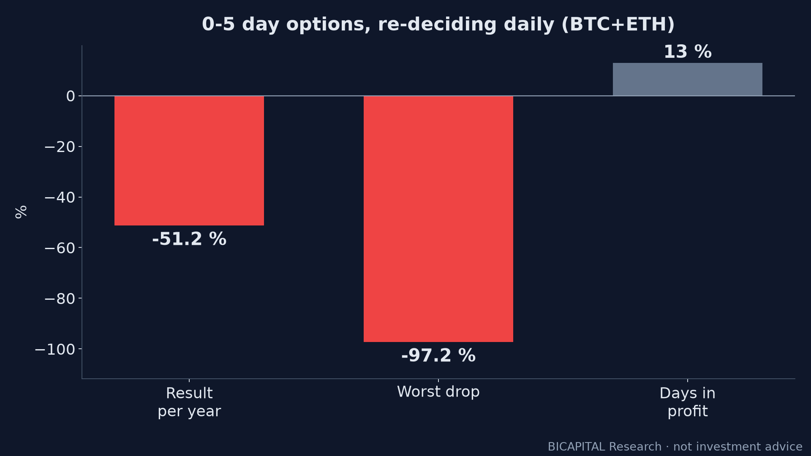

# Crypto options: selling calls or buying puts gives no edge

*We tested 126 strategies with options on bitcoin, ether and four other coins, then 616 more very short-term ones. None beat luck. The most aggressive one lost more than half every year.*

Options have a reputation as a professional's tool. Social media is full of promises: "earn income every week by selling calls", "protect your bitcoin with puts". We wanted to know whether, with real data and rules fixed in advance, any of these ideas gives a true edge.

We ran two studies. The first used terms from 1 day to 8 weeks. The second used options of 0 to 5 days, deciding every day what to do. The answer was the same in both.

## What an option is, in two examples

A **call option** is the right to buy something at a fixed price, until a date. It is like paying a deposit to reserve a flat at a set price: if the flat goes up, you win; if it goes down, you only lose the deposit.

A **put option** is the right to sell at a fixed price. It works like car insurance: you pay a little each month and, if there is a crash, the insurance covers you.

What you pay for an option is called the **premium**. Whoever sells the option collects the premium, just as the insurer collects the insurance fee.

Two very popular strategies:

- **Selling calls on the coin you own** (covered call). You hold bitcoin and collect a premium in exchange for agreeing to sell it if it rises a lot. You get a small extra, but you give up the big rallies.
- **Buying protective puts.** You hold the coin and pay for insurance in case it falls. It protects you, but the insurance costs money every time.

## How we tested it

- Coins: bitcoin, ether, BNB, SOL, XRP and DOGE.
- For bitcoin and ether, option prices come from real trades on a large crypto options exchange. The model was off, at the median, by about 3 volatility points. For the other four coins there is no public history of option prices, so they were estimated with a model; those results are less reliable.
- Every quarter, the strategy that had done best over the previous 2 years was chosen and then applied to data it had not seen. This avoids choosing "with hindsight".
- All results reported are from that "unseen" part, from 2021 to mid-2025.
- The cost of buying and selling the options was deducted.

## The main result

**How to read the chart:** each bar is how much money grew per year on average. The options portfolio on bitcoin and ether grew 2.5% a year. Simply holding bitcoin gave 33.7% a year over the same period, and holding ether 30.5%. Options came nowhere close.

**How to read the chart:** the worst drop is the most you would have lost from a high point to the next low point. The options portfolio fell at most 11.3%. Bitcoin fell as much as 76.8% and ether 80%. In other words: the options portfolio was much calmer, but earned very little. Less risk, yes; edge, no.

**How to read the chart:** on top, the value of two portfolios starting at 1 (labels in Spanish). The blue one (bitcoin and ether) ends around 1.12 after four and a half years. The orange one (all coins) ends almost where it began. Below, the drops in percent. You can see long stretches of slow decline and a few sharp jumps. This is not a steady income.

## Skill or luck?

This is the key part. How is chance built in this study? We create many fake price histories by cutting the real history into chunks and shuffling them. These histories have the same typical moves and the options cost the same, but the order of the days is different. If a strategy wins just as much on these made-up histories, its gains do not come from good timing: they come only from collecting the premium, like an insurer collecting fees, or from luck.

**How to read the chart:** of 126 strategies tested (each coin with each family of strategies, plus the portfolios), 107 were discarded and 19 were rated doubtful. None reached "real", which requires beating luck while accounting for how many were tried.

The fastest-growing one was a signal strategy on DOGE: 71.9% a year. But it fell 54.5% at its worst, its option prices come from a model (not real data) and it failed the luck test. 13 of the 126 topped 12% a year, but none of them passed the tests.

Also, selling calls and buying puts keep almost all the coin's risk. If they made something, it was mostly because the coin went up, not because of the option.

## Second study: very short term, deciding every day

We thought: "maybe with options of just a few days, adapting every day, it works". Every day at midnight, the best combination was picked based on what had worked in previous weeks. Different memory windows were tried, from 5 to 30 days.

**How to read the chart:** the main version, with bitcoin and ether together, lost 51.2% a year. Its worst drop was 97.2%: almost everything. Only 13% of days ended in profit. It made about 295 trades a year. All 616 variants tested were discarded.

Adapting every day did not help. Quite the opposite: chasing what worked yesterday in such a fast market meant paying costs again and again, and arriving late to every change.

## What I take away

- Selling calls or buying puts changes your risk profile, but it does not create an edge. In these tests, the options portfolio earned 2.5% a year.
- If an options strategy wins, ask whether it is skill or just collecting the premium. Compare it with randomly shuffled price histories.
- Shorter and busier is not better. Deciding daily with 0 to 5-day options lost more than half per year.
- Be wary of very high numbers on small coins: they often come from models with no real prices behind them.

*Educational content. Not investment advice.*
