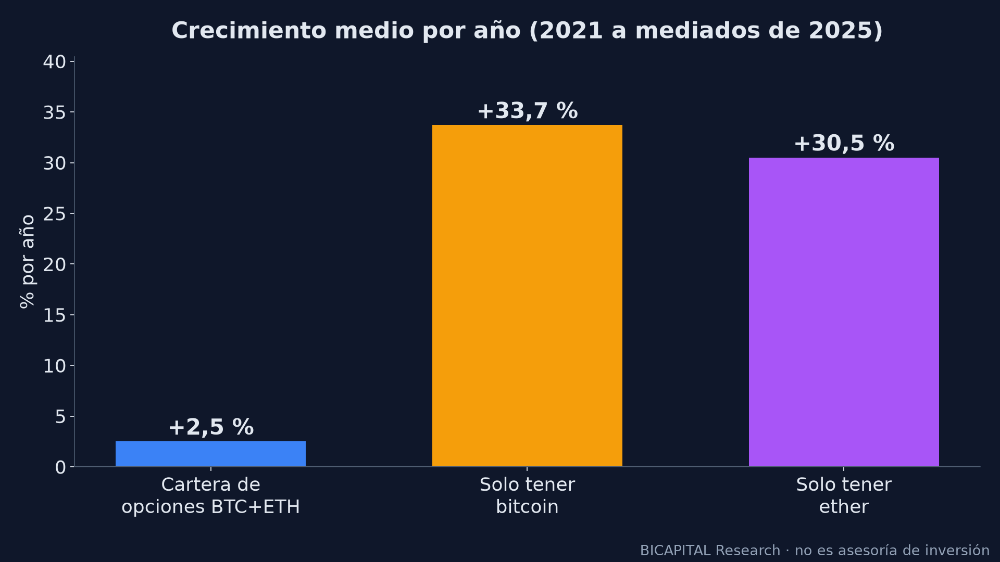
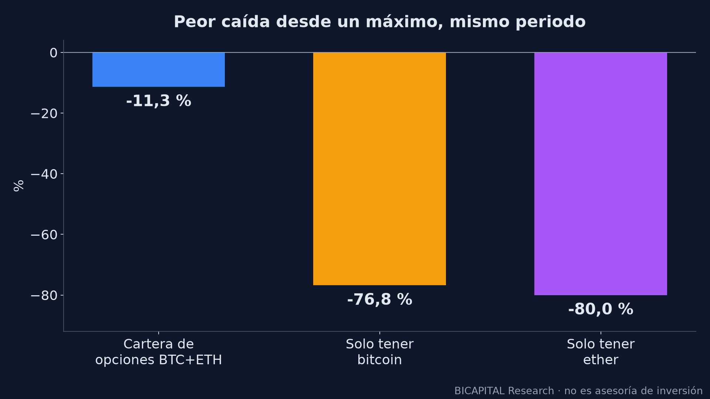
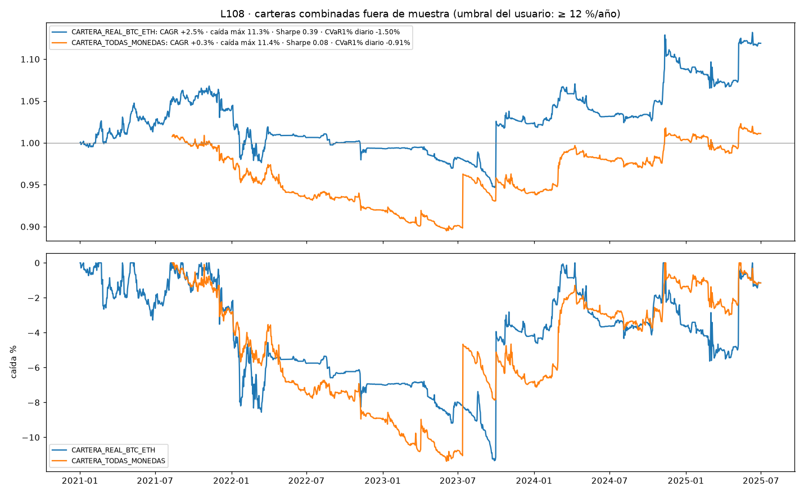
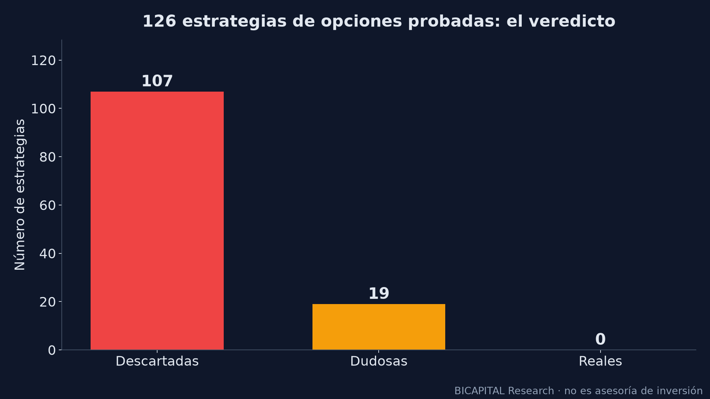
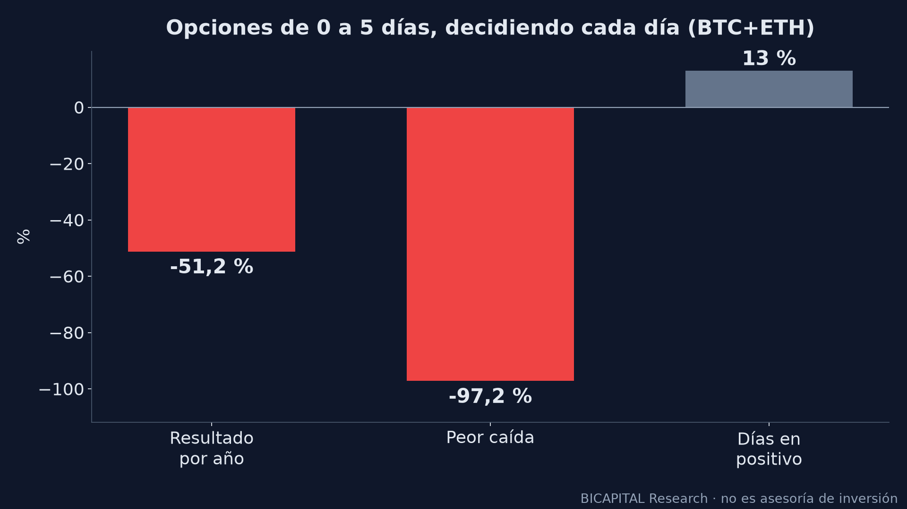

# Opciones de cripto: vender calls o comprar puts no da ventaja

*Probamos 126 estrategias con opciones de bitcoin, ether y otras cuatro monedas, y después otras 616 de muy corto plazo. Ninguna superó a la suerte. La más agresiva perdió más de la mitad cada año.*

Las opciones tienen fama de herramienta de profesionales. En redes se ven muchas promesas: «cobra una renta cada semana vendiendo calls», «protege tu bitcoin con puts». Queríamos saber si, con datos reales y reglas fijadas de antemano, alguna de esas ideas da una ventaja de verdad.

Hicimos dos estudios. El primero, con plazos de 1 día a 8 semanas. El segundo, con opciones de 0 a 5 días, decidiendo cada día qué hacer. La respuesta fue la misma en los dos.

## Qué es una opción, en dos ejemplos

Una **opción call** es el derecho a comprar algo a un precio fijado, hasta una fecha. Es como pagar una señal para reservar un piso a un precio: si el piso sube, ganas; si baja, solo pierdes la señal.

Una **opción put** es el derecho a vender a un precio fijado. Funciona como un seguro del coche: pagas un poco cada mes y, si hay un golpe, el seguro te cubre.

Lo que se paga por una opción se llama **prima**. Quien vende la opción cobra la prima, como la aseguradora cobra la cuota del seguro.

Dos estrategias muy populares:

- **Vender calls sobre la moneda que tienes** (en inglés, covered call). Tienes bitcoin y cobras una prima a cambio de comprometerte a venderlo si sube mucho. Ganas un extra pequeño, pero renuncias a las grandes subidas.
- **Comprar puts de protección.** Tienes la moneda y pagas un seguro por si cae. Te protege, pero el seguro cuesta dinero cada vez.

## Cómo lo probamos

- Monedas: bitcoin, ether, BNB, SOL, XRP y DOGE.
- Para bitcoin y ether, los precios de las opciones salen de operaciones reales en un gran mercado de opciones cripto. El modelo se equivocó, de mediana, en unos 3 puntos de volatilidad. Para las otras cuatro monedas no hay historia pública de precios de opciones, así que se estimaron con un modelo; esos resultados son menos fiables.
- Cada trimestre se elegía la estrategia que mejor lo había hecho en los 2 años anteriores, y se aplicaba después a datos que no había visto. Así se evita elegir «a toro pasado».
- Los resultados que contamos son todos de esa parte «no vista», de 2021 a mediados de 2025.
- Se descontaron los costes de comprar y vender las opciones.

## El resultado principal

**Cómo leer el gráfico:** cada barra es cuánto creció el dinero de media al año. La cartera de opciones sobre bitcoin y ether creció un 2,5 % al año. Simplemente tener bitcoin dio un 33,7 % al año en el mismo periodo, y tener ether un 30,5 %. Las opciones no se acercaron.

**Cómo leer el gráfico:** la peor caída es lo máximo que se llegó a perder desde un punto alto hasta el siguiente punto bajo. La cartera de opciones cayó como mucho un 11,3 %. Bitcoin llegó a caer un 76,8 % y ether un 80 %. Es decir: la cartera de opciones fue mucho más tranquila, pero ganó muy poco. Menos riesgo, sí; ventaja, no.

**Cómo leer el gráfico:** arriba, el valor de dos carteras que empiezan en 1. La azul (bitcoin y ether) termina hacia 1,12 tras cuatro años y medio. La naranja (todas las monedas) termina casi donde empezó. Abajo, las caídas en porcentaje. Se ven largos periodos de bajadas lentas y algunos saltos bruscos. No es una renta estable.

## ¿Es habilidad o es suerte?

Aquí está la parte importante. ¿Cómo se construye el azar en este estudio? Se crean muchas historias de precios falsas, cortando la historia real en trozos y mezclándolos. Esas historias tienen los mismos movimientos típicos y las opciones cuestan lo mismo, pero el orden de los días es otro. Si una estrategia gana igual en esas historias inventadas, lo que gana no viene de saber elegir el momento: viene solo de cobrar la prima, como la aseguradora que cobra cuotas, o de la suerte.

**Cómo leer el gráfico:** de 126 estrategias probadas (cada moneda con cada familia de estrategias, más las carteras), 107 quedaron descartadas y 19 como dudosas. Ninguna llegó a «real», que exige superar a la suerte teniendo en cuenta cuántas se probaron.

La que más creció fue una estrategia con señales en DOGE: un 71,9 % al año. Pero cayó un 54,5 % en el peor momento, sus precios de opciones salen de un modelo (no de datos reales) y no superó la prueba de la suerte. 13 de las 126 superaron el 12 % al año, pero ninguna de ellas pasó las pruebas.

Además, las estrategias de vender calls y comprar puts llevan casi todo el riesgo de la moneda. Si ganaron algo, fue sobre todo porque la moneda subió, no por la opción.

## Segundo estudio: muy corto plazo, decidiendo cada día

Pensamos: «quizá con opciones de muy pocos días y adaptándose cada día, sí». Cada día, a medianoche, se elegía la mejor combinación según lo que había funcionado en las semanas anteriores. Se probaron distintas ventanas de memoria, de 5 a 30 días.

**Cómo leer el gráfico:** la versión principal, con bitcoin y ether juntos, perdió un 51,2 % al año. Su peor caída fue del 97,2 %: casi todo. Solo el 13 % de los días terminó en positivo. Hacía unas 295 operaciones al año. Las 616 variantes probadas quedaron descartadas.

Adaptarse cada día no ayudó. Al contrario: perseguir lo que funcionó ayer en un mercado tan rápido hizo que se pagaran costes una y otra vez, y se llegó tarde a cada cambio.

## Qué me llevo

- Vender calls o comprar puts cambia el perfil de riesgo, pero no crea ventaja. En estas pruebas, la cartera de opciones ganó un 2,5 % al año.
- Si una estrategia de opciones gana, pregúntate si es habilidad o solo cobrar la prima. Compárala con historias de precios mezcladas al azar.
- Más corto y más activo no es mejor. Decidir cada día con opciones de 0 a 5 días perdió más de la mitad al año.
- Desconfía de cifras muy altas en monedas pequeñas: suelen salir de modelos sin precios reales detrás.

*Contenido educativo. No es asesoría de inversión.*
