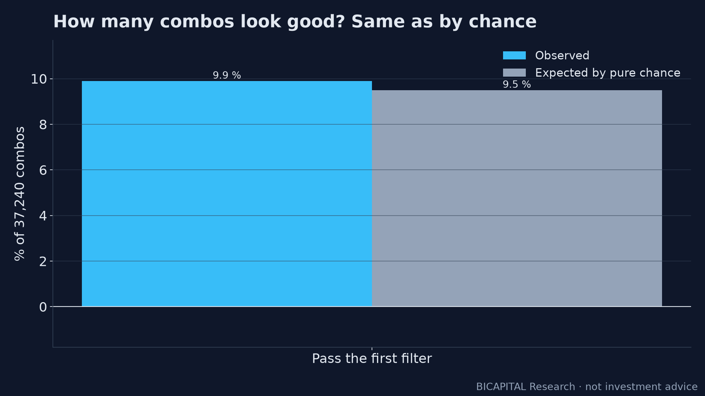
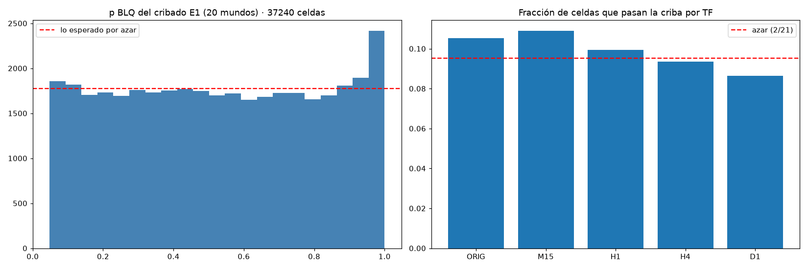
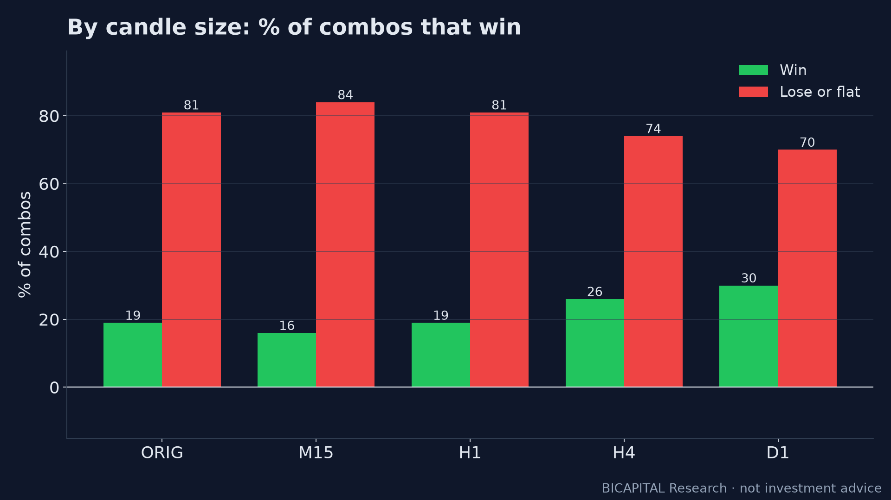
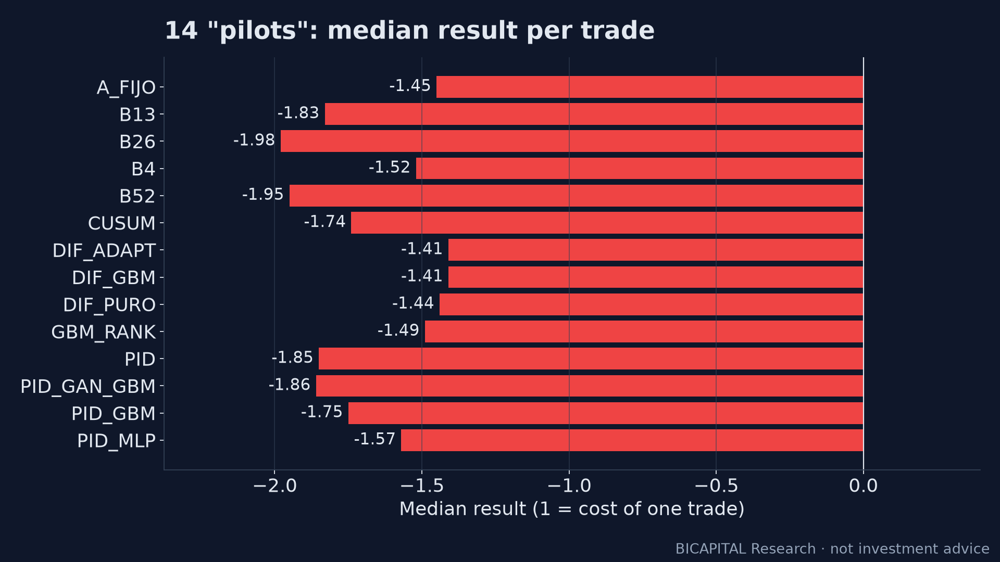
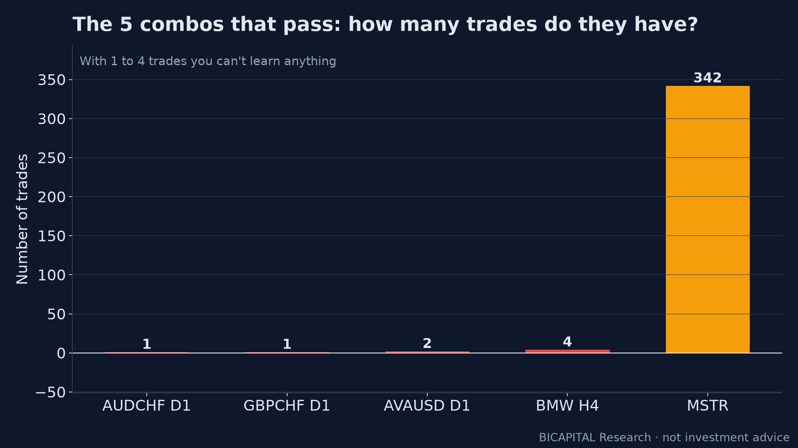

# The thermostat on 133 assets and 5 timeframes: the promised report

*We promised to publish the replication of the self-tuning system, whatever the outcome. We tested 37,240 combinations. What looks good shows up almost exactly as often as chance would produce.*

When we published the system that re-tunes itself like a thermostat, we said we would repeat it on every available asset and on several timeframes. And that we would publish the result, whatever it was. Here it is.

A friendly spoiler: we did not find a money machine. But the report teaches something very valuable about how chance fools you when you test many things at once.

## A two-line reminder

A **PID** is a controller that corrects errors, like the thermostat at home. If the trading rule starts losing, the PID changes its settings to try to win again. In the original study, on EURUSD, it did not manage to win reliably.

This time we did not test just the PID. We tested **14 different "pilots"**: the classic PID, variants with machine learning, "fuzzy" versions (which reason with rules like "if the error is big, correct a lot"), a pilot that only looks at the last few weeks and, as a reference, the fixed rule with no pilot at all.

## The size of the experiment

- **133 assets:** currencies, indices, stocks, commodities and cryptocurrencies. We removed 13 for having less than 18 months of test data or clock problems.
- **5 timeframes:** the timeframe is the size of each candle. M15 means 15-minute candles; H1, one hour; H4, four hours; D1, one day. ORIG is the mix used in the original study.
- **3 entry styles:** breakout, trend and reversion.
- **14 pilots.**

Multiplied together, that is **37,240 combinations**. Each one was tested on data not used to design it (from mid-2022 to June 2025). Later data is still locked away, unseen.

We measured in "costs": +1 means earning what one round-trip trade costs.

## How we built "chance"

For each combination we created made-up price worlds. They resemble the real ones (same moves) but are shuffled in blocks to break any pattern. In each world we repeated the whole process. If the real combination does not stand out from those worlds, it may be luck.

For the first filter we used 20 worlds. A combination passed if it ranked among the top 2 of 21 (the real one plus the 20 worlds). By pure chance, that happens to 2 in 21: 9.5%.

## First filter: as often as chance

**How to read the chart:** the blue bar is the share of combinations that passed the first filter: 9.9% (3,676 of 37,240). The grey bar is what you would expect from pure chance: 9.5%. They are almost the same height.

It is like tossing a coin 37,240 times and counting how often you get "heads twice in a row". It will happen a lot, and not because the coin is special.

**How to read the chart:** this is the original chart (technical labels, partly in Spanish). On the left, how many combinations fall into each slice of a score that goes from 0 (far above chance) to 1 (far below). If there were nothing real, the bars would be flat, at the height of the red line. They nearly are, all the way across. On the right, the share that passes in each timeframe, compared with the red chance line. None truly separates from it.

## By timeframe and by pilot

**How to read the chart:** green is the share of combinations with a positive result; red, those that lose or break even. On short candles (M15) only 16% win. On daily candles (D1), 30%. But careful: on D1 the median result per trade was the worst, −5.68 costs. More combinations win, but the ones that lose, lose a lot.

**How to read the chart:** each bar is a pilot. They are all red: the median result per trade is negative for all 14, between −1.41 and −1.98 costs. The fixed rule with no pilot (A_FIJO) sits at −1.45, in the middle of the pack. No pilot stands out.

## The 5 combinations that passed every filter

After the first filter we applied a strict correction for having tested so many things, using 100 worlds. 8 combinations with a positive result survived, and 5 met every condition we had fixed before starting. Time to celebrate? Look at how many trades they have.

**How to read the chart:** each bar is one of the 5 combinations. AUDCHF and GBPCHF on daily candles have **1 trade** each. AVAUSD, 2. BMW on 4-hour candles, 4. With one to four trades you cannot learn anything: it is like judging a restaurant by a single dish. Only MSTR, a very volatile stock, has 342 trades.

MSTR with a fuzzy pilot in trend mode added up to +22,059 costs. It is the only case worth watching further. But remember it came out of 37,240 attempts. Only the locked-away data will tell whether it was real.

## What all this means

The original EURUSD study found no edge. Repeating it on 133 assets and 5 timeframes does not find one in general either. What shows up as "good" appears in the same proportion chance would produce. And almost everything that passes the toughest filters has so few trades that it says nothing.

We are publishing this because we promised to, and because it is useful. When someone shows you a strategy that "works on this asset and this timeframe", ask them how many combinations they tried first.

## What I take away

- Testing 37,240 combinations manufactures thousands of false successes. Here we got almost exactly as many as chance predicts.
- None of the 14 pilots improved on the fixed rule in general.
- A combination with 1 to 4 trades is proof of nothing.
- Only one case, MSTR, deserves a closer look: the clean test will be the data still locked away.

*Educational content. Not investment advice.*
