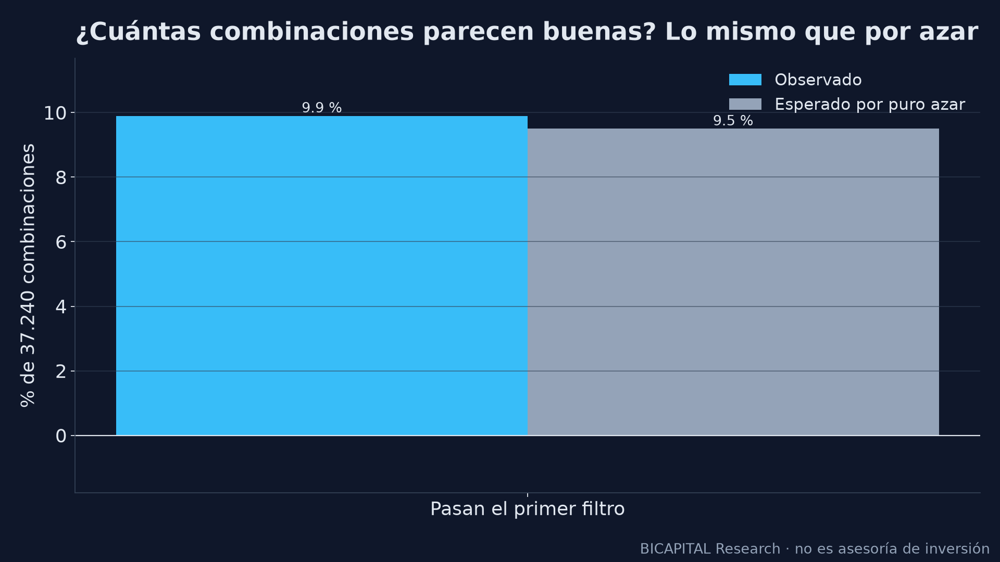
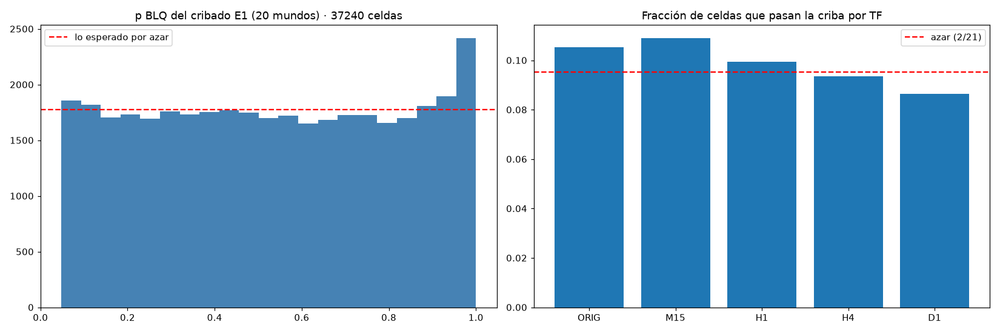
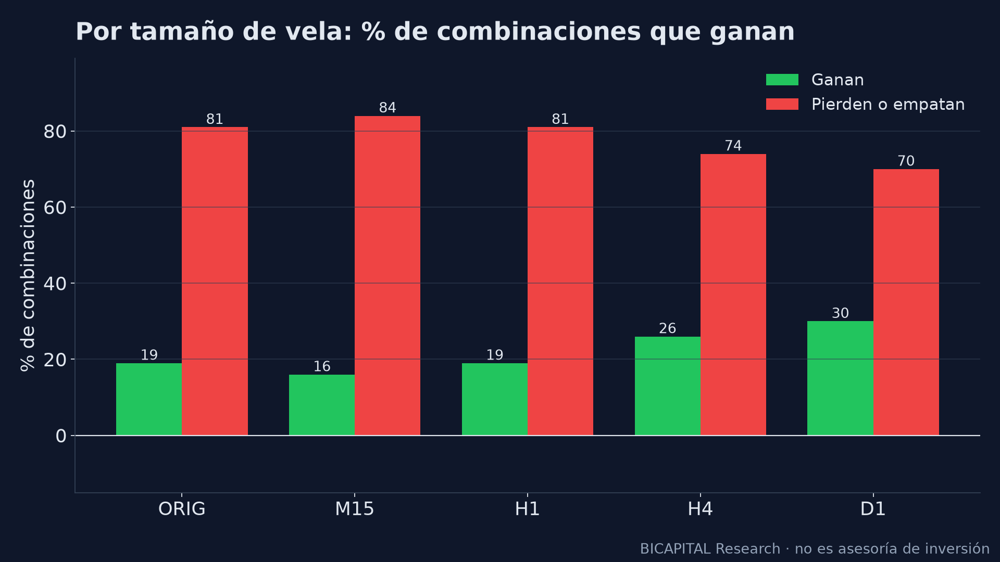
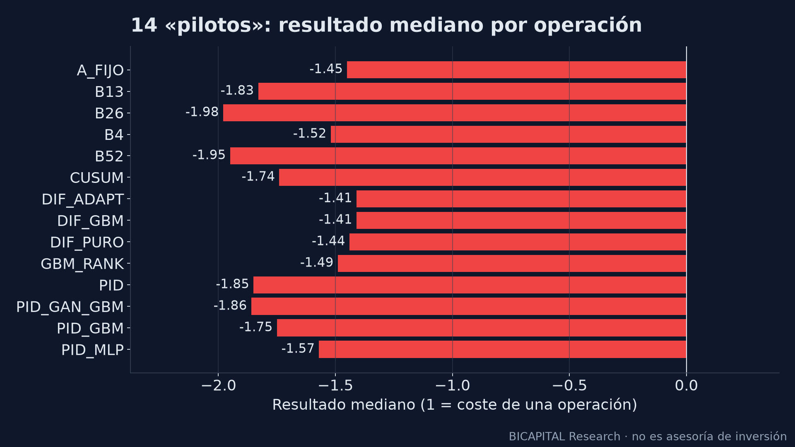
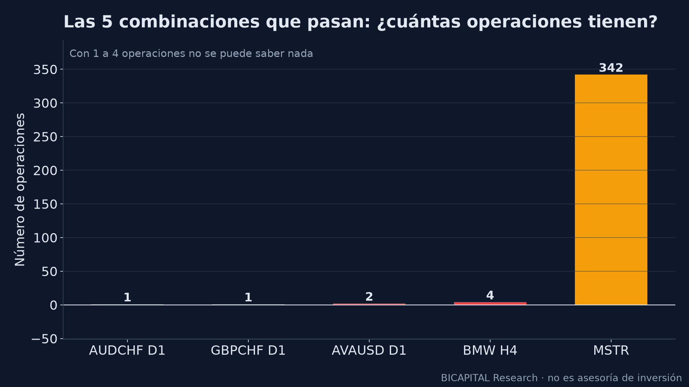

# El termostato en 133 activos y 5 temporalidades: el informe prometido

*Prometimos publicar la réplica del sistema que se recalibra solo, saliera como saliera. Probamos 37.240 combinaciones. Lo que parece bueno aparece casi exactamente tanto como lo que daría el azar.*

Cuando publicamos el sistema que se recalibra solo, como un termostato, dijimos que lo repetiríamos en todos los activos disponibles y en varias temporalidades. Y que publicaríamos el resultado fuera cual fuera. Aquí está.

Spoiler amable: no encontramos una máquina de ganar. Pero el informe enseña algo muy valioso sobre cómo engaña el azar cuando se prueban muchas cosas a la vez.

## Recordatorio en dos líneas

Un **PID** es un controlador que corrige errores, como el termostato de casa. Si la regla de trading empieza a perder, el PID cambia sus parámetros para intentar volver a ganar. En el estudio original, con EURUSD, no consiguió ganar de forma fiable.

Esta vez no probamos solo el PID. Probamos **14 «pilotos»** distintos: el PID clásico, variantes con aprendizaje automático, versiones «difusas» (que razonan con reglas tipo «si el error es grande, corrige mucho»), un piloto que mira solo las últimas semanas y, como referencia, la regla fija sin piloto.

## El tamaño del experimento

- **133 activos:** divisas, índices, acciones, materias primas y criptomonedas. Quitamos 13 por tener menos de 18 meses de datos de prueba o problemas de horario.
- **5 temporalidades:** la temporalidad es el tamaño de cada vela. M15 son velas de 15 minutos; H1, de una hora; H4, de cuatro horas; D1, de un día. ORIG es la mezcla del estudio original.
- **3 estilos de entrada:** ruptura, tendencia y reversión.
- **14 pilotos.**

Multiplicado, salen **37.240 combinaciones**. Cada una se probó en datos que no se usaron para diseñarla (desde mediados de 2022 hasta junio de 2025). Los datos posteriores siguen guardados, sin mirar.

Medimos en «costes»: +1 significa ganar lo que cuesta una operación de ida y vuelta.

## Cómo construimos el azar

Para cada combinación creamos mundos de precios inventados. Se parecen a los reales (mismos movimientos), pero barajados por bloques para romper cualquier patrón. En cada mundo repetimos todo el proceso. Si la combinación real no destaca sobre esos mundos, puede ser suerte.

Para el primer filtro usamos 20 mundos. Una combinación pasaba si quedaba entre las 2 mejores de 21 (la real más los 20 mundos). Por puro azar, eso le pasa a 2 de cada 21: un 9,5 %.

## Primer filtro: tanto como el azar

**Cómo leer el gráfico:** la barra azul es el porcentaje de combinaciones que pasaron el primer filtro: 9,9 % (3.676 de 37.240). La gris es lo que se espera por puro azar: 9,5 %. Están casi a la misma altura.

Es como lanzar una moneda 37.240 veces y contar cuántas veces sale «cara dos veces seguidas». Saldrá muchas veces, y no porque la moneda sea especial.

**Cómo leer el gráfico:** es el gráfico original (rótulos técnicos). A la izquierda, cuántas combinaciones caen en cada tramo de una puntuación que va de 0 (muy por encima del azar) a 1 (muy por debajo). Si no hubiera nada real, las barras serían planas, a la altura de la línea roja. Lo son casi en todo el recorrido. A la derecha, el porcentaje que pasa en cada temporalidad, comparado con la línea roja del azar. Ninguna se separa de verdad.

## Por temporalidad y por piloto

**Cómo leer el gráfico:** verde es el porcentaje de combinaciones con resultado positivo; rojo, las que pierden o quedan igual. En velas cortas (M15) solo gana el 16 %. En velas diarias (D1), el 30 %. Pero ojo: en D1 el resultado mediano por operación fue el peor, −5,68 costes. Ganan más combinaciones, pero las que pierden pierden mucho.

**Cómo leer el gráfico:** cada barra es un piloto. Todas están en rojo: el resultado mediano por operación es negativo en los 14, entre −1,41 y −1,98 costes. La regla fija sin piloto (A_FIJO) queda en −1,45, en medio del grupo. Ningún piloto destaca.

## Las 5 combinaciones que pasaron todos los filtros

Tras el primer filtro aplicamos una corrección estricta por haber probado tantas cosas, con 100 mundos. Pasaron 8 combinaciones con resultado positivo, y 5 cumplieron todas las condiciones que fijamos antes de empezar. ¿Hay que celebrarlo? Mira cuántas operaciones tienen.

**Cómo leer el gráfico:** cada barra es una de las 5 combinaciones. AUDCHF y GBPCHF en velas diarias tienen **1 operación** cada una. AVAUSD, 2. BMW en velas de 4 horas, 4. Con una a cuatro operaciones no se puede saber nada: es como juzgar a un restaurante por un solo plato. Solo MSTR, una acción muy volátil, tiene 342 operaciones.

MSTR con un piloto difuso en tendencia sumó +22.059 costes. Es el único caso que merece seguir mirando. Pero hay que recordar que salió entre 37.240 intentos. Solo los datos guardados dirán si era real.

## Qué significa todo esto

El estudio original con EURUSD no encontró ventaja. Repetirlo en 133 activos y 5 temporalidades tampoco la encuentra de forma general. Lo que aparece como «bueno» aparece en la misma proporción que daría el azar. Y casi todo lo que pasa los filtros más duros tiene tan pocas operaciones que no dice nada.

Publicamos esto porque lo prometimos y porque es útil. Cuando alguien te enseña una estrategia que «funciona en tal activo y tal temporalidad», pregúntale cuántas combinaciones probó antes.

## Qué me llevo

- Probar 37.240 combinaciones fabrica miles de falsos éxitos. Aquí salieron casi exactamente los que predice el azar.
- Ningún piloto, de los 14, mejoró de forma general a la regla fija.
- Una combinación con 1 a 4 operaciones no es una prueba de nada.
- Solo un caso, MSTR, merece una mirada más: la prueba limpia serán los datos que siguen guardados.

*Contenido educativo. No es asesoría de inversión.*
